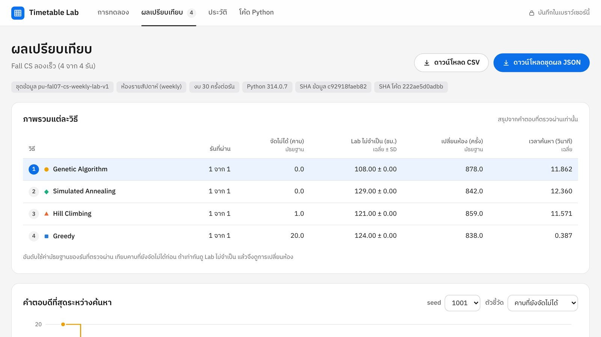

<div align="center">

# 🗓️ Timetable Lab

**ห้องทดลองเทียบ 4 อัลกอริทึมจัดตารางเรียน ที่บางสัปดาห์ต้องใช้ห้อง Computer Lab**

ศึกษาโจทย์ที่ตั้งขึ้นเอง: วันเวลาเรียนคงที่ทั้งเทอม แต่ห้องเปลี่ยนได้รายสัปดาห์
ผลทุกชุดรันด้วย engine C# และเปิดดูในเว็บได้โดยไม่ต้องติดตั้งอะไร

[](https://micosz.github.io/CS373_CourseTimetablingLab/)
[](https://cs373presentation.vercel.app/)
[](https://github.com/Micosz/CS373_CourseTimetablingLab/actions/workflows/checks.yml)
[](LICENSE)




ภาพนี้ถ่ายจากเว็บรุ่นก่อนหน้าและชุดข้อมูลก่อนหน้า ตัวเลขในภาพไม่ใช่ผลปัจจุบัน

▶️ **[เปิดใช้เว็บ](https://micosz.github.io/CS373_CourseTimetablingLab/)**, 📊 **[ดูสไลด์นำเสนอ](https://cs373presentation.vercel.app/)**, 🚀 **[คู่มือเริ่มใช้ 3 ขั้น](docs/quick-start.md)**

</div>

## โปรเจกต์นี้คืออะไร

สมมติว่าวิชาคอมพิวเตอร์บางวิชาต้องใช้ห้อง Computer Lab **แค่บางสัปดาห์** เช่น 4 จาก 15 สัปดาห์ ที่เหลือเรียนในห้องบรรยายธรรมดาได้
ถ้าจองห้อง Lab ไว้ทั้งเทอม ห้อง Lab ก็จะถูกกันไว้ในสัปดาห์ที่ไม่ได้ใช้

Timetable Lab ตั้งโจทย์ให้ **วันและเวลาเรียนคงที่ทั้งเทอม แต่ห้องเปลี่ยนได้ตามสัปดาห์** แล้วให้ 4 อัลกอริทึมจัดตาราง
บนข้อมูลเดียวกัน งบเท่ากัน และใช้ตัวตรวจคำตอบตัวเดียวกัน

นี่คือ **การศึกษาโจทย์ที่ตั้งขึ้นเอง** ความต้องการ Lab ในข้อมูลเป็นค่าจำลอง ผลจึงบอกว่าอัลกอริทึมทำงานอย่างไรบนโจทย์นี้ ไม่ได้เป็นข้อค้นพบเกี่ยวกับมหาวิทยาลัยจริง และไม่ได้พิสูจน์ว่าห้องรายสัปดาห์ดีกว่าห้องคงที่

หลักการทำงานแบบสั้น ๆ:

1. อัลกอริทึมเลือก **ลำดับคลาส** ว่าจะจัดคลาสไหนก่อน และ **ช่วงเวลาที่อยากลองก่อน** ของแต่ละคลาส
2. ตัวจัดตาราง (decoder) จัดทีละคลาสตามลำดับนั้น ใส่ห้องทีละสัปดาห์โดยไม่ละเมิดข้อห้าม ถ้าใส่ไม่ได้จะเว้นคาบนั้นไว้
3. ตัวตรวจอิสระนับคะแนนจากตารางที่ได้ แล้วอัลกอริทึมเอาคะแนนไปปรับลำดับรอบถัดไป วนจนหมดงบ

คำที่จะเจอบ่อยในหน้านี้:

- **คาบรายสัปดาห์ (weekly session)** คาบเรียนหนึ่งคาบในหนึ่งสัปดาห์ ข้อมูลนี้มีทั้งหมด 3,345 คาบ (223 คาบประจำของ 174 คลาส × 15 สัปดาห์)
- **คาบที่ยังจัดไม่ได้** คาบที่หาห้องหรือเวลาที่ไม่ชนไม่ได้ ยิ่งน้อยยิ่งดี และสำคัญที่สุด
- **Lab ไม่จำเป็น** ชั่วโมงที่คาบไปใช้ห้อง Lab ในสัปดาห์ที่ไม่ได้ต้องใช้ Lab (กันห้องไว้โดยไม่ได้ใช้ประโยชน์)
- **เปลี่ยนห้อง** จำนวนครั้งที่คาบเดียวกันย้ายห้องจากสัปดาห์ก่อน
- **งบ (evaluation)** จำนวนครั้งที่ให้จัดตารางเต็มทั้งเทอมแล้วคิดคะแนน ทุกวิธีได้งบเท่ากัน
- **seed** ตัวเลขตั้งต้นของการสุ่ม ใช้ seed เดิมจะได้ผลเดิม
- **โหมดห้อง** `weekly` ห้องเปลี่ยนได้รายสัปดาห์ (ค่าเริ่มต้น) ส่วน `fixed` คาบหนึ่งจองห้องเดียวทั้งเทอม (ไว้เป็นจุดอ้างอิง)

4 วิธีที่แข่งกัน:

| วิธี | ทำงานยังไง |
|---|---|
| **Greedy** | จัดคลาสที่มีทางเลือกน้อยที่สุดก่อน จัดรอบเดียวจบ ใช้เป็นเส้นฐาน |
| **Hill Climbing (HC)** | สุ่มแก้ทีละนิด ถ้าดีขึ้นก็รับ ถ้าติดนานเกินไปก็สุ่มเริ่มใหม่ |
| **Simulated Annealing (SA)** | เหมือน HC แต่บางครั้งยอมรับคำตอบที่แย่ลง เพื่อหนีจุดที่ติดอยู่ ยิ่งรันนานยิ่งยอมน้อยลง |
| **Genetic Algorithm (GA)** | เก็บคำตอบไว้เป็นประชากร คัดตัวดีมาผสมกันและกลายพันธุ์ไปเรื่อย ๆ |

## ผลที่ได้

ทุกการทดลองรันใหม่เมื่อ 2026-11-19 บนชุดข้อมูลปัจจุบัน (Fall CS Weekly Labs v2) ด้วย engine C#
การทดลองสุดท้าย: 4 วิธี × 30 seed × 2 โหมดห้อง งบ 500 ครั้งต่อรัน รวม 240 รัน **ผ่านตัวตรวจอิสระครบทุกรัน**

- ✅ **HC, SA และ GA ดีกว่า Greedy ทุก seed** (30/30, p < 0.001) Greedy ขาด 14 คาบทุก seed ส่วนวิธีค้นหาจัดครบ 26 ถึง 29 จาก 30 รัน ที่งบ 500 จึงยังจัดไม่ครบทุกรัน
- ⚖️ **ที่งบ 500 HC, SA และ GA ยังแยกกันไม่ได้ทางสถิติ** Lab ไม่จำเป็นเฉลี่ย SA 145.8, GA 146.9, HC 169.4 ชม. ต่อเทอม (Greedy 242.0) และ p ปรับแล้วระหว่างสามวิธีอยู่ที่ 0.102 ถึง 0.666
- ⏱️ **ข้อสรุปขึ้นกับงบ** ทุกรันจัดครบตั้งแต่งบ 1,000 และ SA เหลือ Lab ไม่จำเป็น 0 ชม. ครบ 10 seed ตั้งแต่งบ 10,000 ที่งบ 50,000 SA ดีกว่า GA และ HC อย่างมีนัยสำคัญ (p = 0.012) และได้จำนวนเปลี่ยนห้อง 596 ครั้งเท่ากับค่าต่ำสุดที่ข้อมูลบังคับทุก seed ([convergence](experiments/convergence/README.md))
- 🏫 **โหมดห้องคงที่ (fixed) จัดไม่ครบสักรัน** ขาดเฉลี่ย 179 ถึง 285 คาบ และมี Lab ไม่จำเป็นราว 2,020 ถึง 2,050 ชม. ต่อเทอม ข้อนี้เป็นไปตามที่ตั้งโจทย์ไว้ ใช้เป็นจุดอ้างอิง ไม่ใช่ข้อค้นพบ
- 🔁 **เปลี่ยนห้องราว 621 ครั้งต่อเทอม** อยู่ที่ 1.04 ถึง 1.05 เท่าของค่าต่ำสุดที่เป็นไปได้ (596 ครั้ง) ส่วนใหญ่จึงเลี่ยงไม่ได้
- 📆 **วิชา Lab ใช้ Lab ได้ถึง 4 สัปดาห์โดยยังจัดครบ** ตั้งแต่ 6 จาก 15 สัปดาห์ไม่มีรันไหนจัดครบที่งบ 500 ขอบเขตจึงอยู่ระหว่าง 4 กับ 6 สัปดาห์ ([lab-weeks](experiments/lab-weeks/README.md))
- 🧪 **ถ้า Lab เหลือ 3 ห้อง** โหมดห้องรายสัปดาห์จัดครบเพียง 1 ถึง 4 จาก 10 รัน (เหลือเฉลี่ย 1.5 ถึง 3.8 คาบ) และเหลือ 2 ห้องไม่ครบสักรัน ([lab-scarcity](experiments/lab-scarcity/README.md))
- 🔎 **Lab ไม่จำเป็นที่เหลือมาจากการเลือกเวลา** ไม่มีครั้งไหนที่คาบนั่ง Lab ทั้งที่มีห้องบรรยายว่าง และเกือบทั้งหมดเป็นคาบบรรยายล้วนที่ห้องบรรยายเต็ม ([lab-hours-breakdown](experiments/lab-hours-breakdown/README.md))
- 📅 **สัปดาห์ Lab ติดกันหรือเว้นสัปดาห์** วิธีค้นหายังดีกว่า Greedy ลำดับระหว่างสามวิธีเปลี่ยนตามรูปแบบ และจำนวนครั้งย้ายห้องต่างกันมาก (ราว 225 ถึง 850 ครั้งต่อเทอม) ([lab-week-patterns](experiments/lab-week-patterns/README.md))

ตัวเลข สถิติ และกราฟทั้งหมดอยู่ใน [experiments/final/analysis/report.md](experiments/final/analysis/report.md)
ผลทุกชุด (จูนพารามิเตอร์ งบและการรันจนผลนิ่ง จำนวนสัปดาห์ Lab Lab ขาดแคลน รูปแบบสัปดาห์ Lab) สรุปไว้ใน [experiments/INDEX.md](experiments/INDEX.md)

> **ข้อจำกัด** ผลทั้งหมดมาจากชุดข้อมูลดัดแปลงชุดเดียว ความต้องการ Lab สร้างขึ้นเอง (สุ่มเลือกวิชา Lab ครั้งเดียว) และการระบุคาบปฏิบัติเป็นการอนุมานจากรูปแบบเวลาเรียน ไม่ใช่ข้อมูลจากต้นฉบับ
> งบ 500 เล็ก ข้อสรุปเรื่องการจัดครบและลำดับวิธีเปลี่ยนตามงบ พารามิเตอร์ทุกวิธีจูนที่งบ 500 ไม่มีตารางที่คนจัดจริงมาเทียบ (Greedy เป็นตัวแทนการจัดตามกฎง่าย ๆ เท่านั้น) และยังไม่ได้วัดผลของการย้ายห้องต่อนักศึกษา

## จุดเด่น

- 🌐 **เปิดดูผลในเบราว์เซอร์ได้เลย** เว็บเป็นไฟล์ static ไม่มี server ไม่มีการส่งข้อมูลออกไปไหน และไม่รันอัลกอริทึมในเบราว์เซอร์
- ⚖️ **เทียบอย่างยุติธรรม** ทุกวิธีเริ่มจากคำตอบตั้งต้นเดียวกัน ใช้งบเท่ากัน และใช้ข้อมูล ข้อห้าม และตัวนับคะแนนชุดเดียวกัน
- 🔍 **ตัวตรวจคำตอบอิสระ** ตรวจตารางจากข้อมูลดิบใหม่ทุกครั้ง ไม่เชื่อคะแนนที่อัลกอริทึมรายงานมาเอง
- 🗺️ **ดูตารางที่ได้หลายมุมมอง** ตารางรายสัปดาห์, ผังห้องกับเวลา, heatmap การใช้ Lab และห้องของแต่ละคลาสทั้ง 15 สัปดาห์
- 💾 **ผลดิบ commit ไว้ครบ** ทุกรันมีตารางคำตอบ trace และผลตรวจใน `experiments/` ส่งออก CSV เปิดใน Excel ได้ (ภาษาไทยไม่เพี้ยน)
- ⚙️ **ตัวแก้ปัญหามีตัวเดียวคือ engine C#** ผลที่ commit ไว้ทั้งหมดมาจาก engine นี้ ส่วน Python ใน `engine/` เป็นเครื่องมือวิเคราะห์ จูน และตรวจชุดข้อมูล
- 🎮 **แอปเดสก์ท็อป Godot** ดูห้องเปลี่ยนไปทีละสัปดาห์แบบภาพเคลื่อนไหว และเทียบ weekly กับ fixed ข้างกัน

## เลือกวิธีใช้

ถ้าไม่แน่ใจ ให้เริ่มจากแบบแรก เพราะไม่ต้องลงอะไรเลย

| อยากทำอะไร | ใช้แบบไหน | ต้องมีอะไร |
|---|---|---|
| ดูชุดข้อมูล ผลเปรียบเทียบ และตารางที่ได้ | **[เว็บ](https://micosz.github.io/CS373_CourseTimetablingLab/)** | Chrome, Edge หรือ Firefox รุ่นใหม่ |
| รันการทดลองใหม่ | **C# engine** ([dotnet/README.md](dotnet/README.md)) แล้วเปิดไฟล์ผลในเว็บ | .NET 8 SDK |
| วิเคราะห์ผล จูน สร้างชุดข้อมูลซ้ำ | **สคริปต์ Python** (`engine/analyze.py`, `engine/tune.py`, `dataset_tools/`) | Python 3.9+ ไม่ต้องลง package เพิ่ม |
| ดูห้องเปลี่ยนรายสัปดาห์แบบภาพเคลื่อนไหว | **แอป Godot** ([apps/godot/README.md](apps/godot/README.md)) | Godot 4.7 .NET |
| นำเสนองาน | **[สไลด์](https://cs373presentation.vercel.app/)** ([apps/slides/](apps/slides/README.md)) | เบราว์เซอร์ |

## เริ่มใช้งาน

### ใช้เว็บ (3 ขั้น)

1. เปิด **https://micosz.github.io/CS373_CourseTimetablingLab/** หน้า **ข้อมูล** แสดงชุดข้อมูล Fall CS และตารางว่าวิชาไหนใช้ Lab สัปดาห์ไหน
2. ไปที่หน้า **ผลที่เก็บไว้** แล้วเปิดชุดผลที่รันไว้แล้ว (การทดลองสุดท้าย ชุดงบ 50,000 หรือชุดจำนวนสัปดาห์ Lab) หรือนำเข้า `experiment.json.gz` ของตัวเอง
3. ดูหน้า **ผลเปรียบเทียบ**: ตารางสรุปต่อวิธี กราฟ และส่วน **ตรวจตารางที่ได้** แล้วกดดาวน์โหลด CSV ได้

วิธีอ่านผล: วิธีที่ดีกว่าคือวิธีที่มี **คาบที่ยังจัดไม่ได้** น้อยกว่า ถ้าเท่ากันดู **Lab ไม่จำเป็น** แล้วจึงดู **เปลี่ยนห้อง**
คู่มืออยู่ใน [docs/quick-start.md](docs/quick-start.md)

### เปิดเว็บบนเครื่องตัวเอง

ไม่มีขั้นตอน build และไม่มี backend เสิร์ฟไฟล์จาก root ของโปรเจกต์:

```bash
python -m http.server 8766 --bind 127.0.0.1
```

แล้วเปิด `http://127.0.0.1:8766/apps/web/` (อย่าเปิด `index.html` ตรง ๆ แบบ `file://` เพราะเว็บต้องโหลดไฟล์ผ่าน HTTP)

### รันการทดลองด้วย engine C#

ต้องมี .NET 8 SDK รันจาก root ของโปรเจกต์:

```bash
dotnet build -c Release dotnet/src/Timetabling.Cli
```

รันชุดเดียวกับการทดลองสุดท้าย (หยุดกลางทางได้ รันคำสั่งเดิมซ้ำจะทำต่อจากที่ค้างไว้):

```bash
dotnet run -c Release --no-build --project dotnet/src/Timetabling.Cli -- batch run --methods greedy hc sa ga --room-modes weekly fixed --seeds 1001-1030 --budget 500 --seconds 3600 --parameters experiments/tuning/selected-parameters.json --output results/final
```

สร้างตาราง สถิติ และกราฟจากผลที่ได้:

```bash
python engine/analyze.py results/final/experiment.json.gz --output results/final/analysis
```

ไฟล์ `experiment.json.gz` ที่ได้เปิดในเว็บได้ที่หน้า **ผลที่เก็บไว้** คำสั่งของแต่ละชุดการทดลองอยู่ใน README ของชุดนั้น และกติกาการทดลอง (seed สำหรับจูนและทดสอบ งบ และสถิติ) อยู่ใน [docs/protocol.md](docs/protocol.md)

### รันเทสต์

```bash
python -m unittest discover -s engine/tests -v
```

```bash
dotnet test dotnet/Timetabling.sln --filter "Category!=Slow"
```

เทสต์ Python มี 19 รายการ ครอบคลุมเครื่องมือวิเคราะห์และชุดข้อมูล ตัวแก้ปัญหามีเฉพาะใน `dotnet/` โฟลเดอร์ `engine/` เหลือเครื่องมือ Python: `analyze.py` (สถิติและรายงาน), `tune.py` (จูน โดยสั่ง CLI ของ C#), `input_validation.py` และ `solution_validator.py` (ตัวตรวจ)

ก่อนลบตัวแก้ปัญหาภาษา Python ออกจาก repo ได้รัน 16 รันของการทดลองสุดท้าย (4 วิธี × 2 โหมดห้อง × seed 1001–1002) ด้วยตัวนั้นบนชุดข้อมูลใหม่ ได้ metric ตารางคำตอบ และ trace ตรงกับผลของ C# ทุกรัน การตรวจนี้ทำซ้ำจากโค้ดปัจจุบันไม่ได้แล้ว ตัวแก้ปัญหาภาษา Python อยู่ใน git history เท่านั้น (มีอยู่ครั้งสุดท้ายที่ commit 6d33611 บน main)

## ข้อมูลที่ใช้

- ต้นฉบับคือชุดข้อมูล Purdue Fall 2007 CS (`pu-fal07-cs`) จาก [UniTime](https://www.unitime.org/uct_datasets.php)
- เป็น **ข้อมูลดัดแปลง** ไม่ใช่ตารางจริงของมหาวิทยาลัยไทย ต้นฉบับไม่มีห้อง Lab และไม่มีความต้องการ Lab รายสัปดาห์
- **ส่วนที่สร้างขึ้นเอง:** Computer Lab จำลอง 4 ห้อง (61, 36, 30, 26 ที่นั่ง) และความต้องการ Lab ([assumption A10](data/assumptions.json), [config](dataset_tools/config.json))
  - ความต้องการ Lab กำหนดเป็นรายวิชา และตกที่ **คาบปฏิบัติ** ของวิชาเท่านั้น
  - ต้นฉบับไม่บอกว่าส่วนไหนของวิชาเป็นงานปฏิบัติ คาบปฏิบัติจึง **อนุมานจากรูปแบบเวลาเรียน** (วิชาหลายส่วนใช้ส่วนที่คาบยาวที่สุด วิชาส่วนเดียวนับเฉพาะที่เรียนสัปดาห์ละครั้ง) ได้ 27 จาก 44 วิชา
  - สุ่มเลือก 20 วิชาเป็นวิชา Lab ด้วย seed `20261119` รวม 106 จาก 223 คาบประจำ ทุกกลุ่มเรียนของวิชาเดียวกันใช้ Lab 4 จาก 15 สัปดาห์ชุดเดียวกัน รวม 800 ชั่วโมง Lab ต่อเทอม
  - จำนวนวิชา Lab และ 4 สัปดาห์ตั้งเอง ไม่ได้มาจากการสำรวจวิชาจริง
- 174 คลาส, 44 วิชา, ห้องบรรยาย 13 ห้อง, 15 สัปดาห์, 3,345 คาบรายสัปดาห์
- สมมติฐานทุกข้อบันทึกไว้ใน [data/assumptions.json](data/assumptions.json) และสร้างชุดข้อมูลซ้ำได้ด้วย `dataset_tools/rebuild.py`

## ควรรู้ก่อนใช้

- **เว็บไม่รันอัลกอริทึม** ผลที่เห็นมาจากไฟล์ที่ engine C# สร้างไว้ ถ้าจะได้ผลใหม่ต้องรัน CLI แล้วนำไฟล์เข้าเว็บ
- **ผลที่นำเข้าเก็บในเบราว์เซอร์เครื่องนี้เท่านั้น** ถ้าล้างข้อมูลเว็บ เปลี่ยนเบราว์เซอร์ หรือใช้โหมดส่วนตัว รายการที่นำเข้าจะหาย ให้เก็บไฟล์ต้นทางไว้
- **อย่าสรุปผู้ชนะจากรันเดียว** ผลที่รายงานใช้ 30 seed และที่งบ 500 วิธีค้นหาทั้งสามยังแยกกันไม่ได้
- **ตารางอาจยังไม่ครบ** ทุกตารางที่ได้ไม่ละเมิดข้อห้าม แต่อาจมีคาบที่ยังจัดไม่ได้ จะเรียกว่าจัดครบได้ก็ต่อเมื่อคาบที่ยังจัดไม่ได้เป็น 0
- **เวลาที่ใช้ขึ้นกับเครื่อง** ใช้เทียบข้ามเครื่องตรง ๆ ไม่ได้ จึงวัดความยุติธรรมด้วยจำนวนครั้งที่ประเมินคำตอบแทนเวลา
- **นี่คือห้องทดลองเพื่อการศึกษา** ไม่ใช่ระบบจัดตารางที่สถาบันใช้งานจริง

## เอกสาร

| หน้า | มีอะไร |
|---|---|
| 🚀 [เริ่มใช้ 3 ขั้น](docs/quick-start.md) | เปิดเว็บดูชุดข้อมูลและผลที่เก็บไว้ |
| 🔧 [รายละเอียดเชิงเทคนิค](docs/technical.md) | วิธีแทนคำตอบ ข้อห้ามและเป้าหมาย ความเท่าเทียม การรันบนเครื่อง การสร้างชุดข้อมูลซ้ำ |
| 📏 [กติกาการทดลอง](docs/protocol.md) | seed สำหรับจูนและทดสอบ งบ และสถิติที่ใช้ |
| 📈 [ผลทดลองทั้งหมด](experiments/INDEX.md) | ทุกชุดการทดลองพร้อมข้อสรุปและไฟล์ผลดิบ |
| 📚 [เทียบกับงานวิจัย](docs/research-comparison.md) | การตัดสินใจแต่ละข้อมาจากงานไหน และต่างกันตรงไหน |
| 🗂️ [แผนที่ repository](docs/INDEX.md) | ทุกโฟลเดอร์และไฟล์สำคัญมีหน้าที่อะไร |
| ⚡ [C# engine](dotnet/README.md) | engine ที่ใช้ผลิตผลทดลอง และคำสั่ง CLI |
| 🎮 [แอป Godot](apps/godot/README.md) (อังกฤษ) | แผนที่ห้องรายสัปดาห์ รันสด และเทียบ weekly/fixed |

## โครงสร้าง repo

```
apps/web/        เว็บดูชุดข้อมูลและผลที่เก็บไว้
apps/slides/     สไลด์นำเสนอ (deploy บน Vercel)
apps/godot/      แอปเดสก์ท็อป Godot (C#)
engine/          เครื่องมือ Python: วิเคราะห์ผล จูน (สั่ง CLI ของ C#) ตัวตรวจชุดข้อมูลและคำตอบ และ unit test
dotnet/          engine C# ตัวแก้ปัญหาตัวเดียวของ repo + CLI "timetabling" + tests
data/            ชุดข้อมูลดัดแปลง สมมติฐาน และที่มาของข้อมูล
dataset_tools/   สคริปต์สร้าง data/ ซ้ำ
experiments/     ผลดิบของทุกการทดลอง (JSON.gz + CSV + สรุป)
docs/            คู่มือ กติกา เอกสารเทคนิค และการเทียบงานวิจัย
```

## แก้ปัญหา

| อาการ | วิธีแก้ |
|---|---|
| เปิด `index.html` แล้วหน้าว่างหรือโหลดข้อมูลไม่ได้ | อย่าเปิดแบบ `file://` ให้รัน `python -m http.server` จาก root ของโปรเจกต์ แล้วเปิดผ่าน `http://127.0.0.1:8766/apps/web/` |
| รายการผลที่นำเข้าหายไป | รายการผูกกับเบราว์เซอร์และที่อยู่เว็บ (localhost กับ GitHub Pages คนละชุดกัน) นำเข้าไฟล์ `experiment.json.gz` อีกครั้งได้ที่หน้าผลที่เก็บไว้ |
| อยากได้ผลของงบหรือ seed อื่น | เว็บไม่รันอัลกอริทึม ใช้ CLI ของ engine C# ตาม [dotnet/README.md](dotnet/README.md) แล้วนำไฟล์ผลเข้าเว็บ |
| seed เดิมแต่ผลไม่ตรง | ผลจะตรงกันเมื่อใช้ชุดข้อมูล โค้ด engine และพารามิเตอร์เดียวกัน และรันไม่ถูกตัดด้วยเวลาสูงสุดกลางทาง |

## เครดิต

- ชุดข้อมูลต้นฉบับ: Purdue Fall 2007 CS จาก [UniTime](https://www.unitime.org/uct_datasets.php)
- แนวคิดของแต่ละวิธีมาจากงานวิจัยที่สรุปไว้ใน [docs/research-comparison.md](docs/research-comparison.md)

## สัญญาอนุญาต

โค้ดและเอกสารของโปรเจกต์ใช้ [MIT](LICENSE) ส่วนข้อมูลต้นฉบับจาก UniTime/Purdue ยังเป็นสิทธิ์ของผู้ให้ข้อมูลเดิม
รายละเอียดสิทธิ์ที่แยกกันระหว่างโค้ดกับข้อมูล และเครื่องมือที่ใช้พัฒนา อยู่ใน [NOTICE](NOTICE)
