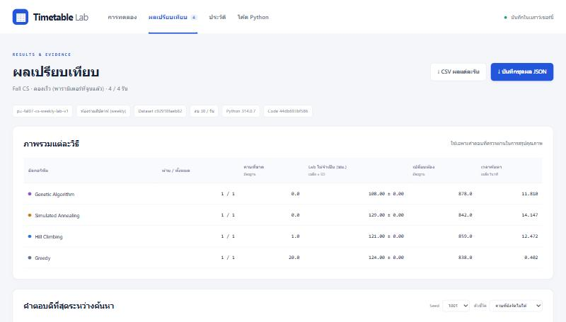

<div align="center">

# 🗓️ Timetable Lab

**ห้องทดลองเทียบ 4 อัลกอริทึมจัดตารางเรียน ที่บางสัปดาห์ต้องใช้ห้อง Computer Lab**

เปิดในเบราว์เซอร์แล้วกดรันได้เลย ไม่ต้องติดตั้งอะไร
ดูได้ทันทีว่าวิธีไหนจัดตารางได้ครบกว่า และเปลืองห้อง Lab น้อยกว่า

[](https://micosz.github.io/course-timetabling-lab/)
[](https://cs373presentation.vercel.app/)
[](https://github.com/Micosz/CS373_CourseTimetablingLab/actions/workflows/checks.yml)
[](LICENSE)




▶️ **[เปิดใช้เว็บ](https://micosz.github.io/course-timetabling-lab/)** · 📊 **[ดูสไลด์นำเสนอ](https://cs373presentation.vercel.app/)** · 🚀 **[คู่มือเริ่มใช้ 3 ขั้น](docs/quick-start.md)**

</div>

## โปรเจกต์นี้คืออะไร

วิชาคอมพิวเตอร์หลายวิชาต้องใช้ห้อง Computer Lab **แค่บางสัปดาห์** เช่น 4 จาก 15 สัปดาห์ ที่เหลือเรียนในห้องบรรยายธรรมดาได้
ถ้าจองห้อง Lab ไว้ทั้งเทอม ห้อง Lab ก็จะว่างเปล่าเกือบทั้งเทอม แต่วิชาอื่นใช้ไม่ได้

Timetable Lab ลองให้ **วันและเวลาเรียนคงที่ทั้งเทอม แต่ห้องเปลี่ยนได้ตามสัปดาห์** แล้วให้ 4 อัลกอริทึมแข่งกันจัดตาราง
บนข้อมูลเดียวกัน งบเท่ากัน และใช้ตัวตรวจคำตอบตัวเดียวกัน

หลักการทำงานแบบสั้น ๆ:

1. อัลกอริทึมเลือก **ลำดับคลาส** ว่าจะจัดคลาสไหนก่อน และ **ช่วงเวลาที่อยากลองก่อน** ของแต่ละคลาส
2. ตัวจัดตาราง (decoder) จัดทีละคลาสตามลำดับนั้น ใส่ห้องทีละสัปดาห์โดยไม่ละเมิดข้อห้าม ถ้าใส่ไม่ได้จะเว้นคาบนั้นไว้
3. ตัวตรวจอิสระนับคะแนนจากตารางที่ได้ แล้วอัลกอริทึมเอาคะแนนไปปรับลำดับรอบถัดไป วนจนหมดงบ

คำที่จะเจอบ่อยในหน้านี้:

- **คาบรายสัปดาห์ (weekly session)** คาบเรียนหนึ่งคาบในหนึ่งสัปดาห์ ข้อมูลนี้มีทั้งหมด 3,345 คาบ (174 คลาส × 15 สัปดาห์)
- **คาบที่ยังจัดไม่ได้** คาบที่หาห้องหรือเวลาที่ไม่ชนไม่ได้ ยิ่งน้อยยิ่งดี และสำคัญที่สุด
- **Lab ไม่จำเป็น** ชั่วโมงที่คาบไปใช้ห้อง Lab ในสัปดาห์ที่ไม่ได้ต้องใช้ Lab (กันห้องไว้โดยไม่ได้ใช้ประโยชน์)
- **เปลี่ยนห้อง** จำนวนครั้งที่คาบเดียวกันย้ายห้องจากสัปดาห์ก่อน
- **งบ (evaluation)** จำนวนครั้งที่ให้จัดตารางเต็มทั้งเทอมแล้วคิดคะแนน ทุกวิธีได้งบเท่ากัน
- **seed** ตัวเลขตั้งต้นของการสุ่ม ใช้ seed เดิมจะได้ผลเดิม
- **โหมดห้อง** `weekly` ห้องเปลี่ยนได้รายสัปดาห์ (ค่าเริ่มต้น) · `fixed` คาบหนึ่งจองห้องเดียวทั้งเทอม (ไว้เทียบ)

4 วิธีที่แข่งกัน:

| วิธี | ทำงานยังไง |
|---|---|
| **Greedy** | จัดคลาสที่มีทางเลือกน้อยที่สุดก่อน จัดรอบเดียวจบ ใช้เป็นเส้นฐาน |
| **Hill Climbing (HC)** | สุ่มแก้ทีละนิด ถ้าดีขึ้นก็รับ ถ้าติดนานเกินไปก็สุ่มเริ่มใหม่ |
| **Simulated Annealing (SA)** | เหมือน HC แต่บางครั้งยอมรับคำตอบที่แย่ลง เพื่อหนีจุดที่ติดอยู่ ยิ่งรันนานยิ่งยอมน้อยลง |
| **Genetic Algorithm (GA)** | เก็บคำตอบไว้เป็นประชากร คัดตัวดีมาผสมกันและกลายพันธุ์ไปเรื่อย ๆ |

## ผลที่ได้

การทดลองสุดท้าย: 4 วิธี × 30 seed × 2 โหมดห้อง งบ 500 ครั้งต่อรัน รวม 240 รัน **ผ่านตัวตรวจอิสระครบทุกรัน**

- ✅ **HC, SA และ GA จัดครบทุกคาบใน 30/30 seed** ส่วน Greedy ขาด 20 คาบทุก seed
- 🥇 **GA ดีที่สุดในภาพรวม** ใช้ Lab ไม่จำเป็นเฉลี่ย 57.7 ชม. ต่อเทอม เทียบกับ HC 64.9 และ SA 76.2 ชม.
  GA ดีกว่า SA อย่างมีนัยสำคัญ แต่ **GA กับ HC ยังแยกกันไม่ได้ทางสถิติ**
- 🏫 **ห้องคงที่ (fixed) แย่กว่าทุกวิธีทุก seed** Lab ถูกกันไว้โดยไม่ได้ใช้เพิ่มราว 1,800–1,950 ชม. ต่อเทอม
  และยังจัดไม่ได้ 150–390 คาบ เพราะ Lab 4 ห้องไม่พอให้จองทั้งเทอม
- 🔁 **เปลี่ยนห้องราว 831 ครั้งต่อเทอม** ห่างจากค่าต่ำสุดที่เป็นไปได้ (783 ครั้ง) แค่ 1.06 เท่า ส่วนใหญ่จึงเลี่ยงไม่ได้
- 🧪 **ถ้า Lab เหลือ 3 ห้อง** โหมดห้องรายสัปดาห์ยังจัดครบทุกคาบ ส่วนโหมดห้องคงที่จัดไม่ครบตั้งแต่มี Lab 4 ห้องแล้ว

ตัวเลข สถิติ และกราฟทั้งหมดอยู่ใน [experiments/final/analysis/report.md](experiments/final/analysis/report.md)
ผลทุกชุด (จูนพารามิเตอร์ งบ Lab ขาดแคลน ความเร็ว engine) สรุปไว้ใน [experiments/INDEX.md](experiments/INDEX.md)

> ผลทั้งหมดนี้มาจากชุดข้อมูลดัดแปลงชุดเดียว ใช้บอกว่าวิธีไหนดีกว่าบนโจทย์นี้ ไม่ได้บอกว่าดีกว่าในทุกโจทย์จัดตาราง

## จุดเด่น

- 🌐 **เปิดในเบราว์เซอร์ได้เลย** Python ทั้ง engine รันในเบราว์เซอร์ผ่าน Pyodide ไม่มี server ไม่มีการส่งข้อมูลออกไปไหน
- ⚖️ **เทียบอย่างยุติธรรม** ทุกวิธีเริ่มจากคำตอบตั้งต้นเดียวกัน ใช้งบเท่ากัน และใช้ข้อมูล ข้อห้าม และตัวนับคะแนนชุดเดียวกัน
- 🔍 **ตัวตรวจคำตอบอิสระ** ตรวจตารางจากข้อมูลดิบใหม่ทุกครั้ง ไม่เชื่อคะแนนที่อัลกอริทึมรายงานมาเอง
- 🗺️ **ดูตารางที่ได้ 3 มุมมอง** ตารางรายสัปดาห์, heatmap การใช้ Lab และห้องของแต่ละคลาสทั้ง 15 สัปดาห์
- 💾 **ส่งออกหลักฐานได้** CSV เปิดใน Excel ได้ (ภาษาไทยไม่เพี้ยน) และชุดผล JSON ที่นำเข้ากลับเว็บหรือส่งให้คนอื่นตรวจได้
- ✍️ **เขียนอัลกอริทึมของตัวเองได้** วางโค้ด Python ในแท็บโค้ด แล้วแข่งกับ 4 วิธีภายใต้กติกาเดียวกัน
- ⚡ **engine C# เร็วกว่าราว 75–99 เท่า** ได้ผลตรงกับ Python ทุกบิต ใช้รันการทดลองชุดใหญ่
- 🎮 **แอปเดสก์ท็อป Godot** ดูห้องเปลี่ยนไปทีละสัปดาห์แบบภาพเคลื่อนไหว และเทียบ weekly กับ fixed ข้างกัน

## เลือกวิธีใช้

ถ้าไม่แน่ใจ ให้เริ่มจากแบบแรก เพราะไม่ต้องลงอะไรเลย

| อยากทำอะไร | ใช้แบบไหน | ต้องมีอะไร |
|---|---|---|
| ลองเล่น เทียบ 4 วิธี ดูตารางที่ได้ | **[เว็บ](https://micosz.github.io/course-timetabling-lab/)** | Chrome, Edge หรือ Firefox รุ่นใหม่ + อินเทอร์เน็ต |
| รันการทดลองหลาย seed บนเครื่อง | **Python CLI** (`engine/cli.py`, `engine/batch.py`) | Python 3.9+ ไม่ต้องลง package เพิ่ม |
| รันชุดใหญ่ให้เร็ว | **C# engine** ([dotnet/README.md](dotnet/README.md)) | .NET 8 SDK |
| ดูห้องเปลี่ยนรายสัปดาห์แบบภาพเคลื่อนไหว | **แอป Godot** ([apps/godot/README.md](apps/godot/README.md)) | Godot 4.7 .NET |
| นำเสนองาน | **[สไลด์](https://cs373presentation.vercel.app/)** ([apps/slides/](apps/slides/README.md)) | เบราว์เซอร์ |

## เริ่มใช้งาน

### ใช้เว็บ (3 ขั้น)

1. เปิด **https://micosz.github.io/course-timetabling-lab/** แล้วรอจนขึ้นชื่อ **Fall CS · Weekly Labs v1**
   (ครั้งแรกต้องโหลด Python ในเบราว์เซอร์ ราว 10–30 วินาที)
2. ในกล่อง **กำหนดการรัน** กดปุ่ม **ลองเร็ว** ระบบจะกรอกค่าที่จูนแล้วให้ทุกช่อง แล้วกด **▶ เริ่มการทดลอง** (ราว 1 นาที)
3. ดูตารางเปรียบเทียบ กราฟ และส่วน **ตรวจตารางที่ได้** แล้วกดดาวน์โหลด CSV หรือชุดผล JSON

วิธีอ่านผล: วิธีที่ดีกว่าคือวิธีที่มี **คาบที่ยังจัดไม่ได้** น้อยกว่า ถ้าเท่ากันดู **Lab ไม่จำเป็น** แล้วจึงดู **เปลี่ยนห้อง**
คู่มือพร้อมภาพประกอบอยู่ใน [docs/quick-start.md](docs/quick-start.md)

### รันเว็บบนเครื่องตัวเอง

ไม่มีขั้นตอน build และไม่มี backend เสิร์ฟไฟล์จาก root ของโปรเจกต์:

```bash
python3 -m http.server 8766 --bind 127.0.0.1
```

แล้วเปิด `http://127.0.0.1:8766/apps/web/` (อย่าเปิด `index.html` ตรง ๆ แบบ `file://` เพราะเว็บต้องโหลดไฟล์ผ่าน HTTP)

### รันด้วย Python CLI

ใช้ engine ตัวเดียวกับเว็บ ไม่ต้องลง package เพิ่ม:

```bash
python3 engine/cli.py --budget 50 --seconds 60 --seed 42 --repeats 3 --output results
```

เทียบโหมดห้อง weekly กับ fixed บน seed ชุดเดียวกัน:

```bash
python3 engine/cli.py --room-modes weekly fixed --budget 50 --seconds 600 --seed 1001 --repeats 30 --output results
```

รันการทดลองชุดใหญ่หลาย process พร้อมกัน (หยุดกลางทางได้ รันคำสั่งเดิมซ้ำจะทำต่อจากที่ค้างไว้):

```bash
python3 engine/batch.py run --methods greedy hc sa ga --room-modes weekly --seeds 1001-1030 --budget 500 --seconds 3600 --output results/final --workers 8
```

รันเทสต์:

```bash
python3 -m unittest discover -s engine/tests -v
```

ไฟล์ JSON ที่ CLI สร้างนำเข้ากลับเว็บได้ กติกาการทดลองสุดท้าย (seed สำหรับจูนและทดสอบ งบ และสถิติ) อยู่ใน [docs/protocol.md](docs/protocol.md)

## ข้อมูลที่ใช้

- ต้นฉบับคือชุดข้อมูล Purdue Fall 2007 CS (`pu-fal07-cs`) จาก [UniTime](https://www.unitime.org/uct_datasets.php)
- เป็น **ข้อมูลดัดแปลง** ไม่ใช่ตารางจริงของมหาวิทยาลัยไทย: เพิ่ม Computer Lab จำลอง 4 ห้อง (61, 36, 30, 26 ที่นั่ง)
  และสุ่มให้ 134 คาบประจำต้องใช้ Lab คนละ 4 สัปดาห์ (รวม 804 ชั่วโมง)
- 174 คลาส · ห้องบรรยาย 13 ห้อง · 15 สัปดาห์ · 3,345 คาบรายสัปดาห์
- สมมติฐานทุกข้อบันทึกไว้ใน [data/assumptions.json](data/assumptions.json) และสร้างชุดข้อมูลซ้ำได้ด้วย `dataset_tools/rebuild.py`

## ควรรู้ก่อนใช้

- **ผลเก็บในเบราว์เซอร์เครื่องนี้เท่านั้น** ถ้าล้างข้อมูลเว็บ เปลี่ยนเบราว์เซอร์ หรือใช้โหมดส่วนตัว ประวัติจะหาย ผลไหนสำคัญให้ดาวน์โหลดชุดผล JSON เก็บไว้
- **ค่าเริ่มต้นของเว็บยังไม่ใช่ค่าที่จูนแล้ว** ถ้าจะเก็บผลจริงให้กดปุ่ม **ลองเร็ว** หรือ **ตามการทดลองสุดท้าย** และรันหลาย seed (เช่น 30) อย่าสรุปผู้ชนะจากรันเดียว
- **ตารางอาจยังไม่ครบ** ทุกตารางที่ได้ไม่ละเมิดข้อห้าม แต่อาจมีคาบที่ยังจัดไม่ได้ จะเรียกว่าจัดครบได้ก็ต่อเมื่อคาบที่ยังจัดไม่ได้เป็น 0
- **เวลาที่ใช้ขึ้นกับเครื่อง** ใช้เทียบข้ามเครื่องตรง ๆ ไม่ได้ จึงวัดความยุติธรรมด้วยจำนวนครั้งที่ประเมินคำตอบแทนเวลา
- **โค้ดที่เพิ่มเองไม่ได้ถูกแยกสิทธิ์** ใส่เฉพาะโค้ดที่ไว้ใจได้ และควรตรวจโค้ดก่อนใช้เป็นหลักฐาน
- **นี่คือห้องทดลองเพื่อการศึกษา** ไม่ใช่ระบบจัดตารางที่สถาบันใช้งานจริง

## เอกสาร

| หน้า | มีอะไร |
|---|---|
| 🚀 [เริ่มใช้ 3 ขั้น](docs/quick-start.md) | ใช้เว็บครั้งแรก พร้อมภาพประกอบ |
| 🔧 [รายละเอียดเชิงเทคนิค](docs/technical.md) | วิธีแทนคำตอบ ข้อห้ามและเป้าหมาย ความเท่าเทียม การเพิ่มโค้ด Python การสร้างชุดข้อมูลซ้ำ |
| 📏 [กติกาการทดลอง](docs/protocol.md) | seed สำหรับจูนและทดสอบ งบ และสถิติที่ใช้ |
| 📈 [ผลทดลองทั้งหมด](experiments/INDEX.md) | ทุกชุดการทดลองพร้อมข้อสรุปและไฟล์ผลดิบ |
| 📚 [เทียบกับงานวิจัย](docs/research-comparison.md) | การตัดสินใจแต่ละข้อมาจากงานไหน และต่างกันตรงไหน |
| 🗂️ [แผนที่ repository](docs/INDEX.md) | ทุกโฟลเดอร์และไฟล์สำคัญมีหน้าที่อะไร |
| ⚡ [C# engine](dotnet/README.md) | engine ที่เร็วกว่าและได้ผลตรงกับ Python |
| 🎮 [แอป Godot](apps/godot/README.md) (อังกฤษ) | แผนที่ห้องรายสัปดาห์ รันสด และเทียบ weekly/fixed |

## โครงสร้าง repo

```
apps/web/        เว็บห้องทดลอง
apps/slides/     สไลด์นำเสนอ (deploy บน Vercel)
apps/godot/      แอปเดสก์ท็อป Godot (C#)
engine/          Python engine: ตัวจัดตาราง 4 วิธี ตัวตรวจ CLI และ batch runner
dotnet/          engine เดียวกันใน C# + CLI "timetabling" + parity tests
data/            ชุดข้อมูลดัดแปลง สมมติฐาน และที่มาของข้อมูล
dataset_tools/   สคริปต์สร้าง data/ ซ้ำ
experiments/     ผลดิบของทุกการทดลอง (JSON.gz + CSV + สรุป)
docs/            คู่มือ กติกา เอกสารเทคนิค และการเทียบงานวิจัย
```

## แก้ปัญหา

| อาการ | วิธีแก้ |
|---|---|
| เว็บค้างที่ขั้นโหลด Python | ต้องใช้อินเทอร์เน็ตโหลด Pyodide จาก jsDelivr ครั้งแรกอาจใช้ 10–30 วินาที ถ้าเครือข่ายบล็อก jsDelivr ให้ลองเครือข่ายอื่น |
| เปิด `index.html` แล้วหน้าว่างหรือโหลดข้อมูลไม่ได้ | อย่าเปิดแบบ `file://` ให้รัน `python3 -m http.server` จาก root ของโปรเจกต์ แล้วเปิดผ่าน `http://127.0.0.1:8766/apps/web/` |
| ประวัติการรันหายไป | ประวัติผูกกับเบราว์เซอร์และที่อยู่เว็บ (localhost กับ GitHub Pages คนละชุดกัน) นำเข้าไฟล์ JSON ที่ดาวน์โหลดไว้ได้ในแท็บประวัติ |
| รันในเว็บนานมาก | ลดงบหรือจำนวน seed ถ้าจะรันชุดใหญ่ ใช้ `engine/batch.py` หรือ C# engine แทน |
| seed เดิมแต่ผลไม่ตรง | ผลจะตรงกันเมื่อใช้ชุดข้อมูล โค้ด พารามิเตอร์ และเวอร์ชัน Python เดียวกัน และรันไม่ถูกตัดด้วยเวลาสูงสุดกลางทาง |

## เครดิต

- ชุดข้อมูลต้นฉบับ: Purdue Fall 2007 CS จาก [UniTime](https://www.unitime.org/uct_datasets.php)
- [Pyodide](https://pyodide.org/) ทำให้ Python รันในเบราว์เซอร์ได้
- แนวคิดของแต่ละวิธีมาจากงานวิจัยที่สรุปไว้ใน [docs/research-comparison.md](docs/research-comparison.md)

## สัญญาอนุญาต

โค้ดและเอกสารของโปรเจกต์ใช้ [MIT](LICENSE) ส่วนข้อมูลต้นฉบับจาก UniTime/Purdue ยังเป็นสิทธิ์ของผู้ให้ข้อมูลเดิม
รายละเอียดสิทธิ์ที่แยกกันระหว่างโค้ดกับข้อมูล และเครื่องมือที่ใช้พัฒนา อยู่ใน [NOTICE](NOTICE)
