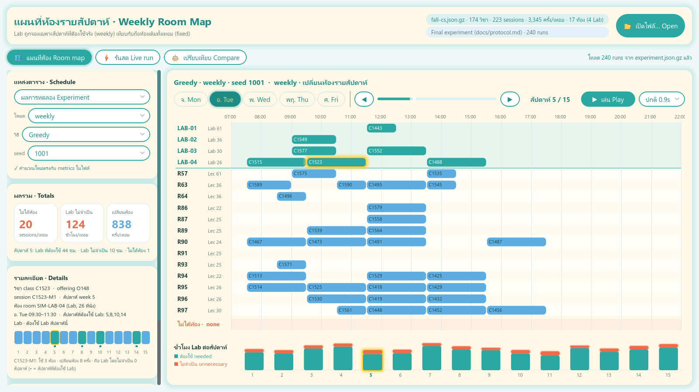
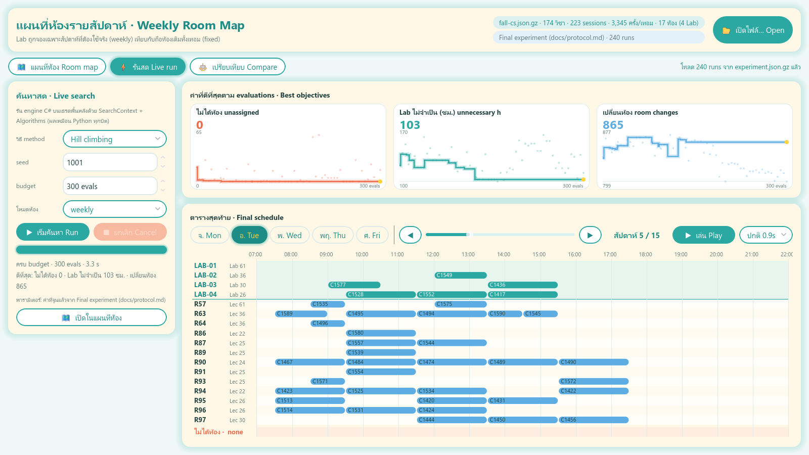
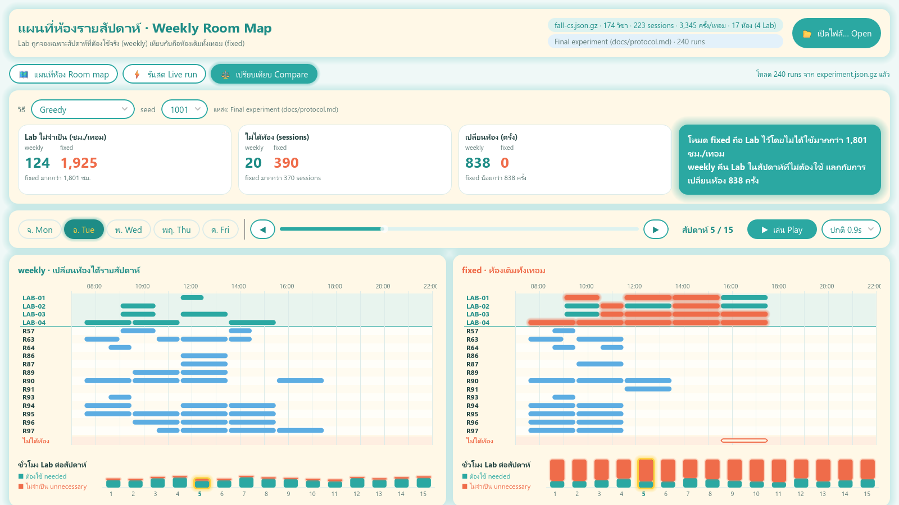

# Room Map (Godot 4.7 .NET desktop app)

This desktop app shows the weekly-vs-fixed room story one week at a time. In `weekly` mode a recurring session may change room by week, so it holds a computer Lab only in the weeks it needs one. In `fixed` mode it holds one room all term. The HTML app in `apps/web` stays the main tool. This app is a companion view built on the C# engine in `dotnet/src/Timetabling.Engine`, which it references as a project and never copies.

| Room map | Live run | Compare |
|---|---|---|
|  |  |  |

## Views

- **Room map (แผนที่ห้อง).** Rooms are rows (Labs first) and the hours of one day are columns. Use the day pills to pick a day. The week slider goes from 1 to 15, and the ◀ ▶ buttons step one week. **Play** animates the weeks, and each session glides from last week's room to this week's, so you can watch Labs being freed in non-Lab weeks. Block colours:
  - teal: a Lab used by a session that needs a Lab that week
  - coral (glowing): a Lab used by a session that does not need one that week (unnecessary)
  - sky: a lecture room
  - stone: an external booking
  - hatched: unavailable
  - coral outline in the bottom row: unassigned

  Hover a block to see its class, session, week and room. Click a block to pin it: the Details card then shows that session's room in every week. The bars under the map show Lab hours per week (needed vs unnecessary); click a bar to jump to that week. The schedule source can be any run from the loaded experiment (mode, method, seed), the Greedy schedule decoded now, or the last live run. The totals are recomputed from the raw schedule with the same rules as `engine/solution_validator.py` and checked against the metrics stored in the file (✓).
- **Live run (รันสด).** Choose the method (greedy, hc, sa, ga), seed, budget and room mode. The search runs on a background thread through `SearchContext`, `Algorithms.Run` and `PyRandom`, so it is bit-exact with Python. Three small line charts plot the best objectives over evaluations: unassigned sessions, unnecessary Lab hours and room changes. Dots mark each candidate's own objectives. **Cancel** uses the `SearchContext` `CancellationToken`. The final schedule appears below the charts, and you can open it in the Room map. If an experiment is loaded, the search uses its tuned parameters; otherwise it uses the engine defaults.
- **Compare (เปรียบเทียบ).** Shows weekly and fixed side by side for the same method and seed. Each mode has totals for unnecessary Lab hours, unassigned sessions and room changes, and one week/day control drives both maps. Clicking a session highlights it in both maps. Without an experiment, this view compares the two Greedy schedules decoded now.

## Data

When the app starts, it looks for the repository: the nearest parent folder (of the project or of the executable) that contains `data/provenance.json`. You can also name it with the `TIMETABLING_REPO` environment variable. The app then loads `data/fall-cs.json.gz` and decodes Greedy in both modes. After that it loads `experiments/final/experiment.json.gz` in the background.

**📂 Open** reads any `experiments/**/experiment.json.gz` or `.json` file, or a dataset file, and works out which kind it is. If an experiment's `dataset_text` differs from the loaded dataset, the app switches to the experiment's dataset.

## Open and run

You need the .NET 8 SDK and Godot 4.7.2 **.NET** (mono), for example `Godot_v4.7.2-stable_mono_win64.exe`.

- **Editor:** open Godot, click *Import*, pick `apps/godot/project.godot`, then press F5 (*Run Project*).
- **Command line:**

```bash
dotnet build apps/godot/TimetablingRoomMap.csproj
```

```bash
"<godot-mono>" --path apps/godot
```

### Checks

```bash
"<godot-mono-console>" --headless --path apps/godot --build-solutions --quit
```

```bash
"<godot-mono-console>" --headless --path apps/godot -- --smoke
```

The smoke run exits 0 only if every check passes:

- It loads the dataset and `experiments/final`.
- It decodes Greedy in both modes. The totals must match all 30 stored seeds: weekly is 20 unassigned, 124 unnecessary Lab hours and 838 room changes; fixed is 390 unassigned, 1,925 h and 0 changes.
- It recomputes the totals of all 240 stored runs from their raw schedules.
- It replays the first 10 evaluations of HC seed 1001, which must reproduce the stored trace.
- It cancels a search through the token.

To regenerate the screenshots in `docs/`, run this. It opens a 1600×900 window, captures each view and quits:

```bash
"<godot-mono-console>" --path apps/godot -- --capture=docs
```

## Export for desktop

C# Godot projects cannot export to the web, so this app is desktop only.

1. Install the **.NET** export templates for 4.7.2. In the editor, open *Editor → Manage Export Templates → Download*. The templates go to `%APPDATA%/Godot/export_templates/4.7.2.stable.mono/`. The plain `4.7.2.stable` templates cannot export C# projects.
2. Open *Project → Export → Add… → Windows Desktop*, then export to `apps/godot/export/` (ignored by git). Use the same steps with the Linux or macOS preset on those systems.
3. Keep the exported app inside the repository checkout, or set `TIMETABLING_REPO`, so that it finds `data/` and `experiments/`. Otherwise use **📂 Open** to load a dataset or experiment file directly.

No `export_presets.cfg` is committed, because only the non-.NET 4.7.2 templates were installed on the machine where this app was built.

## Layout

| Path | What it holds |
|---|---|
| `project.godot`, `Main.tscn` | Project settings and the single scene. The UI is built in code. |
| `TimetablingRoomMap.csproj` / `.sln` | `Godot.NET.Sdk/4.7.2`, net8.0, with a `ProjectReference` to the engine |
| `src/ScheduleModel.cs` | Godot-free model: blocks per room/week/day, totals with the validator's rules, per-week stats |
| `src/DataFiles.cs` | Dataset and experiment loading (streams `.json.gz`), repository lookup |
| `src/RoomMapView.cs` | The room map control: drawing, the week-to-week glide, hover and click |
| `src/Widgets.cs` | Week/day controls with play, per-week Lab bars, session strip, objective charts |
| `src/Ui.cs` | Palette and theme: pill buttons, 16px cream cards, soft teal glows, Thai-capable system font |
| `src/Main.cs` | App shell and the three views; the `--capture` screenshot mode |
| `src/SmokeTest.cs` | The `--smoke` headless check |

**Fonts:** the theme uses a `SystemFont` that tries Leelawadee UI, Noto Sans Thai, Sarabun, Tahoma and then Segoe UI, so Thai labels render on Windows and on Linux systems that have Noto installed. No font files are bundled.
