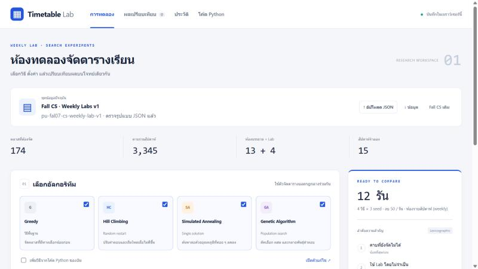
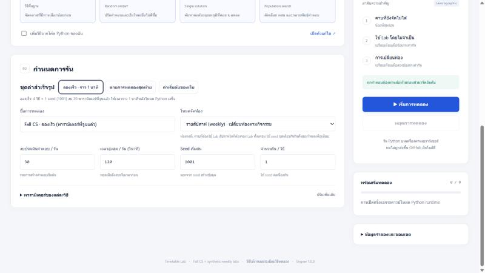
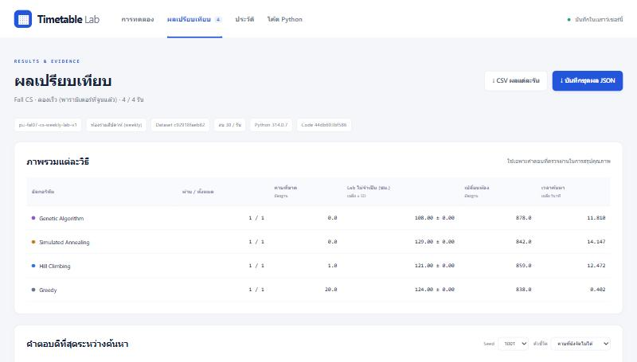

# เริ่มใช้ Timetable Lab ใน 3 ขั้น

คู่มือนี้สำหรับคนที่ไม่เคยเปิดเว็บนี้มาก่อน ไม่ต้องติดตั้งอะไร ใช้แค่ Chrome, Edge หรือ Firefox รุ่นใหม่และอินเทอร์เน็ต

## 1. เปิดเว็บ

เปิด **https://micosz.github.io/course-timetabling-lab/** แล้วรอจนเห็นชื่อชุดข้อมูล **Fall CS · Weekly Labs v1** (174 คลาส / 3,345 คาบรายสัปดาห์) และปุ่ม **▶ เริ่มการทดลอง** กดได้ การเปิดครั้งแรกต้องโหลด Python ในเบราว์เซอร์ อาจใช้เวลาราว 10–30 วินาที

## 2. เลือกชุดค่าแล้วกดรัน

ในกล่อง **02 กำหนดการรัน** กดปุ่ม **ลองเร็ว · ราว 1 นาที** ทุกช่องจะถูกกรอกให้: ครบ 4 วิธี (Greedy, HC, SA, GA), seed 1001, งบ 30 ครั้งต่อรัน และพารามิเตอร์ที่จูนแล้วจาก [`experiments/tuning/selected-parameters.json`](../experiments/tuning/selected-parameters.json)

จากนั้นกด **▶ เริ่มการทดลอง** ด้านขวา แถบความคืบหน้าจะขึ้นทีละรัน ทั้ง 4 รันใช้เวลาราว 45 วินาที (วัดบน Edge/Chromium เครื่องเดสก์ท็อป หลังโหลด Python เสร็จ) กด **หยุดการทดลอง** ได้ทุกเมื่อ

ชุดค่าอื่น:
- **ตามการทดลองสุดท้าย**: ค่าเดียวกับผลใน `experiments/final/` (4 วิธี × seed 1001–1030 งบ 500) ในเบราว์เซอร์ใช้เวลาหลายชั่วโมง ถ้าจะตรวจผลทั้งชุด ให้ใช้คำสั่ง `python3 python/batch.py` ตาม [README](../README.md)
- **ค่าเริ่มต้นของเว็บ**: กลับเป็นค่าเดิม (พารามิเตอร์ยังไม่จูน)

## 3. อ่านผลและดาวน์โหลด

เมื่อรันจบ เว็บจะเปิดหน้าผลให้เอง

- **ตารางเปรียบเทียบ**: วิธีที่ดีกว่าคือวิธีที่มี *คาบที่ยังจัดไม่ได้* น้อยกว่า ถ้าเท่ากันดู *Lab ไม่จำเป็น (ชม.)* แล้วจึงดู *เปลี่ยนห้อง*
- **กราฟคำตอบดีที่สุดระหว่างค้นหา**: ดูว่าแต่ละวิธีดีขึ้นเร็วแค่ไหน
- **ตรวจตารางที่ได้**: ดูตารางรายสัปดาห์ heatmap การใช้ Lab และห้องของแต่ละคลาส
- **ดาวน์โหลด**: CSV เปิดใน Excel ได้ ส่วนชุดผล JSON ใช้นำเข้ากลับเว็บหรือส่งให้คนอื่นตรวจ

ผลถูกบันทึกไว้ในเบราว์เซอร์เครื่องนี้เท่านั้น (แท็บ **ประวัติ**) ไม่ได้ส่งขึ้นที่ไหน ถ้าจะเก็บไว้ให้ดาวน์โหลดชุดผล JSON
