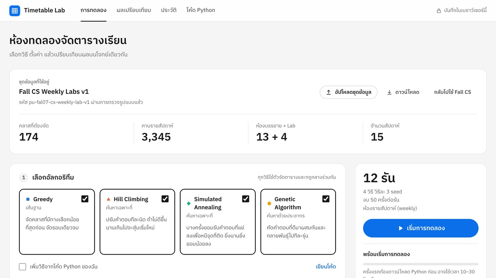
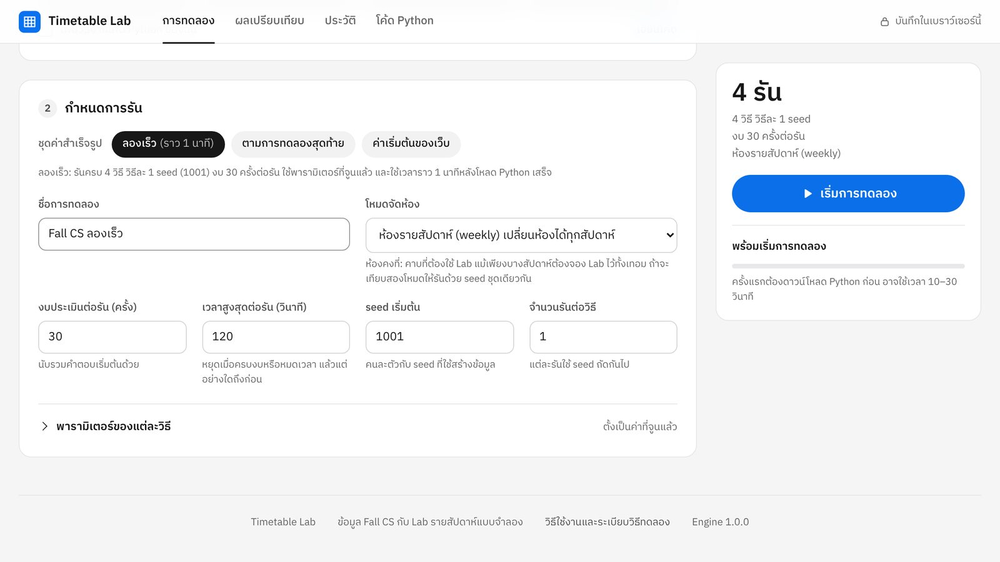
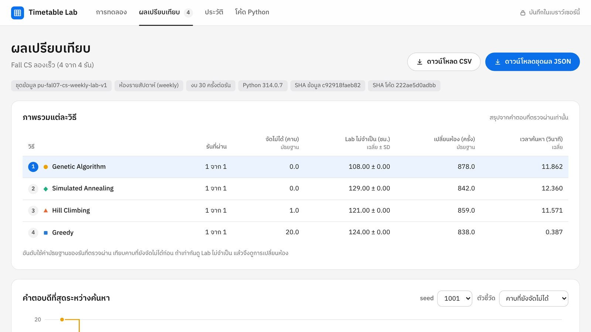

# เริ่มใช้ Timetable Lab ใน 3 ขั้น

คู่มือนี้สำหรับคนที่ไม่เคยเปิดเว็บนี้มาก่อน เว็บเป็น **ที่ดูชุดข้อมูลและผลการทดลองที่เก็บไว้** ไม่ได้รันอัลกอริทึมในเบราว์เซอร์ ผลทุกชุดรันไว้แล้วด้วย engine C# ใช้แค่ Chrome, Edge หรือ Firefox รุ่นใหม่

ภาพสามภาพในหน้านี้ (`img/quick-start-*.jpg`) ถ่ายจากเว็บรุ่นก่อนหน้า ซึ่งยังมีปุ่มรันในเบราว์เซอร์และใช้ชุดข้อมูลก่อนหน้า หน้าตาและตัวเลขจึงไม่ตรงกับเว็บปัจจุบัน

## ขั้นที่ 1 เปิดเว็บและดูชุดข้อมูล

เปิด **https://micosz.github.io/CS373_CourseTimetablingLab/** หรือเสิร์ฟ repository บนเครื่องตัวเอง:

```bash
python -m http.server 8766 --bind 127.0.0.1
```

แล้วเปิด `http://127.0.0.1:8766/apps/web/` (อย่าเปิด `index.html` แบบ `file://` เพราะเว็บต้องโหลดไฟล์ผ่าน HTTP)

หน้าแรกคือหน้า **ข้อมูล** แสดงชุดข้อมูลหลัก Fall CS (174 คลาส, 3,345 คาบรายสัปดาห์, ห้องบรรยาย 13 ห้อง + Lab 4 ห้อง, 15 สัปดาห์)

- ตาราง **คอร์สไหนต้องใช้ Lab สัปดาห์ไหน** แสดงวิชา Lab 20 วิชาและสัปดาห์ที่ใช้ Lab
- ตัวเลือกชุดข้อมูลเปลี่ยนเป็นชุดแปรที่วิชา Lab ใช้ Lab 1 ถึง 15 สัปดาห์ได้ (ชุดเดียวกับ [`experiments/lab-weeks/`](../experiments/lab-weeks/README.md))
- ความต้องการ Lab เป็นข้อมูลจำลอง อ่านที่มาได้ในกล่อง **ข้อมูลจำลองและขอบเขต**



## ขั้นที่ 2 เปิดผลที่เก็บไว้

ไปที่หน้า **ผลที่เก็บไว้** แล้วเลือกชุดผลในรายการ **ผลการทดลองที่เก็บไว้ในโครงงาน** เช่น การทดลองสุดท้าย (`experiments/final/`: 4 วิธี × seed 1001–1030 × 2 โหมดห้อง งบ 500) ชุดงบ 50,000 (`experiments/convergence/b50000/`) หรือชุดจำนวนสัปดาห์ Lab (`experiments/lab-weeks/wNN/`) เปิดดูได้ทันทีโดยไม่ต้องรันใหม่

ถ้ามีไฟล์ผลของตัวเอง กด **นำเข้าชุดผล JSON** แล้วเลือก `experiment.json.gz` ผลที่นำเข้าถูกเก็บในเบราว์เซอร์เครื่องนี้เท่านั้น



## ขั้นที่ 3 อ่านผลเปรียบเทียบและตารางเรียน

เมื่อเปิดชุดผลแล้ว หน้า **ผลเปรียบเทียบ** จะแสดง

- **ภาพรวมแต่ละวิธี**: วิธีที่ดีกว่าคือวิธีที่มี *คาบที่ยังจัดไม่ได้* น้อยกว่า ถ้าเท่ากันดู *Lab ไม่จำเป็น (ชม.)* แล้วจึงดู *เปลี่ยนห้อง*
- **กราฟคำตอบดีที่สุดระหว่างค้นหา**: ดูว่าแต่ละวิธีดีขึ้นเร็วแค่ไหน
- **ตรวจตารางที่ได้**: เลือกรัน แล้วดูตารางรายสัปดาห์ ผังห้องกับเวลา คาบที่ไม่มีห้อง heatmap การใช้ Lab และห้องของแต่ละคลาส
- **ดาวน์โหลด**: CSV เปิดใน Excel ได้ ส่วนชุดผล JSON ใช้นำเข้ากลับเว็บหรือส่งให้คนอื่นตรวจ



## อยากรันการทดลองใหม่

ใช้ CLI ของ engine C# ตาม [dotnet/README.md](../dotnet/README.md) แล้วนำ `experiment.json.gz` ที่ได้เข้าเว็บที่หน้า **ผลที่เก็บไว้** ตัวอย่างคำสั่งของแต่ละชุดการทดลองอยู่ใน README ของชุดนั้นใน [`experiments/`](../experiments/INDEX.md)
