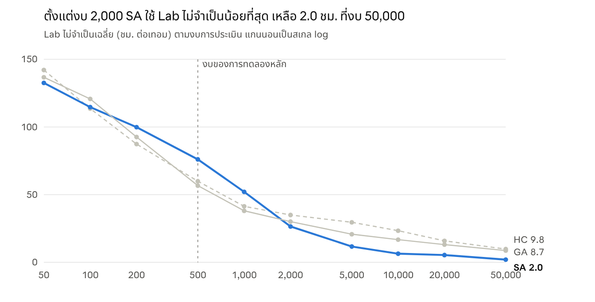

# ระบบจัดตารางเรียนและจัดสรรห้องเรียน ภายใต้ความต้องการใช้ Lab รายสัปดาห์

18 พฤศจิกายน 2026 · [ฉบับ PDF](CS373-report.pdf)

รายงานโครงงานวิชา CS373

## 1. บทนำ

วิชาคอมพิวเตอร์หลายวิชาต้องใช้ห้อง Computer Lab เพียงบางสัปดาห์ของภาคเรียน สัปดาห์ที่เหลือเรียนในห้องบรรยายได้ ถ้าจัดตารางแบบห้องคงที่ วิชาเหล่านี้ต้องจอง Lab ไว้ทั้งเทอม สัปดาห์ที่เป็นบรรยายจึงนั่งอยู่ใน Lab โดยไม่ได้ใช้ และคลาสอื่นที่ต้องใช้ Lab จริงในสัปดาห์นั้นก็จองไม่ได้

โครงงานนี้ทดลองแนวคิดให้วันและเวลาเรียนคงที่ทั้งเทอม แต่ห้องเปลี่ยนได้รายสัปดาห์ สัปดาห์ที่ต้องใช้ Lab เรียนใน Lab สัปดาห์อื่นเรียนในห้องบรรยาย

คำถามวิจัยมีสองข้อ

1. ห้องรายสัปดาห์ลดชั่วโมง Lab ที่ไม่จำเป็นได้เท่าไรภายใต้ข้อห้ามทั้งหมด ต้องแลกกับการย้ายห้องกี่ครั้ง และประหยัด Lab ได้กี่ห้อง

2. ในสี่อัลกอริทึม ได้แก่ Greedy, Hill Climbing (HC), Simulated Annealing (SA) และ Genetic Algorithm (GA) วิธีใดให้ตารางดีที่สุดเมื่อได้งบการค้นหาเท่ากัน

คำตอบโดยย่อคือ ห้องรายสัปดาห์ลด Lab ที่ไม่จำเป็นได้ราว 1,800 ถึง 1,950 ชั่วโมงต่อเทอม และประหยัด Lab ได้หนึ่งห้อง ส่วนวิธีที่ดีที่สุดขึ้นกับงบ ที่งบ 500 GA ดีที่สุด ตั้งแต่งบ 2,000 SA ดีที่สุด

## 2. ข้อมูลที่ใช้

ชุดข้อมูลชื่อ Fall CS Weekly Labs v1 ดัดแปลงจากข้อมูลจริงของ Purdue University ภาคเรียน Fall 2007 ภาควิชา CS (`pu-fal07-cs`) ที่เผยแพร่โดย UniTime ต้นฉบับไม่มีห้อง Lab และไม่มีความต้องการ Lab รายสัปดาห์ ข้อมูลส่วนนี้จึงสร้างขึ้นเองทั้งหมด

| รายการ | ค่า | ที่มา |
| --- | --- | --- |
| คลาส | 174 คลาส | ต้นฉบับ |
| คาบรายสัปดาห์ | 3,345 คาบ ใน 15 สัปดาห์ | ต้นฉบับ บนปฏิทินจำลอง 15 สัปดาห์ |
| ห้องบรรยาย | 13 ห้อง | ต้นฉบับ |
| ห้อง Lab | 4 ห้อง ความจุ 61, 36, 30 และ 26 คน | สร้างขึ้นเอง |
| คาบที่ต้องใช้ Lab | ร้อยละ 60 ของคาบ ใช้ Lab 4 จาก 15 สัปดาห์ | สร้างขึ้นเอง (สุ่มสัปดาห์) |
| ชั่วโมงที่ต้องใช้ Lab จริง | 804 ชั่วโมงต่อเทอม | คำนวณจากข้อมูลข้างต้น |

ค่าร้อยละ 60 และ 4 สัปดาห์เป็นค่าที่ตั้งขึ้น ไม่ได้มาจากการสำรวจวิชาจริง จึงทดลองเพิ่มด้วยสัปดาห์ Lab แบบติดกันและแบบเว้นสัปดาห์ (หัวข้อ 7.4) สมมติฐานทุกข้อของการดัดแปลงบันทึกไว้ในไฟล์ `data/assumptions.json`

## 3. นิยามปัญหา

การตัดสินใจมีสองชั้น ชั้นแรกคือเวลา แต่ละคลาสเลือกวันและเวลาหนึ่งชุดจากตัวเลือกที่ต้นฉบับอนุญาต แล้วใช้ทั้ง 15 สัปดาห์ ชั้นที่สองคือห้อง ซึ่งเลือกใหม่ได้ทุกสัปดาห์

### 3.1 ข้อห้าม

ข้อห้ามทุกข้อเป็น hard constraint ถ้าจัดไม่ได้จะเว้นคาบนั้นไว้และนับเป็นคาบที่ยังจัดไม่ได้ ไม่ยอมละเมิด

- ห้องหนึ่งห้องใช้ได้ทีละคลาสในเวลาเดียวกัน

- ผู้สอนและกลุ่มนักศึกษาเดียวกันห้ามมีคาบซ้อนเวลา

- ความจุห้องต้องพอกับจำนวนที่นั่งของคลาส

- สัปดาห์ที่ต้องใช้ Lab ต้องได้ห้องประเภท Computer Lab

- ห้องต้องอยู่ในรายการห้องที่คลาสใช้ได้ และว่างตลอดทั้งคาบ

- ห้ามชนกับการจองภายนอกที่กำหนดไว้แล้วของห้องและผู้สอน

- กลุ่มคลาสที่ต้นฉบับกำหนดว่าห้ามซ้อนเวลา หรือกำหนดให้เรียนเวลาเดียวกัน ต้องเป็นไปตามนั้น

### 3.2 เป้าหมาย

เทียบตารางตามลำดับความสำคัญ (lexicographic) ตารางที่ดีกว่าในข้อแรกชนะเสมอ ถ้าเท่ากันจึงดูข้อถัดไป

1. คาบรายสัปดาห์ที่ยังจัดไม่ได้

2. ชั่วโมง Lab ไม่จำเป็น คือชั่วโมงที่คาบใช้ห้อง Lab ในสัปดาห์ที่ไม่ต้องใช้ Lab

3. จำนวนครั้งที่คาบเดียวกันเปลี่ยนห้องจากสัปดาห์ก่อน

ตัวอย่างของข้อ 2: วิชาคาบละ 1.5 ชั่วโมงที่ใช้ Lab 4 จาก 15 สัปดาห์ ถ้าล็อกห้อง Lab ทั้งเทอมจะเสีย 11 สัปดาห์ รวม 16.5 ชั่วโมง ถ้าเปลี่ยนห้องรายสัปดาห์จะเป็น 0

## 4. วิธีการ

ทั้งสี่วิธีค้นหาบนตัวแทนคำตอบเดียวกัน จึงต่างกันเฉพาะวิธีค้นหา ขั้นตอนของหนึ่งรอบการประเมินมีดังนี้

1. อัลกอริทึมกำหนดลำดับคลาสที่จะจัดก่อนหลัง และตัวเลือกเวลาที่อยากลองก่อนของแต่ละคลาส

2. ตัวจัดตาราง (decoder) จัดทีละคลาสตามลำดับนั้น เลือกเวลาแรกที่ไม่ละเมิดข้อห้าม แล้วเลือกห้องทีละสัปดาห์ ถ้าใส่ไม่ได้จะเว้นคาบนั้นไว้

3. ตัวตรวจอิสระ (`solution_validator.py`) ตรวจข้อห้ามและนับค่าเป้าหมายทั้งสามใหม่จากข้อมูลดิบ ไม่ใช้คะแนนที่อัลกอริทึมรายงานเอง

4. อัลกอริทึมนำผลไปปรับลำดับในรอบถัดไป วนจนหมดงบ

| วิธี | หลักการ |
| --- | --- |
| Greedy | จัดคลาสที่มีตัวเลือกน้อยที่สุดก่อน ประเมินครั้งเดียว ใช้เป็นเส้นฐานและเป็นคำตอบเริ่มต้นของอีกสามวิธี |
| Hill Climbing (HC) | สุ่มแก้คำตอบทีละเล็กน้อย รับเฉพาะคำตอบที่ดีขึ้น และสุ่มเริ่มใหม่เมื่อไม่ดีขึ้นนานเกินกำหนด |
| Simulated Annealing (SA) | เหมือน HC แต่ยอมรับคำตอบที่แย่ลงได้ด้วยความน่าจะเป็นที่ลดลงเรื่อย ๆ เพื่อหนีจุดที่ติด |
| Genetic Algorithm (GA) | เก็บคำตอบเป็นประชากร คัดเลือกแบบ tournament ผสมคำตอบ กลายพันธุ์ และเก็บตัวดีที่สุดไว้ |

โหมดห้องมีสองแบบ `weekly` คือห้องเปลี่ยนได้รายสัปดาห์ตามแนวคิดของโครงงาน และ `fixed` คือคาบหนึ่งใช้ห้องเดียวทั้งเทอม ใช้เป็นตัวเทียบ

## 5. การออกแบบการทดลอง

กติกาเขียนไว้ก่อนเริ่มจูนและไม่แก้ย้อนหลัง (`docs/protocol.md`)

- **Seed:** จูนพารามิเตอร์บน seed 1 ถึง 10 และทดสอบบน seed 1001 ถึง 1030 ซึ่งไม่ถูกใช้ตอนจูน

- **งบ:** HC, SA และ GA ได้ 500 การประเมินต่อรันเท่ากัน นับทุกครั้งที่ตัวจัดตารางประเมินคำตอบ ส่วน Greedy ใช้ 1 การประเมินตามนิยาม

- **ความเท่าเทียม:** ทุกวิธีเริ่มจากคำตอบตั้งต้นเดียวกัน ใช้ข้อมูล ตัวจัดตาราง และตัวตรวจชุดเดียวกัน

- **การทดลองหลัก:** 4 วิธี × 30 seed × 2 โหมดห้อง รวม 240 รัน ผ่านตัวตรวจอิสระครบทุกรัน

- **สถิติ (α = 0.05):** Friedman test เทียบ 4 วิธีพร้อมกัน แล้วเทียบรายคู่ด้วย Wilcoxon signed-rank แบบจับคู่ตาม seed ปรับค่า p ด้วยวิธี Holm

การจูนลองทั้งหมด 47 ชุดค่า รวม 470 รัน เลือกชุดที่ค่าเฉลี่ยบน seed จูนดีที่สุดตามลำดับเป้าหมาย

| วิธี | พารามิเตอร์ที่เลือก |
| --- | --- |
| HC | restart_patience = 50 |
| SA | initial_acceptance = 0.2, cooling_rate = 0.9 |
| GA | population_size = 35, mutation_rate = 0.66, crossover_rate = 0.64, tournament_size = 5, elites = 3 |

ค่าที่เลือกของ SA อยู่ที่มุมของช่วงที่ลอง จึงจูน SA เพิ่มอีก 20 ชุดค่าหลังเห็นผล ค่าใหม่ดีขึ้นบน seed จูน แต่บน seed ทดสอบไม่ดีขึ้น (76.2 เป็น 77.5 ชั่วโมง ชนะ 15 แพ้ 15) ผลหลักจึงใช้ค่าเดิม และรายงานส่วนนี้แยกไว้เพราะเป็นการจูนหลังเห็นผล

## 6. ผลการทดลองหลักที่งบ 500

ที่งบ 500 HC, SA และ GA จัดครบทุกคาบทั้ง 30 seed และ GA ใช้ Lab ไม่จำเป็นน้อยที่สุด เฉลี่ย 57.7 ชั่วโมงต่อเทอม ส่วน Greedy ยังจัดไม่ได้ 20 คาบทุก seed

ตารางนี้คือโหมดห้องรายสัปดาห์ บน seed ทดสอบ 30 ตัว ค่าที่แสดงคือค่าเฉลี่ย ± ส่วนเบี่ยงเบนมาตรฐาน

| วิธี | จัดครบทุกคาบ (seed) | คาบที่ยังจัดไม่ได้ | Lab ไม่จำเป็น (ชม.) | เปลี่ยนห้อง (ครั้ง) |
| --- | --- | --- | --- | --- |
| GA | 30 จาก 30 | 0 | 57.7 ± 19.8 | 831.3 ± 18.0 |
| HC | 30 จาก 30 | 0 | 64.9 ± 22.2 | 830.8 ± 17.8 |
| SA | 30 จาก 30 | 0 | 76.2 ± 20.8 | 835.4 ± 13.7 |
| Greedy | 0 จาก 30 | 20 | 124.0 ± 0.0 | 838.0 ± 0.0 |

Friedman test พบว่าสี่วิธีต่างกันอย่างมีนัยสำคัญ (χ² = 63.12, df = 3, p \< 0.001) อันดับเฉลี่ยคือ GA 1.53, HC 1.93, SA 2.53 และ Greedy 4.00 ผลเทียบรายคู่หลังปรับ Holm มีดังนี้

| คู่ที่เทียบ | จำนวน seed ที่ชนะ | p (Holm) | สรุป |
| --- | --- | --- | --- |
| GA กับ SA | GA 26, SA 4 | \< 0.001 | GA ดีกว่าอย่างมีนัยสำคัญ |
| GA กับ HC | GA 18, HC 12 | 0.188 | ยังแยกกันไม่ได้ |
| HC กับ SA | HC 20, SA 10 | 0.176 | ยังแยกกันไม่ได้ |
| HC, SA, GA กับ Greedy | 30 ต่อ 0 ทุกคู่ | \< 0.001 | ทั้งสามวิธีดีกว่า Greedy |

สรุปคือที่งบ 500 GA ดีที่สุดโดยรวม แต่ยังไม่มีหลักฐานพอว่าดีกว่า HC

Lab ไม่จำเป็นที่เหลืออยู่มาจากการเลือกเวลา ไม่ได้มาจากการเลือกห้อง เมื่อตรวจตารางคำตอบทุกรัน ไม่พบครั้งใดที่คาบนั่ง Lab ทั้งที่มีห้องบรรยายว่าง ทุกครั้งห้องบรรยายถูกคลาสอื่นใช้อยู่ในเวลาเดียวกัน

## 7. ผลการศึกษาเพิ่มเติม

### 7.1 ห้องรายสัปดาห์เทียบกับห้องคงที่

ห้องคงที่แย่กว่าห้องรายสัปดาห์ในทุกวิธีและทุก seed (p \< 0.001) Lab ถูกครองโดยไม่ได้ใช้เพิ่มขึ้นเฉลี่ย 1,801 ถึง 1,949 ชั่วโมงต่อเทอม และยังจัดไม่ได้เฉลี่ย 152 ถึง 390 คาบ เพราะ Lab 4 ห้องไม่พอให้จองทั้งเทอม

### 7.2 ถ้าจำนวนห้อง Lab ลดลง

ห้องรายสัปดาห์ยังจัดครบทุกคาบเมื่อเหลือ Lab 3 ห้อง ส่วนห้องคงที่จัดไม่ครบตั้งแต่มี 4 ห้อง จึงประหยัด Lab ได้หนึ่งห้อง ตารางแสดงคาบที่ยังจัดไม่ได้เฉลี่ยของ GA ที่งบ 500 บน 10 seed

| จำนวนห้อง Lab | ห้องรายสัปดาห์ (คาบ) | ห้องคงที่ (คาบ) |
| --- | --- | --- |
| 4 | 0 | 159.0 |
| 3 | 0 | 481.5 |
| 2 | 17.7 | 895.5 |

### 7.3 จำนวนครั้งที่ต้องเปลี่ยนห้อง

ตารางของ HC, SA และ GA เปลี่ยนห้องราว 831 ถึง 835 ครั้งต่อเทอม หรือ 1.06 ถึง 1.07 เท่าของค่าต่ำสุดที่เป็นไปได้ ข้อมูลบังคับให้เปลี่ยนอย่างน้อย 783 ครั้งถ้าจะจัดครบและไม่ใช้ Lab เกินจำเป็น เพราะคาบที่สลับระหว่างสัปดาห์ Lab กับสัปดาห์บรรยายต้องเปลี่ยนประเภทห้องทุกครั้ง ห้องคงที่ไม่ต้องเปลี่ยนห้องเลย แต่ Lab ที่ถูกครองเปล่าเพิ่มจากราว 66 เป็น 1,987 ชั่วโมงต่อเทอม

### 7.4 รูปแบบสัปดาห์ Lab

เมื่อเปลี่ยนสัปดาห์ Lab จากแบบสุ่มเป็นแบบติดกันหรือแบบเว้นสัปดาห์ ข้อสรุปหลักและลำดับของวิธีไม่เปลี่ยน สิ่งที่เปลี่ยนคือจำนวนครั้งที่เปลี่ยนห้อง คือราว 274 ครั้งเมื่อสัปดาห์ Lab ติดกัน 830 ครั้งเมื่อสุ่ม และ 1,080 ครั้งเมื่อเว้นสัปดาห์

### 7.5 ผลเมื่อให้งบมากขึ้น

วิธีที่ดีที่สุดขึ้นกับงบ ที่งบ 500 ถึง 1,000 GA ดีที่สุด แต่ตั้งแต่งบ 2,000 SA ดีที่สุด

ที่มา: [experiments/convergence/summary.csv](../../experiments/convergence/summary.csv) · seed 1001 ถึง 1010 · งบ 50 ถึง 50,000 · เส้นประคือ HC

ที่งบ 50,000 SA ดีกว่า GA (p = 0.008) และ HC (p = 0.006) อย่างมีนัยสำคัญ SA ได้ตารางที่จัดครบและไม่มี Lab ไม่จำเป็นเลยใน 8 จาก 10 seed และใน 8 seed นั้นเปลี่ยนห้อง 785 ถึง 786 ครั้ง ห่างจากค่าต่ำสุด 783 ครั้งไม่เกินร้อยละ 0.4 ผลยังไม่นิ่งสนิทที่งบ 50,000 แต่ดีขึ้นช้ามาก และพารามิเตอร์ทุกวิธีจูนที่งบ 500

## 8. ระบบที่พัฒนา

| ส่วน | ทำอะไร | เทคโนโลยี |
| --- | --- | --- |
| [เว็บ Timetable Lab](https://micosz.github.io/CS373_CourseTimetablingLab/) | รันทั้งสี่วิธีในเบราว์เซอร์ ดูตารางรายสัปดาห์ heatmap การใช้ Lab และห้องของแต่ละคลาส ส่งออก CSV และ JSON และเขียนอัลกอริทึมของตัวเองมาแข่งได้ | Python ผ่าน Pyodide ไม่มี server |
| Engine Python | ต้นฉบับอ้างอิงของตัวจัดตาราง อัลกอริทึม และตัวตรวจอิสระ พร้อมชุดทดสอบอัตโนมัติ 31 รายการ | Python 3.9 ขึ้นไป ไม่ใช้ package เพิ่ม |
| Engine C# | ใช้รันการทดลองชุดใหญ่ ให้ผลตรงกับ Python ทั้ง 240 รัน | .NET 8 |
| แอปเดสก์ท็อป | แสดงห้องที่เปลี่ยนไปทีละสัปดาห์ และเทียบห้องรายสัปดาห์กับห้องคงที่ข้างกัน | Godot 4.7 (C#) |

รูปที่ 1 หน้าผลเปรียบเทียบของเว็บ แสดงตารางสรุปของทั้งสี่วิธีและปุ่มดาวน์โหลด CSV และ JSON ตัวเลขในรูปมาจากการรันตัวอย่างแบบเร็วหนึ่ง seed ไม่ใช่ผลการทดลองหลัก

รูปที่ 2 Heatmap การใช้ห้อง Lab ทั้ง 4 ห้องตลอด 15 สัปดาห์ แยกชั่วโมงที่จำเป็นกับชั่วโมงที่ไม่จำเป็น ตัวอย่างในรูปคือตารางของ Greedy seed 1001

รูปที่ 3 แอปเดสก์ท็อปแสดงห้องที่แต่ละคลาสใช้ในสัปดาห์ที่เลือก และจำนวนชั่วโมง Lab ของแต่ละสัปดาห์

การทดลองหลัก 240 รันใช้เวลา 1,812 วินาทีด้วย Python และ 20.5 วินาทีด้วย C# เวลาค้นหารวมลดลงราว 75 เท่า ความเร็วนี้ทำให้การทดลองงบ 50,000 ทำได้จริง

ซอร์สโค้ด ข้อมูล และผลดิบทั้งหมดอยู่ที่ [github.com/Micosz/CS373_CourseTimetablingLab](https://github.com/Micosz/CS373_CourseTimetablingLab)

## 9. ข้อจำกัดของการศึกษา

- ผลทั้งหมดมาจากชุดข้อมูลดัดแปลงชุดเดียว และข้อมูล Lab สร้างขึ้นเอง จึงบอกได้ว่าวิธีใดดีกว่าบนโจทย์นี้ ไม่ได้บอกว่าดีกว่าในทุกโจทย์จัดตาราง

- ไม่มีตารางที่คนจัดจริงมาเทียบ Greedy เป็นเพียงตัวแทนของการจัดตามกฎง่าย ๆ

- พารามิเตอร์ทุกวิธีจูนที่งบ 500 ผลที่งบสูงกว่านั้นจึงอาจเปลี่ยนได้ถ้าจูนใหม่ที่งบใหญ่

- การศึกษางบใหญ่ Lab ขาดแคลน และรูปแบบสัปดาห์ Lab ใช้ 10 seed ไม่ใช่ 30 seed

- ยังไม่ได้วัดผลของการย้ายห้องต่อนักศึกษาและผู้สอน

## 10. สรุปผล

1. ห้องรายสัปดาห์ลด Lab ที่ไม่จำเป็นได้ราว 1,800 ถึง 1,950 ชั่วโมงต่อเทอมเมื่อเทียบกับห้องคงที่ และยังจัดครบทุกคาบเมื่อเหลือ Lab 3 ห้อง จึงประหยัด Lab ได้หนึ่งห้อง ข้อสรุปนี้ไม่เปลี่ยนเมื่อสัปดาห์ Lab ติดกันหรือเว้นสัปดาห์

2. วิธีที่ดีที่สุดขึ้นกับงบ ที่งบ 500 GA ดีที่สุดแต่ยังแยกจาก HC ไม่ได้ทางสถิติ ตั้งแต่งบ 2,000 SA ดีที่สุด และที่งบ 50,000 SA ห่างจากค่าที่ดีที่สุดไม่เกินร้อยละ 0.4 ใน 8 จาก 10 seed

3. ราคาที่ต้องจ่ายคือการย้ายห้อง ราว 1.06 เท่าของค่าต่ำสุดที่ข้อมูลบังคับ และขึ้นกับรูปแบบสัปดาห์ Lab ของวิชาจริง

งานต่อยอดคือทดลองกับข้อมูลวิชาจริง จูนพารามิเตอร์ที่งบใหญ่ และวัดผลของการย้ายห้องต่อนักศึกษา

## เอกสารอ้างอิง

- Bellio, R., Ceschia, S., Di Gaspero, L., Schaerf, A., & Urli, T. (2016). Feature-based tuning of simulated annealing applied to the curriculum-based course timetabling problem. *Computers & Operations Research, 65*, 83–92. [doi:10.1016/j.cor.2015.07.002](https://doi.org/10.1016/j.cor.2015.07.002)

- Cavalcante, J. L. S., Clímaco, F. G. N., & Chagas, F. (2026). A mathematical model for class scheduling: A case study with the Federal University of Maranhão. In *Numerical Modeling – Integrated Approaches for Complex Systems*. IntechOpen. [doi:10.5772/intechopen.1017804](https://doi.org/10.5772/intechopen.1017804)

- Davis, L. (1985). Applying adaptive algorithms to epistatic domains. *Proceedings of IJCAI-85*, 162–164. [ijcai.org/proceedings/1985/29](https://www.ijcai.org/proceedings/1985/29)

- Goldberg, D. E., & Deb, K. (1991). A comparative analysis of selection schemes used in genetic algorithms. *Foundations of Genetic Algorithms*, 69–93. [doi:10.1016/B978-0-08-050684-5.50008-2](https://doi.org/10.1016/B978-0-08-050684-5.50008-2)

- ITC2007. Curriculum-based Course Timetabling: The Problem Model. Queen's University Belfast. [eeecs.qub.ac.uk/itc2007](https://www.eeecs.qub.ac.uk/itc2007/curriculmcourse/course_curriculm_index.htm)

- Lemos, A., Melo, F. S., Monteiro, P. T., & Lynce, I. (2019). Room usage optimization in timetabling: A case study at Universidade de Lisboa. *Operations Research Perspectives, 6*, 100092. [doi:10.1016/j.orp.2018.100092](https://doi.org/10.1016/j.orp.2018.100092)

- Müller, T. (2009). ITC2007 solver description: A hybrid approach. *Annals of Operations Research, 172*(1), 429–446. [doi:10.1007/s10479-009-0644-y](https://doi.org/10.1007/s10479-009-0644-y)

- Raviv, T. (2026). The lecture-hall quadratic assignment problem. *Computers & Operations Research, 196*, 107659. [doi:10.1016/j.cor.2026.107659](https://doi.org/10.1016/j.cor.2026.107659)

- UniTime. University course timetabling datasets, Purdue Fall 2007 CS (`pu-fal07-cs`). [unitime.org/uct_datasets.php](https://www.unitime.org/uct_datasets.php)

- Xiao, L. (2021). *The Course Scheduling Problem with Room Considerations* \[Doctoral dissertation, Wright State University\]. [corescholar.libraries.wright.edu/etd_all/2474](https://corescholar.libraries.wright.edu/etd_all/2474/)
