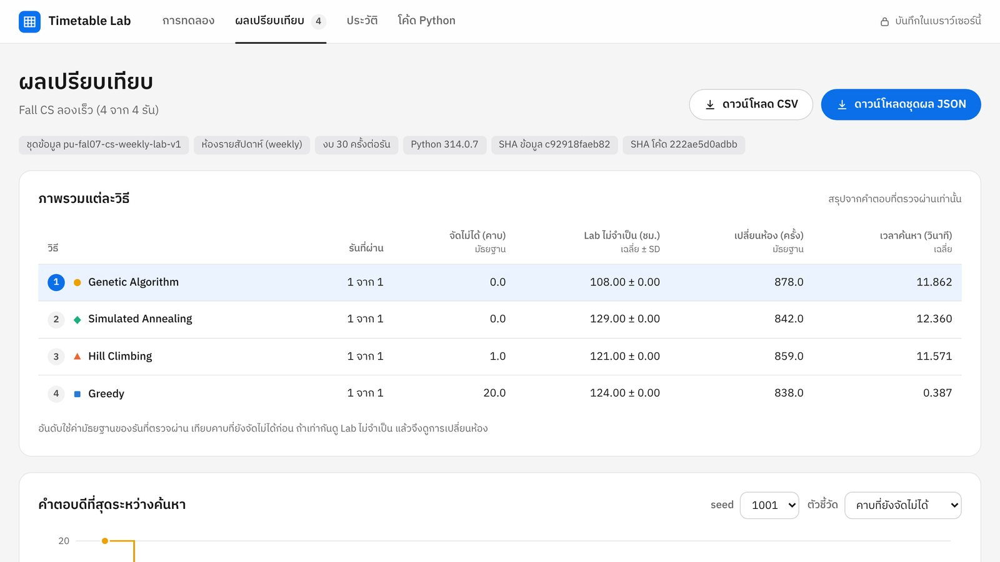
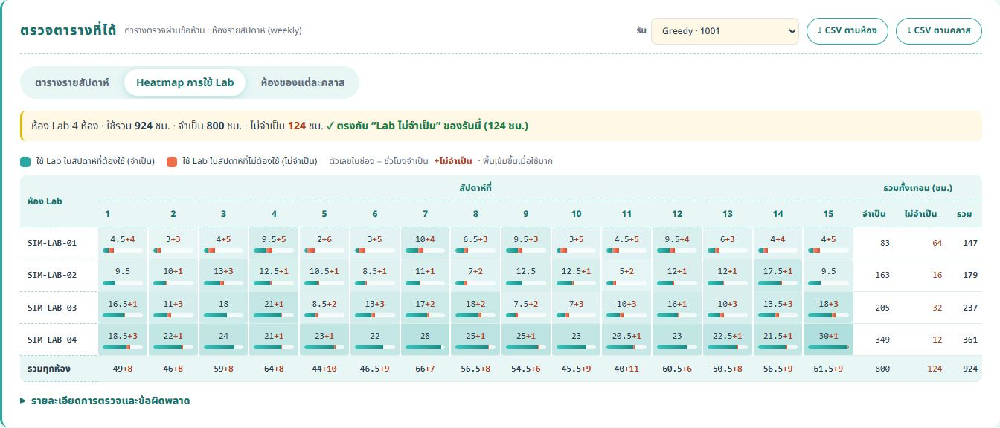
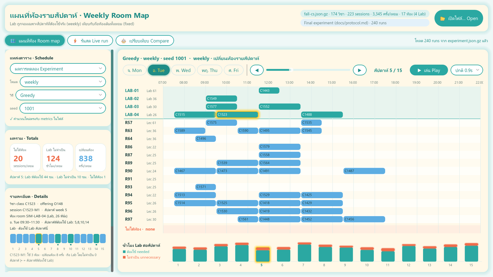

# ระบบจัดตารางเรียนและจัดสรรห้องเรียน ภายใต้ความต้องการใช้ Lab รายสัปดาห์

19 พฤศจิกายน 2026 (ตัวเลขทั้งหมดมาจากการรันใหม่บนชุดข้อมูล Fall CS Weekly Labs v2)

รายงานโครงงานวิชา CS373

## 1. บทนำ

สมมติว่าวิชาคอมพิวเตอร์บางวิชาต้องใช้ห้อง Computer Lab เพียงบางสัปดาห์ของภาคเรียน สัปดาห์ที่เหลือเรียนในห้องบรรยายได้ ถ้าจัดตารางแบบห้องคงที่ คาบเหล่านี้ต้องจอง Lab ไว้ทั้งเทอม สัปดาห์ที่ไม่ได้ใช้ Lab ก็ยังครองห้องอยู่

โครงงานนี้ตั้งโจทย์ให้วันและเวลาเรียนคงที่ทั้งเทอม แต่ห้องเปลี่ยนได้รายสัปดาห์ สัปดาห์ที่ต้องใช้ Lab เรียนใน Lab สัปดาห์อื่นเรียนในห้องบรรยาย แล้วศึกษาว่าอัลกอริทึมค้นหาจัดตารางแบบนี้ได้ดีแค่ไหน

งานนี้เป็น **การศึกษาโจทย์ที่ตั้งขึ้นเอง** ความต้องการ Lab ในข้อมูลเป็นค่าจำลอง ผลจึงไม่ใช่ข้อค้นพบเกี่ยวกับมหาวิทยาลัยจริง และโหมดห้องคงที่ใช้เป็นจุดอ้างอิงเท่านั้น ไม่ได้ใช้พิสูจน์ว่าห้องรายสัปดาห์ดีกว่า

คำถามที่ศึกษามีสองข้อ

1. บนโจทย์นี้ อัลกอริทึมจัดครบทุกคาบได้หรือไม่ เหลือชั่วโมง Lab ที่ไม่จำเป็นเท่าไร ต้องย้ายห้องกี่ครั้ง และรับความต้องการ Lab ได้ถึงระดับไหน

2. ในสี่อัลกอริทึม ได้แก่ Greedy, Hill Climbing (HC), Simulated Annealing (SA) และ Genetic Algorithm (GA) วิธีใดให้ตารางดีที่สุดเมื่อได้งบการค้นหาเท่ากัน

คำตอบโดยย่อคือ ที่งบ 500 วิธีค้นหาทั้งสามดีกว่า Greedy ชัดเจน แต่ยังแยกกันเองไม่ได้ และยังจัดไม่ครบทุกรัน เมื่อให้งบตั้งแต่ 1,000 ทุกรันจัดครบ และตั้งแต่งบ 10,000 SA ไม่เหลือ Lab ที่ไม่จำเป็นเลย ส่วนความต้องการ Lab ที่ Lab 4 ห้องรับได้อยู่ระหว่าง 4 กับ 6 จาก 15 สัปดาห์ต่อวิชา Lab

## 2. ข้อมูลที่ใช้

ชุดข้อมูลชื่อ Fall CS Weekly Labs v2 ดัดแปลงจากข้อมูลจริงของ Purdue University ภาคเรียน Fall 2007 ภาควิชา CS (`pu-fal07-cs`) ที่เผยแพร่โดย UniTime ต้นฉบับไม่มีห้อง Lab และไม่มีความต้องการ Lab รายสัปดาห์ ข้อมูลส่วนนี้จึงสร้างขึ้นเองทั้งหมด

| รายการ | ค่า | ที่มา |
| --- | --- | --- |
| คลาส | 174 คลาส ใน 44 วิชา | ต้นฉบับ |
| คาบประจำ | 223 คาบ | ต้นฉบับ |
| คาบรายสัปดาห์ | 3,345 คาบ (223 × 15 สัปดาห์) | ต้นฉบับ บนปฏิทินจำลอง 15 สัปดาห์ |
| ห้องบรรยาย | 13 ห้อง | ต้นฉบับ |
| ห้อง Lab | 4 ห้อง ความจุ 61, 36, 30 และ 26 คน | สร้างขึ้นเอง |
| วิชาที่มีคาบปฏิบัติ | 27 จาก 44 วิชา | อนุมานจากรูปแบบเวลาเรียน |
| วิชา Lab | 20 วิชา รวม 106 คาบประจำ ใช้ Lab 4 จาก 15 สัปดาห์ | สร้างขึ้นเอง (สุ่มเลือกวิชาและสัปดาห์) |
| คาบที่ไม่ใช้ Lab เลย | 117 คาบประจำ | ผลจากข้อข้างต้น |
| ชั่วโมงที่ต้องใช้ Lab จริง | 800 ชั่วโมงต่อเทอม (9 ถึง 89 ชั่วโมงต่อสัปดาห์) | คำนวณจากข้อมูลข้างต้น |

กติกาสร้างความต้องการ Lab (assumption A10) มีดังนี้

- ความต้องการ Lab กำหนดเป็นรายวิชา และตกที่คาบปฏิบัติของวิชาเท่านั้น คาบอื่นไม่ต้องใช้ Lab

- ต้นฉบับบอกส่วนของวิชา (subpart) แต่ไม่บอกว่าส่วนไหนเป็นงานปฏิบัติ คาบปฏิบัติจึงเป็นการอนุมานจากรูปแบบเวลาเรียน ไม่ใช่ข้อมูลจากต้นฉบับ วิชาที่มีหลายส่วนใช้ส่วนที่คาบยาวที่สุด (ถ้าเท่ากันเลือกส่วนที่เรียนน้อยครั้งต่อสัปดาห์ แล้วส่วนที่มีกลุ่มเรียนมากกว่า) ส่วนวิชาที่มีส่วนเดียวนับเป็นคาบปฏิบัติเฉพาะเมื่อเรียนสัปดาห์ละครั้ง

- สับลำดับวิชาที่มีคาบปฏิบัติด้วย seed `20261119` แล้วหยิบตามลำดับจนชั่วโมง Lab ทั้งเทอมใกล้เป้าที่ตั้งไว้ที่สุด ได้วิชา Lab 20 วิชา

- ทุกกลุ่มเรียนในคาบปฏิบัติของวิชาเดียวกันใช้สัปดาห์ Lab ชุดเดียวกัน โดยสุ่มสัปดาห์ต่อวิชา

จำนวนวิชา Lab และค่า 4 สัปดาห์เป็นค่าที่ตั้งขึ้น ไม่ได้มาจากการสำรวจวิชาจริง จึงทดลองเพิ่มโดยเปลี่ยนจำนวนสัปดาห์ Lab จาก 1 ถึง 15 (หัวข้อ 7.2) และเปลี่ยนสัปดาห์ Lab เป็นแบบติดกันและแบบเว้นสัปดาห์ (หัวข้อ 7.5) สมมติฐานทุกข้อของการดัดแปลงบันทึกไว้ในไฟล์ `data/assumptions.json`

## 3. นิยามปัญหา

การตัดสินใจมีสองชั้น ชั้นแรกคือเวลา แต่ละคลาสเลือกวันและเวลาหนึ่งชุดจากตัวเลือกที่ต้นฉบับอนุญาต แล้วใช้ทั้ง 15 สัปดาห์ ชั้นที่สองคือห้อง ซึ่งเลือกใหม่ได้ทุกสัปดาห์

### 3.1 ข้อห้าม

ข้อห้ามทุกข้อเป็น hard constraint ถ้าจัดไม่ได้จะเว้นคาบนั้นไว้และนับเป็นคาบที่ยังจัดไม่ได้ ไม่ยอมละเมิด

- ห้องหนึ่งห้องใช้ได้ทีละคลาสในเวลาเดียวกัน

- ผู้สอนและกลุ่มนักศึกษาเดียวกันห้ามมีคาบซ้อนเวลา

- ความจุห้องต้องพอกับจำนวนที่นั่งของคลาส

- สัปดาห์ที่ต้องใช้ Lab ต้องได้ห้องประเภท Computer Lab

- ห้องต้องอยู่ในรายการห้องที่คลาสใช้ได้ และว่างตลอดทั้งคาบ

- ห้ามชนกับการจองภายนอกที่กำหนดไว้แล้วของห้องและผู้สอน

- กลุ่มคลาสที่ต้นฉบับกำหนดว่าห้ามซ้อนเวลา หรือกำหนดให้เรียนเวลาเดียวกัน ต้องเป็นไปตามนั้น

### 3.2 เป้าหมาย

เทียบตารางตามลำดับความสำคัญ (lexicographic) ตารางที่ดีกว่าในข้อแรกชนะเสมอ ถ้าเท่ากันจึงดูข้อถัดไป

1. คาบรายสัปดาห์ที่ยังจัดไม่ได้

2. ชั่วโมง Lab ไม่จำเป็น คือชั่วโมงที่คาบใช้ห้อง Lab ในสัปดาห์ที่ไม่ต้องใช้ Lab

3. จำนวนครั้งที่คาบเดียวกันเปลี่ยนห้องจากสัปดาห์ก่อน

ตัวอย่างของข้อ 2: วิชาคาบละ 1.5 ชั่วโมงที่ใช้ Lab 4 จาก 15 สัปดาห์ ถ้าล็อกห้อง Lab ทั้งเทอมจะเสีย 11 สัปดาห์ รวม 16.5 ชั่วโมง ถ้าเปลี่ยนห้องรายสัปดาห์จะเป็น 0

## 4. วิธีการ

ทั้งสี่วิธีค้นหาบนตัวแทนคำตอบเดียวกัน จึงต่างกันเฉพาะวิธีค้นหา ขั้นตอนของหนึ่งรอบการประเมินมีดังนี้

1. อัลกอริทึมกำหนดลำดับคลาสที่จะจัดก่อนหลัง และตัวเลือกเวลาที่อยากลองก่อนของแต่ละคลาส

2. ตัวจัดตาราง (decoder) จัดทีละคลาสตามลำดับนั้น เลือกเวลาแรกที่ไม่ละเมิดข้อห้าม แล้วเลือกห้องทีละสัปดาห์ ถ้าใส่ไม่ได้จะเว้นคาบนั้นไว้

3. ตัวตรวจอิสระ (`SolutionValidator` ของ engine C#) ตรวจข้อห้ามและนับค่าเป้าหมายทั้งสามใหม่จากข้อมูลดิบ ไม่ใช้คะแนนที่อัลกอริทึมรายงานเอง

4. อัลกอริทึมนำผลไปปรับลำดับในรอบถัดไป วนจนหมดงบ

| วิธี | หลักการ |
| --- | --- |
| Greedy | จัดคลาสที่มีตัวเลือกน้อยที่สุดก่อน ประเมินครั้งเดียว ใช้เป็นเส้นฐานและเป็นคำตอบเริ่มต้นของอีกสามวิธี |
| Hill Climbing (HC) | สุ่มแก้คำตอบทีละเล็กน้อย รับเฉพาะคำตอบที่ดีขึ้น และสุ่มเริ่มใหม่เมื่อไม่ดีขึ้นนานเกินกำหนด |
| Simulated Annealing (SA) | เหมือน HC แต่ยอมรับคำตอบที่แย่ลงได้ด้วยความน่าจะเป็นที่ลดลงเรื่อย ๆ เพื่อหนีจุดที่ติด |
| Genetic Algorithm (GA) | เก็บคำตอบเป็นประชากร คัดเลือกแบบ tournament ผสมคำตอบ กลายพันธุ์ และเก็บตัวดีที่สุดไว้ |

โหมดห้องมีสองแบบ `weekly` คือห้องเปลี่ยนได้รายสัปดาห์ตามโจทย์ของโครงงาน และ `fixed` คือคาบหนึ่งใช้ห้องเดียวทั้งเทอม ใช้เป็นจุดอ้างอิง

## 5. การออกแบบการทดลอง

กติกาเขียนไว้ก่อนเริ่มจูน (`docs/protocol.md`) เมื่อเปลี่ยนกติกาสร้างข้อมูล ได้เขียนข้อ 5 ของ protocol ใหม่ก่อนจูนรอบนี้ แล้วรันทุกการทดลองใหม่ทั้งหมดด้วย engine C#

- **Seed:** จูนพารามิเตอร์บน seed 1 ถึง 10 และทดสอบบน seed 1001 ถึง 1030 ซึ่งไม่ถูกใช้ตอนจูน

- **งบ:** HC, SA และ GA ได้ 500 การประเมินต่อรันเท่ากัน นับทุกครั้งที่ตัวจัดตารางประเมินคำตอบ ส่วน Greedy ใช้ 1 การประเมินตามนิยาม

- **ความเท่าเทียม:** ทุกวิธีเริ่มจากคำตอบตั้งต้นเดียวกัน ใช้ข้อมูล ตัวจัดตาราง และตัวตรวจชุดเดียวกัน

- **การทดลองหลัก:** 4 วิธี × 30 seed × 2 โหมดห้อง รวม 240 รัน ผ่านตัวตรวจอิสระครบทุกรัน

- **สถิติ (α = 0.05):** Friedman test เทียบ 4 วิธีพร้อมกัน แล้วเทียบรายคู่ด้วย Wilcoxon signed-rank แบบจับคู่ตาม seed ปรับค่า p ด้วยวิธี Holm

การจูนลองทั้งหมด 51 ชุดค่า รวม 510 รัน เลือกชุดที่ค่าเฉลี่ยบน seed จูนดีที่สุดตามลำดับเป้าหมาย และมีกฎขยายขอบที่กำหนดไว้ล่วงหน้า คือค่าที่เลือกต้องไม่ติดขอบของช่วงที่ลอง ถ้าติดให้ขยายช่วงด้านนั้นหนึ่งขั้นแล้วรันเพิ่ม

| วิธี | พารามิเตอร์ที่เลือก |
| --- | --- |
| HC | restart_patience = 200 |
| SA | initial_acceptance = 0.8, cooling_rate = 0.97 (เท่ากับค่าเริ่มต้น) |
| GA | population_size = 12, mutation_rate = 0.86, crossover_rate = 0.85, tournament_size = 4, elites = 3 |

กฎขยายขอบทำงานหนึ่งครั้ง ค่าที่ชนะของ SA ในรอบแรกคือการยอมรับ 0.8 ซึ่งเป็นขอบบน จึงเพิ่มค่า 0.95 อีก 4 ชุด ผลไม่ดีกว่า ค่าที่เลือกจึงอยู่ด้านในของช่วง สำหรับ HC ค่า 200 ชนะเพราะจัดครบทุก seed จูน ทั้งที่ใช้ Lab ไม่จำเป็นมากกว่าค่าเริ่มต้น (174.6 เทียบ 150.2 ชั่วโมง) เพราะเกณฑ์ดูคาบที่จัดไม่ได้ก่อน

## 6. ผลการทดลองหลักที่งบ 500

ที่งบ 500 HC, SA และ GA ดีกว่า Greedy ในทุก seed แต่สามวิธีนี้ยังแยกกันไม่ได้ทางสถิติ และยังจัดไม่ครบทุกรัน

ตารางนี้คือโหมดห้องรายสัปดาห์ บน seed ทดสอบ 30 ตัว ค่าที่แสดงคือค่าเฉลี่ย ± ส่วนเบี่ยงเบนมาตรฐาน

| วิธี | จัดครบทุกคาบ (seed) | คาบที่ยังจัดไม่ได้ | Lab ไม่จำเป็น (ชม.) | เปลี่ยนห้อง (ครั้ง) |
| --- | --- | --- | --- | --- |
| SA | 29 จาก 30 | 0.03 | 145.8 ± 47.9 | 619.7 ± 10.0 |
| GA | 28 จาก 30 | 0.07 | 146.9 ± 47.3 | 617.8 ± 14.2 |
| HC | 26 จาก 30 | 0.2 | 169.4 ± 39.5 | 624.4 ± 10.2 |
| Greedy | 0 จาก 30 | 14 | 242.0 ± 0.0 | 654.0 ± 0.0 |

Friedman test พบว่าสี่วิธีต่างกันอย่างมีนัยสำคัญ (χ² = 56.44, df = 3, p \< 0.001) อันดับเฉลี่ยคือ SA 1.83, GA 1.87, HC 2.30 และ Greedy 4.00 ผลเทียบรายคู่หลังปรับ Holm มีดังนี้

| คู่ที่เทียบ | จำนวน seed ที่ชนะ | p (Holm) | สรุป |
| --- | --- | --- | --- |
| HC, SA, GA กับ Greedy | 30 ต่อ 0 ทุกคู่ | \< 0.001 | ทั้งสามวิธีดีกว่า Greedy |
| SA กับ HC | SA 19, HC 11 | 0.102 | ยังแยกกันไม่ได้ |
| GA กับ HC | GA 20, HC 10 | 0.102 | ยังแยกกันไม่ได้ |
| SA กับ GA | SA 16, GA 14 | 0.666 | ยังแยกกันไม่ได้ |

สรุปคือที่งบ 500 ไม่มีผู้ชนะในสามวิธีค้นหา ความต่างของค่าเฉลี่ย (146 ถึง 169 ชั่วโมง) เล็กเมื่อเทียบกับส่วนเบี่ยงเบนมาตรฐานราว 40 ถึง 48 ชั่วโมง

Lab ไม่จำเป็นที่เหลืออยู่มาจากการเลือกเวลา ไม่ได้มาจากการเลือกห้อง เมื่อตรวจตารางคำตอบทุกรัน ไม่พบครั้งใดที่คาบนั่ง Lab ทั้งที่มีห้องบรรยายว่าง ทุกครั้งห้องบรรยายถูกคลาสเป้าหมายอื่นใช้อยู่ในเวลาเดียวกัน และเกือบทั้งหมดเป็นคาบบรรยายล้วนที่ล้นจากห้องบรรยาย (GA: 135.7 จาก 146.9 ชั่วโมง) คำอธิบายที่เป็นไปได้คือ 117 คาบประจำที่ไม่ใช้ Lab เลยต้องแย่งห้องบรรยาย 13 ห้องกัน ข้อนี้เป็นการตีความ ยังไม่ได้ทดสอบแยก

## 7. ผลการศึกษาเพิ่มเติม

หัวข้อ 7.2 ถึง 7.5 ใช้ seed 1001 ถึง 1010 และงบ 500

### 7.1 ผลเมื่อให้งบมากขึ้น

ข้อสรุปขึ้นกับงบ ทั้งเรื่องการจัดครบและเรื่องวิธีที่ดีที่สุด ตารางแสดง Lab ไม่จำเป็นเฉลี่ย (ชั่วโมง) บน 10 seed ในวงเล็บคือจำนวนรันที่จัดครบทุกคาบ

| งบ | HC | SA | GA |
| --- | --- | --- | --- |
| 200 | 200.3 (3) | 216.1 (5) | 182.6 (9) |
| 500 | 161.1 (10) | 135.8 (9) | 146.3 (10) |
| 1,000 | 109.4 (10) | 89.4 (10) | 112.8 (10) |
| 5,000 | 51.5 (10) | 15.0 (10) | 63.9 (10) |
| 10,000 | 41.3 (10) | 0.0 (10) | 48.6 (10) |
| 50,000 | 19.4 (10) | 0.0 (10) | 40.9 (10) |

ที่มา: [experiments/convergence/summary.csv](../../experiments/convergence/summary.csv) ใช้ seed 1001 ถึง 1010 และงบ 50 ถึง 50,000

- ตั้งแต่งบ 1,000 ทุกรันของทุกวิธีจัดครบทุกคาบ

- SA ไม่เหลือ Lab ไม่จำเป็นเลยครบ 10 seed ตั้งแต่งบ 10,000 และตั้งแต่งบ 20,000 เปลี่ยนห้อง 596 ครั้งทุก seed เท่ากับค่าต่ำสุดที่ข้อมูลบังคับ จึงดีกว่านี้ไม่ได้แล้วภายใต้เกณฑ์สามข้อ

- ที่งบ 50,000 SA ดีกว่า GA (p = 0.012) และ HC (p = 0.012) อย่างมีนัยสำคัญ ส่วน GA กับ HC ยังแยกกันไม่ได้ (p = 0.131)

- HC และ GA ยังดีขึ้นอยู่ที่งบ 50,000 และพารามิเตอร์ทุกวิธีจูนที่งบ 500 ผลนี้จึงบอกว่าลำดับวิธีขึ้นกับงบ มากกว่าจะบอกว่าวิธีใดดีที่สุดเสมอ

### 7.2 ถ้าวิชา Lab ใช้ Lab มากหรือน้อยกว่า 4 สัปดาห์

เปลี่ยนจำนวนสัปดาห์ที่วิชา Lab ใช้ Lab จาก 1 ถึง 15 โดยคงวิชา Lab ชุดเดิม ตารางแสดงคาบที่ยังจัดไม่ได้เฉลี่ยในโหมดห้องรายสัปดาห์

| สัปดาห์ Lab ต่อวิชา Lab | Greedy | HC | SA | GA | รันที่จัดครบ จาก 10 (HC / SA / GA) |
| --- | --- | --- | --- | --- | --- |
| 1 | 0.0 | 0.0 | 0.0 | 0.0 | 10 / 10 / 10 |
| 2 | 0.0 | 0.0 | 0.0 | 0.0 | 10 / 10 / 10 |
| 4 | 14.0 | 0.0 | 0.1 | 0.0 | 10 / 9 / 10 |
| 6 | 66.0 | 10.2 | 9.2 | 8.6 | 0 / 0 / 0 |
| 8 | 87.0 | 18.4 | 16.7 | 15.6 | 0 / 0 / 0 |
| 10 | 137.0 | 48.7 | 42.8 | 39.1 | 0 / 0 / 0 |
| 12 | 193.0 | 89.9 | 86.1 | 80.3 | 0 / 0 / 0 |
| 15 | 285.0 | 189.0 | 190.5 | 181.5 | 0 / 0 / 0 |

วิธีค้นหาจัดครบได้ถึง 4 สัปดาห์ และตั้งแต่ 6 สัปดาห์ไม่มีรันไหนจัดครบ ขอบเขตของ Lab 4 ห้องบนโจทย์นี้จึงอยู่ระหว่าง 4 กับ 6 สัปดาห์ที่งบ 500 ที่ 15 สัปดาห์โหมดห้องรายสัปดาห์กับห้องคงที่ให้ผลเท่ากันทุกรัน เพราะกลายเป็นโจทย์เดียวกัน ซึ่งใช้เป็นการตรวจความถูกต้องของระบบ

### 7.3 ถ้าจำนวนห้อง Lab ลดลง

ตารางแสดงคาบที่ยังจัดไม่ได้เฉลี่ยในโหมดห้องรายสัปดาห์ ในวงเล็บคือจำนวนรันจาก 10 ที่จัดครบ

| จำนวนห้อง Lab | Greedy | HC | SA | GA |
| --- | --- | --- | --- | --- |
| 4 | 14.0 (0) | 0.0 (10) | 0.1 (9) | 0.0 (10) |
| 3 | 30.0 (0) | 3.8 (1) | 1.5 (4) | 1.9 (4) |
| 2 | 126.0 (0) | 40.1 (0) | 38.8 (0) | 32.2 (0) |

เมื่อเหลือ Lab 3 ห้อง วิธีค้นหาจัดครบเพียง 1 ถึง 4 จาก 10 รัน จึงสรุปไม่ได้ว่าลด Lab ได้หนึ่งห้องโดยยังจัดครบที่งบ 500 และยังไม่ได้ลองงบที่มากกว่านี้กับกรณี 3 ห้อง

### 7.4 จำนวนครั้งที่ต้องเปลี่ยนห้อง และโหมดห้องคงที่

ตารางของ HC, SA และ GA เปลี่ยนห้องราว 618 ถึง 624 ครั้งต่อเทอม หรือ 1.04 ถึง 1.05 เท่าของค่าต่ำสุดที่เป็นไปได้ ข้อมูลบังคับให้เปลี่ยนอย่างน้อย 596 ครั้งถ้าจะจัดครบและไม่ใช้ Lab เกินจำเป็น เพราะคาบที่สลับระหว่างสัปดาห์ Lab กับสัปดาห์บรรยายต้องเปลี่ยนประเภทห้องทุกครั้ง

โหมดห้องคงที่ไม่ต้องเปลี่ยนห้องเลย แต่จัดไม่ครบสักรัน ยังจัดไม่ได้เฉลี่ย 179 ถึง 285 คาบ และมี Lab ไม่จำเป็นราว 2,020 ถึง 2,050 ชั่วโมงต่อเทอม (มากกว่าโหมดรายสัปดาห์เฉลี่ย 1,791 ถึง 1,900 ชั่วโมง, p \< 0.001 ทุกวิธี) ผลนี้เป็นไปตามนิยามของโหมด เพราะคาบที่มีสัปดาห์ Lab ต้องอยู่ Lab ทั้งเทอม จึงใช้เป็นจุดอ้างอิง ไม่นับเป็นข้อค้นพบ

### 7.5 รูปแบบสัปดาห์ Lab

เมื่อเปลี่ยนสัปดาห์ Lab จากแบบสุ่มเป็นแบบติดกันหรือแบบเว้นสัปดาห์ วิธีค้นหายังดีกว่า Greedy ทุกรูปแบบ แต่ลำดับระหว่าง HC, SA และ GA เปลี่ยนไปตามรูปแบบ (อันดับดีสุดคือ SA ในชุดสุ่ม และ GA ในอีกสองชุด) สิ่งที่เปลี่ยนชัดที่สุดคือจำนวนครั้งที่เปลี่ยนห้อง คือราว 225 ครั้งเมื่อสัปดาห์ Lab ติดกัน 620 ครั้งเมื่อสุ่ม และ 850 ครั้งเมื่อเว้นสัปดาห์

## 8. ระบบที่พัฒนา

| ส่วน | ทำอะไร | เทคโนโลยี |
| --- | --- | --- |
| [เว็บ Timetable Lab](https://micosz.github.io/CS373_CourseTimetablingLab/) | ดูชุดข้อมูล เปิดไฟล์ผลที่เก็บไว้หรือนำเข้าไฟล์ผล ดูตารางเปรียบเทียบ ตารางรายสัปดาห์ heatmap การใช้ Lab และห้องของแต่ละคลาส ส่งออก CSV ไม่รันอัลกอริทึมในเบราว์เซอร์ | HTML และ JavaScript ไม่มี server |
| Engine C# | ตัวแก้ปัญหาตัวเดียวของระบบ ผลิตผลทดลองทั้งหมดในรายงานนี้ มีตัวจัดตาราง อัลกอริทึม และตัวตรวจอิสระ | .NET 8 |
| เครื่องมือ Python | วิเคราะห์สถิติและสร้างรายงาน (`analyze.py`) จูนโดยสั่ง CLI ของ C# (`tune.py`) และตัวตรวจชุดข้อมูลกับคำตอบ ไม่มีตัวแก้ปัญหา | Python 3.9 ขึ้นไป ไม่ใช้ package เพิ่ม |
| แอปเดสก์ท็อป | แสดงห้องที่เปลี่ยนไปทีละสัปดาห์ และเทียบห้องรายสัปดาห์กับห้องคงที่ข้างกัน | Godot 4.7 (C#) |

ภาพสามภาพด้านล่างถ่ายกับเว็บรุ่นก่อนหน้าและชุดข้อมูลก่อนหน้า หน้าตาและตัวเลขในภาพจึงไม่ตรงกับระบบและผลปัจจุบัน ใช้ดูลักษณะของมุมมองเท่านั้น

รูปที่ 1 หน้าผลเปรียบเทียบของเว็บรุ่นก่อนหน้า แสดงตารางสรุปของทั้งสี่วิธีและปุ่มดาวน์โหลด

รูปที่ 2 Heatmap การใช้ห้อง Lab ทั้ง 4 ห้องตลอด 15 สัปดาห์ แยกชั่วโมงที่จำเป็นกับชั่วโมงที่ไม่จำเป็น (ชุดข้อมูลก่อนหน้า)

รูปที่ 3 แอปเดสก์ท็อปแสดงห้องที่แต่ละคลาสใช้ในสัปดาห์ที่เลือก และจำนวนชั่วโมง Lab ของแต่ละสัปดาห์ (ชุดข้อมูลก่อนหน้า)

การทดลองหลัก 240 รันใช้เวลาจริง 19.5 วินาทีด้วย engine C# และการทดลองงบ 50,000 จำนวน 30 รันใช้ 8.3 นาที ก่อนลบตัวแก้ปัญหาภาษา Python ออกจาก repo ได้รัน 16 รันของการทดลองสุดท้าย (4 วิธี × 2 โหมดห้อง × seed 1001–1002) ด้วยตัวนั้นบนชุดข้อมูลใหม่ ได้ metric ตารางคำตอบ และ trace ตรงกับผลของ C# ทุกรัน การตรวจนี้ทำซ้ำจากโค้ดปัจจุบันไม่ได้แล้ว ตัวแก้ปัญหาภาษา Python อยู่ใน git history เท่านั้น (มีอยู่ครั้งสุดท้ายที่ commit 6d33611 บน main) ไม่มีการวัดเวลาเทียบกัน

ซอร์สโค้ด ข้อมูล และผลดิบทั้งหมดอยู่ที่ [github.com/Micosz/CS373_CourseTimetablingLab](https://github.com/Micosz/CS373_CourseTimetablingLab)

## 9. ข้อจำกัดของการศึกษา

- ผลทั้งหมดมาจากชุดข้อมูลดัดแปลงชุดเดียว และความต้องการ Lab สร้างขึ้นเอง จึงเป็นการศึกษาโจทย์ที่ตั้งขึ้น ไม่ใช่ข้อค้นพบเกี่ยวกับมหาวิทยาลัยจริง และไม่ได้บอกว่าวิธีใดดีกว่าในทุกโจทย์จัดตาราง

- การระบุคาบปฏิบัติเป็นการอนุมานจากรูปแบบเวลาเรียน ไม่ใช่ข้อมูลจากต้นฉบับ และวิชา Lab มาจากการสุ่มเลือกครั้งเดียว (seed สร้างข้อมูลค่าเดียว)

- งบ 500 เล็ก ข้อสรุปหลายข้อขึ้นกับงบ ทั้งการจัดครบและวิธีที่ดีที่สุด

- ไม่มีตารางที่คนจัดจริงมาเทียบ Greedy เป็นเพียงตัวแทนของการจัดตามกฎง่าย ๆ

- พารามิเตอร์ทุกวิธีจูนที่งบ 500 ผลที่งบสูงกว่านั้นจึงอาจเปลี่ยนได้ถ้าจูนใหม่ที่งบใหญ่

- การศึกษางบใหญ่ จำนวนสัปดาห์ Lab Lab ขาดแคลน และรูปแบบสัปดาห์ Lab ใช้ 10 seed ไม่ใช่ 30 seed

- ยังไม่ได้วัดผลของการย้ายห้องต่อนักศึกษาและผู้สอน

## 10. สรุปผล

1. บนโจทย์ที่ตั้งขึ้นนี้ วิธีค้นหาทั้งสามจัดตารางได้ดีกว่า Greedy ทุก seed ที่งบ 500 จัดครบ 26 ถึง 29 จาก 30 รัน และจัดครบทุกรันตั้งแต่งบ 1,000

2. วิธีที่ดีที่สุดขึ้นกับงบ ที่งบ 500 HC, SA และ GA ยังแยกกันไม่ได้ทางสถิติ ที่งบ 50,000 SA ดีกว่าอีกสองวิธีอย่างมีนัยสำคัญ และตั้งแต่งบ 10,000 SA ไม่เหลือ Lab ที่ไม่จำเป็นเลยทั้ง 10 seed

3. Lab 4 ห้องรับวิชา Lab ที่ใช้ Lab ได้ถึง 4 จาก 15 สัปดาห์ และจัดไม่ครบตั้งแต่ 6 สัปดาห์ เมื่อเหลือ Lab 3 ห้องก็จัดไม่ครบทุกรันแล้ว (ทั้งสองข้อที่งบ 500)

4. การย้ายห้องอยู่ที่ราว 1.04 ถึง 1.05 เท่าของค่าต่ำสุดที่ข้อมูลบังคับ และขึ้นกับรูปแบบสัปดาห์ Lab มาก (ราว 225 ถึง 850 ครั้งต่อเทอม)

งานต่อยอดคือทดลองกับข้อมูลวิชาจริง ลองการสุ่มเลือกวิชา Lab หลายชุด จูนพารามิเตอร์ที่งบใหญ่ และวัดผลของการย้ายห้องต่อนักศึกษา

## เอกสารอ้างอิง

- Bellio, R., Ceschia, S., Di Gaspero, L., Schaerf, A., & Urli, T. (2016). Feature-based tuning of simulated annealing applied to the curriculum-based course timetabling problem. *Computers & Operations Research, 65*, 83–92. [doi:10.1016/j.cor.2015.07.002](https://doi.org/10.1016/j.cor.2015.07.002)

- Cavalcante, J. L. S., Clímaco, F. G. N., & Chagas, F. (2026). A mathematical model for class scheduling: A case study with the Federal University of Maranhão. In *Numerical Modeling – Integrated Approaches for Complex Systems*. IntechOpen. [doi:10.5772/intechopen.1017804](https://doi.org/10.5772/intechopen.1017804)

- Davis, L. (1985). Applying adaptive algorithms to epistatic domains. *Proceedings of IJCAI-85*, 162–164. [ijcai.org/proceedings/1985/29](https://www.ijcai.org/proceedings/1985/29)

- Goldberg, D. E., & Deb, K. (1991). A comparative analysis of selection schemes used in genetic algorithms. *Foundations of Genetic Algorithms*, 69–93. [doi:10.1016/B978-0-08-050684-5.50008-2](https://doi.org/10.1016/B978-0-08-050684-5.50008-2)

- ITC2007. Curriculum-based Course Timetabling: The Problem Model. Queen's University Belfast. [eeecs.qub.ac.uk/itc2007](https://www.eeecs.qub.ac.uk/itc2007/curriculmcourse/course_curriculm_index.htm)

- Lemos, A., Melo, F. S., Monteiro, P. T., & Lynce, I. (2019). Room usage optimization in timetabling: A case study at Universidade de Lisboa. *Operations Research Perspectives, 6*, 100092. [doi:10.1016/j.orp.2018.100092](https://doi.org/10.1016/j.orp.2018.100092)

- Müller, T. (2009). ITC2007 solver description: A hybrid approach. *Annals of Operations Research, 172*(1), 429–446. [doi:10.1007/s10479-009-0644-y](https://doi.org/10.1007/s10479-009-0644-y)

- Raviv, T. (2026). The lecture-hall quadratic assignment problem. *Computers & Operations Research, 196*, 107659. [doi:10.1016/j.cor.2026.107659](https://doi.org/10.1016/j.cor.2026.107659)

- UniTime. University course timetabling datasets, Purdue Fall 2007 CS (`pu-fal07-cs`). [unitime.org/uct_datasets.php](https://www.unitime.org/uct_datasets.php)

- Xiao, L. (2021). *The Course Scheduling Problem with Room Considerations* \[Doctoral dissertation, Wright State University\]. [corescholar.libraries.wright.edu/etd_all/2474](https://corescholar.libraries.wright.edu/etd_all/2474/)
