# งบ 50 / 200 / 500 / 1000 evaluations (#8)

สร้างโดย `python/studies.py budget` · seed 1001–1010 · weekly · พารามิเตอร์ที่จูนแล้ว · จุด 500 มาจากการทดลองสุดท้าย

รันที่ล้มเหลว (ไม่ผ่านตัวตรวจหรือโดนตัดเวลา): 0

คอลัมน์วินาที/รันวัดตอนรันหลาย process พร้อมกันคนละชุด (งบ 500 รัน 18 process, งบอื่น 9 process พร้อมกับการทดลองอื่น) จึงใช้เทียบเวลาข้ามงบไม่ได้ ใช้ดูขนาดคร่าว ๆ เท่านั้น

| วิธี | งบ | คาบที่ยังจัดไม่ได้ (เฉลี่ย) | จัดครบทุกคาบ | Lab ไม่จำเป็น (ชม., เฉลี่ย) | มัธยฐาน | เปลี่ยนห้อง | วินาที/รัน |
|---|---:|---:|---:|---:|---:|---:|---:|
| Hill Climbing | 50 | 0.10 | 90% | 142.1 | 143.0 | 857.7 | 17 |
| Hill Climbing | 200 | 0.00 | 100% | 87.4 | 96.0 | 843.7 | 67 |
| Hill Climbing | 500 | 0.00 | 100% | 60.0 | 55.2 | 826.7 | 211 |
| Hill Climbing | 1000 | 0.00 | 100% | 41.4 | 45.5 | 818.2 | 239 |
| Simulated Annealing | 50 | 0.10 | 90% | 132.6 | 136.0 | 860.6 | 17 |
| Simulated Annealing | 200 | 0.00 | 100% | 99.9 | 103.5 | 849.9 | 67 |
| Simulated Annealing | 500 | 0.00 | 100% | 76.1 | 74.5 | 839.8 | 211 |
| Simulated Annealing | 1000 | 0.00 | 100% | 52.1 | 51.5 | 825.9 | 238 |
| Genetic Algorithm | 50 | 0.30 | 80% | 136.8 | 138.0 | 859.7 | 17 |
| Genetic Algorithm | 200 | 0.00 | 100% | 92.6 | 83.5 | 837.6 | 67 |
| Genetic Algorithm | 500 | 0.00 | 100% | 56.7 | 51.5 | 834.2 | 207 |
| Genetic Algorithm | 1000 | 0.00 | 100% | 38.1 | 36.5 | 822.0 | 236 |

เพิ่มงบแล้วดีขึ้นไหม (จับคู่ seed, Wilcoxon signed-rank บน energy แบบ exact เมื่อไม่มีค่าซ้ำ เพราะ n = 10, ปรับ Holm ทั้ง 9 คู่):

| วิธี | งบ | seed ที่ดีขึ้น / แย่ลง | Δ Lab ไม่จำเป็น เฉลี่ย (ชม.) | p (Holm) |
|---|---|---:|---:|---:|
| Hill Climbing | 50 → 200 | 10 / 0 | -54.7 | 0.018 |
| Hill Climbing | 200 → 500 | 10 / 0 | -27.4 | 0.018 |
| Hill Climbing | 500 → 1000 | 8 / 0 | -18.6 | 0.018 |
| Simulated Annealing | 50 → 200 | 10 / 0 | -32.7 | 0.018 |
| Simulated Annealing | 200 → 500 | 10 / 0 | -23.8 | 0.018 |
| Simulated Annealing | 500 → 1000 | 10 / 0 | -24.0 | 0.018 |
| Genetic Algorithm | 50 → 200 | 10 / 0 | -44.1 | 0.018 |
| Genetic Algorithm | 200 → 500 | 10 / 0 | -35.9 | 0.018 |
| Genetic Algorithm | 500 → 1000 | 10 / 0 | -18.6 | 0.018 |

**สรุป:**

- Hill Climbing: ยังดีขึ้นอย่างมีนัยสำคัญทุกขั้นจนถึงงบ 1000 (ยังไม่หยุดดีขึ้นในช่วงที่ลอง); จาก 500 → 1000 Lab ไม่จำเป็นเปลี่ยนเฉลี่ย -18.6 ชม.
- Simulated Annealing: ยังดีขึ้นอย่างมีนัยสำคัญทุกขั้นจนถึงงบ 1000 (ยังไม่หยุดดีขึ้นในช่วงที่ลอง); จาก 500 → 1000 Lab ไม่จำเป็นเปลี่ยนเฉลี่ย -24.0 ชม.
- Genetic Algorithm: ยังดีขึ้นอย่างมีนัยสำคัญทุกขั้นจนถึงงบ 1000 (ยังไม่หยุดดีขึ้นในช่วงที่ลอง); จาก 500 → 1000 Lab ไม่จำเป็นเปลี่ยนเฉลี่ย -18.6 ชม.

