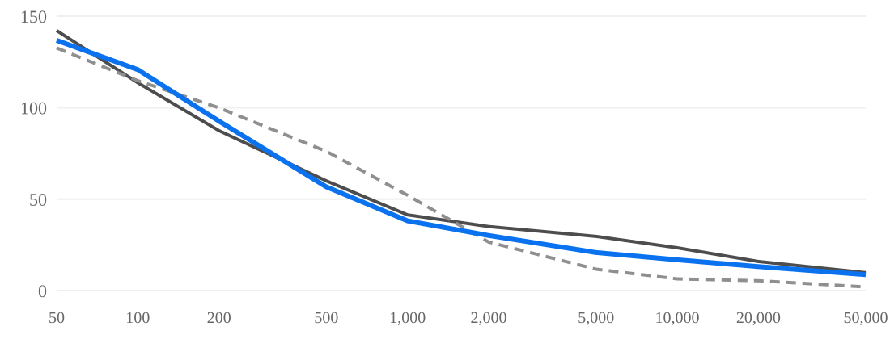

# งบและการรันจนผลนิ่ง: งบ 50 ถึง 50,000 (issue #33)

อาจารย์แนะนำว่าควรรันจนผลไม่ดีขึ้นแล้ว ไม่ใช่หยุดที่งบตายตัว ชุดนี้จึงรันถึง **50,000 evaluations** ด้วย engine C# บนชุดข้อมูลหลักชุดปัจจุบัน (Fall CS Weekly Labs v2) เมื่อ 2026-11-19 และใช้ตอบคำถามเรื่องงบทุกระดับด้วย (ไม่มีชุดทดลองงบแยกอีกแล้ว)

| | |
|---|---|
| วิธี | HC, SA, GA ในโหมด weekly ใช้พารามิเตอร์จาก `experiments/tuning/selected-parameters.json` (จูนที่งบ 500) |
| Seeds | 1001–1010 (ส่วนหนึ่งของ seed ทดสอบ) |
| งบ | รันเดียวต่อ seed ที่งบ 50,000 แล้วอ่าน best-so-far ที่งบ 50, 100, 200, 500, 1k, 2k, 5k, 10k, 20k, 50k จาก trace |
| ผลตรวจ | 30/30 รันผ่านตัวตรวจอิสระ ครบงบทุกรัน เวลาจริง 8.3 นาที (Windows, 24 process พร้อมกัน) ราว 5 นาทีต่อรัน |
| Dataset SHA-256 | `dcb93db8…` เดียวกับ [`../final/`](../final/README.md) |
| Engine SHA-256 | `e9222d73…` เดียวกับ [`../final/`](../final/README.md) |

**ทำไมรันเดียวพอ:** ไม่มีวิธีไหนใช้งบในการวางแผนการค้นหา (ช่วงปรับเทียบของ SA ต่างกันเฉพาะงบต่ำกว่า 9) best-so-far ของรันยาวที่ evaluation ที่ E จึงเท่ากับผลของ seed เดียวกันที่งบ E สคริปต์ตรวจข้อนี้กับรันที่เก็บไว้แล้ว: ค่าที่งบ 500 ตรงกับ `experiments/final/` ครบทั้ง 30 รัน

```sh
dotnet run -c Release --project dotnet/src/Timetabling.Cli -- batch run --methods hc sa ga --room-modes weekly \
  --seeds 1001-1010 --budget 50000 --seconds 3600 --parameters experiments/tuning/selected-parameters.json \
  --workers 24 --name 'Convergence study: budget 50000, issue #33' --output experiments/convergence/b50000
python experiments/convergence/analyze_convergence.py
```

## ผล (`summary.csv`, `convergence.csv`)

Lab ไม่จำเป็นเฉลี่ย (ชม.) ในวงเล็บคือจำนวนรันจาก 10 ที่จัดครบทุกคาบ

| งบ | 50 | 100 | 200 | 500 | 1k | 2k | 5k | 10k | 20k | 50k |
|---|---:|---:|---:|---:|---:|---:|---:|---:|---:|---:|
| HC | 238.7 (0) | 224.7 (0) | 200.3 (3) | 161.1 (10) | 109.4 (10) | 72.0 (10) | 51.5 (10) | 41.3 (10) | 29.3 (10) | 19.4 (10) |
| SA | 234.9 (0) | 235.9 (4) | 216.1 (5) | 135.8 (9) | 89.4 (10) | 60.8 (10) | 15.0 (10) | **0.0** (10) | **0.0** (10) | **0.0** (10) |
| GA | 249.9 (4) | 223.6 (7) | 182.6 (9) | 146.3 (10) | 112.8 (10) | 77.7 (10) | 63.9 (10) | 48.6 (10) | 44.6 (10) | 40.9 (10) |

ชั่วโมง Lab ที่งบต่ำกว่า 1,000 ต้องอ่านคู่กับจำนวนรันที่จัดครบ เพราะคาบที่ยังจัดไม่ได้ไม่ถูกนับเป็น Lab ไม่จำเป็น และเกณฑ์เทียบดูคาบที่จัดไม่ได้ก่อน

- **ตั้งแต่งบ 1,000 ทุกรันของทุกวิธีจัดครบทุกคาบ** ที่งบ 500 SA ยังขาด 1 คาบใน 1 seed
- **SA ได้ Lab ไม่จำเป็น 0 ชม. ครบ 10 seed ตั้งแต่งบ 10,000** (ที่งบ 5,000 ได้ 0 ใน 6 seed) ที่งบ 50,000 HC ได้ 0 ใน 3 seed และ GA ได้ 0 ใน 2 seed
- เปลี่ยนห้องเฉลี่ยที่งบ 50,000: HC 600.3, SA 596.0, GA 596.9 (ค่าต่ำสุดที่ข้อมูลบังคับคือ 596)

เทียบแบบจับคู่ที่งบ 50,000 (Wilcoxon บน energy, Holm 3 คู่, n = 10):

| คู่ | A ดีกว่า / B ดีกว่า | p (Holm) |
|---|---:|---:|
| SA vs GA | 9 / 0 (เสมอ 1) | **0.012** |
| SA vs HC | 10 / 0 | **0.012** |
| GA vs HC | 2 / 8 | 0.131 |

## นิ่งแล้วหรือยัง

เกณฑ์ที่ตั้งไว้ก่อนดูผล: รันถือว่านิ่งที่ evaluation E ถ้า best-so-far ไม่ดีขึ้นเลยใน W evaluations ถัดไป ผลคือ **เกณฑ์แบบนี้ใช้กับ HC และ GA ไม่ได้** ทุกรันมีช่วงที่ไม่ดีขึ้นยาวเกิน W แต่หลายรันกลับดีขึ้นอีกภายหลัง ส่วน SA หยุดดีขึ้นเพราะถึงค่าต่ำสุดแล้ว

| วิธี | ดีขึ้นอีกหลังหยุดนิ่ง 5,000 ครั้ง | ดีขึ้นอีกหลังหยุดนิ่ง 10,000 ครั้ง | ครั้งสุดท้ายที่ดีขึ้น (มัธยฐาน) | ยังดีขึ้นหลัง 30,000 |
|---|---:|---:|---:|---:|
| HC | 8/10 | 6/10 | 27,011 | 4/10 |
| SA | 1/10 | 1/10 | 6,730 | 0/10 |
| GA | 7/10 | 4/10 | 15,015 | 1/10 |

SA ดีขึ้นครั้งสุดท้ายไม่เกิน evaluation 19,276 ในทุก seed ส่วน HC ยังมี 4 รันที่ดีขึ้นหลัง evaluation 40,000 และค่าเฉลี่ยของ HC กับ GA ยังลดลง 4 ถึง 10 ชม. จาก 20k ไป 50k **จึงสรุปว่า SA นิ่งแล้ว ส่วน HC และ GA ยังไม่นิ่งที่งบ 50,000**

## ห่างจากคำตอบที่ดีที่สุดแค่ไหน

ไม่ต้องใช้ ILP ก็บอกได้: ทุกตารางที่จัดครบและไม่มี Lab ไม่จำเป็นต้องเปลี่ยนห้องอย่างน้อย **596 ครั้ง** (ค่าต่ำสุดของข้อมูล, `experiments/final/analysis/stats.json`) ดังนั้นรันที่ได้ (0 คาบตกค้าง, 0 ชม. Lab ไม่จำเป็น) **ดีที่สุดแล้วในสองเป้าหมายแรก** และห่างจากคำตอบที่ดีที่สุดแบบ lexicographic ไม่เกิน (เปลี่ยนห้อง − 596) ครั้ง

| วิธี (งบ 50,000) | รันที่ได้ 0 / 0 | เปลี่ยนห้องของรันเหล่านั้น | ห่างจากค่าต่ำสุดไม่เกิน |
|---|---:|---|---:|
| SA | 10/10 | 596 ทุกรัน | 0 ครั้ง |
| HC | 3/10 | 597 ทุกรัน | 1 ครั้ง |
| GA | 2/10 | 596, 600 | 4 ครั้ง |

SA ได้ (0, 0, 596) ครบ 10 seed ตั้งแต่งบ 20,000 ซึ่งเท่ากับค่าต่ำสุดทั้งสามเป้าหมาย จึงดีกว่านี้ไม่ได้แล้วภายใต้เกณฑ์นี้ (ที่งบ 10,000 ได้ 596 ใน 8 seed และ 597 ใน 2 seed) ค่าเหล่านี้คำนวณซ้ำได้จาก `convergence.csv`

## อ่านผล

- **ข้อสรุปขึ้นกับงบ** ที่งบ 500 สามวิธีแยกกันไม่ได้ (ผลหลักใน `experiments/final/`) ตั้งแต่งบ 1,000 ค่าเฉลี่ยของ SA ต่ำที่สุด และที่งบ 50,000 SA ดีกว่าทั้ง GA และ HC อย่างมีนัยสำคัญ ส่วน GA กับ HC ยังแยกกันไม่ได้ (ชุดนี้ทดสอบสถิติเฉพาะที่งบ 50,000)
- **การจัดครบก็ขึ้นกับงบ** งบ 200 จัดครบ 3 ถึง 9 จาก 10 รัน งบ 500 จัดครบ 9 ถึง 10 รัน และครบทุกรันตั้งแต่งบ 1,000
- คำอธิบายที่เป็นไปได้ว่าทำไม SA ไปได้ไกลกว่า (ยังไม่ได้ทดสอบแยก): cooling 0.97 ต่อ evaluation ทำให้อุณหภูมิลดเกือบ 0 ภายในไม่กี่ร้อยครั้ง หลังจากนั้น SA ยอมรับเฉพาะคำตอบที่ดีขึ้นหรือเท่าเดิม จึงเดินบนที่ราบของคำตอบได้เรื่อย ๆ ส่วน HC ที่ patience 200 จะเริ่มใหม่แบบสุ่มเมื่อไม่ดีขึ้นนาน ซึ่งทิ้งคำตอบที่สะสมมา
- พารามิเตอร์ทุกวิธีจูนที่งบ 500 ถ้าจะใช้งบใหญ่จริงควรจูนใหม่ที่งบนั้น ผลชุดนี้จึงบอกว่า "ลำดับวิธีขึ้นกับงบ" มากกว่าจะบอกว่าวิธีไหนดีที่สุดในงบใหญ่
- ในทางปฏิบัติ งบ 50,000 ใช้เวลาราว 5 นาทีต่อรันด้วย C# (รันพร้อมกัน 24 process) จึงทำได้จริง
- ทั้งหมดนี้เป็นผลบนชุดข้อมูลเดียวที่ความต้องการ Lab สร้างขึ้นเอง และ 10 seed


