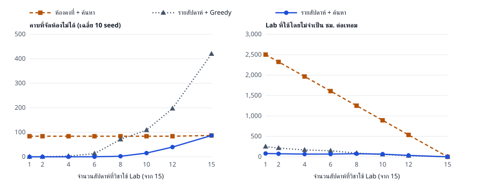

# กำหนด Lab เป็นรายวิชา และเปลี่ยนจำนวนสัปดาห์ Lab จาก 1 ถึง 15

รันเมื่อ 2026-11-18 ด้วย engine C# บน seed 1001–1010 งบ 500 พารามิเตอร์ที่จูนแล้วจาก [experiments/tuning](../tuning/)

```sh
python3 dataset_tools/make_course_lab_variants.py
bash experiments/course-level-labs/run.sh
python3 experiments/course-level-labs/summarize.py
```

## ทำไมต้องมีชุดนี้

ชุดข้อมูลหลักสุ่มความต้องการ Lab ทีละคาบ (assumption A10) ซึ่งมีจุดอ่อนสามข้อ

- 42 จาก 44 วิชากลายเป็นวิชาที่ใช้ Lab ทั้งที่วิชาจริงควรแยกเป็นวิชาที่ใช้ Lab กับวิชาที่ไม่ใช้
- กลุ่มเรียนของวิชาเดียวกันได้สัปดาห์ Lab คนละชุด
- ความต้องการ Lab ถูกเกลี่ยจนเรียบ (40 ถึง 67 ชั่วโมงต่อสัปดาห์) Lab 4 ห้องจึงเหลือเฟือ และตัวเลข 4 จาก 15 สัปดาห์เป็นค่าที่ตั้งเองค่าเดียว

ชุดนี้จึงกำหนด Lab เป็นรายวิชา และทำให้จำนวนสัปดาห์ Lab เป็นตัวแปรที่ศึกษา

## ชุดข้อมูลสร้างอย่างไร

`dataset_tools/make_course_lab_variants.py` เปลี่ยนเฉพาะ `lab_weeks` ของแต่ละคาบ อย่างอื่นเหมือนชุดหลักทุกอย่าง

- สับลำดับวิชาด้วย seed `20261118` แล้วหยิบตามลำดับจนจำนวนคาบที่ต้องใช้ Lab ใกล้ชุดหลักที่สุด ได้ 30 จาก 44 วิชา รวม 135 คาบ (ชุดหลัก 134 คาบ)
- ทุกคาบของวิชาที่ถูกเลือกใช้สัปดาห์ Lab ชุดเดียวกัน วิชาที่เหลือไม่ใช้ Lab เลย
- แต่ละวิชาได้ลำดับสุ่มของ 15 สัปดาห์หนึ่งชุด ระดับ n ใช้ n สัปดาห์แรกของลำดับนั้น ระดับต่าง ๆ จึงซ้อนกัน เช่น สัปดาห์ Lab ของระดับ 4 อยู่ในระดับ 6 ทั้งหมด
- ระดับที่สร้าง: 1, 2, 4, 6, 8, 10, 12 และ 15 สัปดาห์

ที่ระดับ 4 สัปดาห์ ความต้องการ Lab รวมทั้งเทอมคือ 780 ชั่วโมง ใกล้กับชุดหลัก (804 ชั่วโมง) แต่กระจายไม่เท่ากัน สัปดาห์ที่น้อยที่สุดใช้ 17 ชั่วโมง สัปดาห์ที่มากที่สุดใช้ 126 ชั่วโมง

## ผล (เฉลี่ย 10 seed, `summary.csv`)

640 รัน ผ่านตัวตรวจอิสระทุกรัน สามคอลัมน์สุดท้ายเรียงเป็น HC / SA / GA

| สัปดาห์ Lab ต่อวิชา | Greedy: คาบที่จัดไม่ได้ | HC | SA | GA | รันที่จัดครบ จาก 10 | Lab ไม่จำเป็น (ชั่วโมง) | ห้องคงที่: คาบที่จัดไม่ได้ |
|---:|---:|---:|---:|---:|---|---|---|
| 1 | 0.0 | 0.0 | 0.0 | 0.0 | 10 / 10 / 10 | 99 / 81 / 98 | 153 / 84 / 112 |
| 2 | 0.0 | 0.0 | 0.0 | 0.0 | 10 / 10 / 10 | 95 / 74 / 100 | 153 / 84 / 112 |
| 4 | 3.0 | 0.0 | 0.0 | 0.0 | 10 / 10 / 10 | 75 / 76 / 66 | 153 / 84 / 112 |
| 6 | 13.0 | 0.2 | 0.1 | 0.1 | 8 / 9 / 9 | 74 / 83 / 67 | 153 / 84 / 114 |
| 8 | 71.0 | 4.1 | 3.8 | 2.1 | 1 / 1 / 2 | 76 / 99 / 110 | 153 / 84 / 114 |
| 10 | 109.0 | 20.9 | 23.0 | 15.3 | 0 / 0 / 0 | 65 / 74 / 78 | 153 / 84 / 114 |
| 12 | 197.0 | 43.8 | 47.9 | 39.8 | 0 / 0 / 0 | 37 / 42 / 33 | 153 / 84 / 114 |
| 15 | 420.0 | 151.5 | 87.0 | 112.5 | 0 / 0 / 0 | 0 / 0 / 0 | 152 / 87 / 112 |

คอลัมน์ Greedy, HC, SA, GA และ Lab ไม่จำเป็น เป็นโหมดห้องรายสัปดาห์ ข้อมูลมีทั้งหมด 3,345 คาบรายสัปดาห์



ในกราฟ เส้น "ค้นหา" คือค่าเฉลี่ยที่ต่ำที่สุดในสามวิธี (HC, SA, GA) ของแต่ละระดับ

## อ่านผล

- **ถึง 4 สัปดาห์ วิธีค้นหาจัดครบทุกรัน** ส่วน Greedy เริ่มขาดที่ 4 สัปดาห์ (3 คาบทุก seed)
- **ขอบเขตอยู่ราว 6 ถึง 8 สัปดาห์** ที่ 6 สัปดาห์วิธีค้นหายังจัดครบ 8 ถึง 9 จาก 10 รัน ที่ 8 สัปดาห์เหลือ 1 ถึง 2 รัน และตั้งแต่ 10 สัปดาห์ไม่มีรันไหนจัดครบ
- **ยิ่ง Lab ตึง ช่องว่างระหว่าง Greedy กับวิธีค้นหายิ่งกว้าง** จำนวนคาบที่วิธีค้นหาที่ดีที่สุดจัดได้มากกว่า Greedy คือ 0, 0, 3, 13, 69, 94, 157 และ 333 คาบ ตามระดับ 1 ถึง 15
- **ห้องรายสัปดาห์ดีกว่าห้องคงที่ทุกระดับที่ต่ำกว่า 15** ที่ 12 สัปดาห์ยังขาดเพียง 40 ถึง 48 คาบ เทียบกับ 84 ถึง 153 คาบของห้องคงที่ ช่องว่างแคบลงเมื่อสัปดาห์ Lab เพิ่ม
- **ที่ 15 สัปดาห์สองโหมดให้ผลเท่ากันทุกรัน** เพราะกลายเป็นโจทย์เดียวกัน ใช้เป็นการตรวจความถูกต้องของระบบ
- **ห้องคงที่ขาดคาบเท่าเดิมทุกระดับ** เพราะในโหมดนี้คาบที่มีสัปดาห์ Lab ต้องอยู่ Lab ทั้งเทอมไม่ว่าจะใช้กี่สัปดาห์ ตัวเลขต่างกันเล็กน้อยที่ระดับ 6 ขึ้นไปเพราะการนับ Lab ไม่จำเป็นเปลี่ยน ทำให้การค้นหาเดินคนละเส้นทาง

## เทียบกับชุดหลักที่ 4 สัปดาห์ (seed 1001–1010 เดียวกัน)

| ชุดข้อมูล | Greedy: คาบที่จัดไม่ได้ | HC / SA / GA: คาบที่จัดไม่ได้ | Lab ไม่จำเป็น HC / SA / GA (ชั่วโมง) | เปลี่ยนห้อง HC / SA / GA |
|---|---:|---|---|---|
| ชุดหลัก (สุ่มรายคาบ) | 20 | 0 / 0 / 0 | 60 / 76 / 57 | 827 / 840 / 834 |
| รายวิชา 4 สัปดาห์ | 3 | 0 / 0 / 0 | 75 / 76 / 66 | 836 / 830 / 827 |

ที่ 4 สัปดาห์ ข้อสรุปของชุดหลักยังเหมือนเดิม คือวิธีค้นหาจัดครบและ Greedy จัดไม่ครบ

## ข้อจำกัด

- **สุ่มเลือกวิชาครั้งเดียว** ผลขึ้นกับว่าวิชาใหญ่วิชาไหนถูกเลือก ชุดนี้ได้วิชา O144 (26 กลุ่มเรียน) และ O147 (18 กลุ่มเรียน) ยังไม่ได้ลอง seed อื่นของการเลือกวิชา
- **พารามิเตอร์จูนบนชุดหลัก** ที่ 4 สัปดาห์และงบ 500 ไม่ได้จูนใหม่ในแต่ละระดับ
- **งบ 500 เท่านั้น** ขอบเขต 6 ถึง 8 สัปดาห์อาจขยับถ้าให้งบมากขึ้น และชุดนี้ไม่ได้พิสูจน์ว่าระดับที่จัดไม่ครบนั้นจัดครบไม่ได้จริง
- **ทุกคาบของวิชาต้องใช้ Lab** รวมถึงคาบบรรยายของวิชาที่มีทั้งบรรยายและปฏิบัติ
- **ยังเป็นข้อมูลจำลอง** จำนวนวิชาที่ใช้ Lab (30 จาก 44) และสัปดาห์ Lab ไม่ได้มาจากการสำรวจ ชุดนี้ทำให้ข้อสรุปไม่ขึ้นกับค่า 4 สัปดาห์ค่าเดียว แต่ไม่ได้ทำให้ข้อมูลเป็นข้อมูลจริง
