# ผลวิเคราะห์การทดลอง

สร้างโดย `engine/analyze.py` จากผลดิบ ห้ามแก้ตัวเลขด้วยมือ กติกาอยู่ใน [docs/protocol.md](../../../docs/protocol.md)

## ตารางสรุปต่อวิธี

ค่าเฉลี่ย ± ส่วนเบี่ยงเบนมาตรฐาน · มัธยฐาน · ดีสุด–แย่สุด จากรันที่ผ่านตัวตรวจ

| โหมด | วิธี | ผ่านตัวตรวจ | จัดครบทุกคาบ | คาบที่ยังจัดไม่ได้ | Lab ไม่จำเป็น (ชม.) | เปลี่ยนห้อง (ครั้ง) | เวลาค้นหา (วินาที) |
|---|---|---:|---:|---|---|---|---|
| weekly | Greedy | 30/30 | 0% | 14.0 ± 0.0 · 14.0 · 14.0–14.0 | 242.0 ± 0.0 · 242.0 · 242.0–242.0 | 654.0 ± 0.0 · 654.0 · 654.0–654.0 | 0.0 ± 0.0 · 0.0 · 0.0–0.0 |
| weekly | Hill Climbing | 30/30 | 87% | 0.2 ± 0.5 · 0.0 · 0.0–2.0 | 169.4 ± 39.5 · 173.5 · 83.0–228.0 | 624.4 ± 10.2 · 627.0 · 602.0–642.0 | 1.9 ± 0.3 · 2.1 · 1.4–2.3 |
| weekly | Simulated Annealing | 30/30 | 97% | 0.0 ± 0.2 · 0.0 · 0.0–1.0 | 145.8 ± 47.9 · 133.5 · 45.0–226.0 | 619.7 ± 10.0 · 620.0 · 604.0–640.0 | 2.0 ± 0.4 · 2.2 · 1.3–2.4 |
| weekly | Genetic Algorithm | 30/30 | 93% | 0.1 ± 0.3 · 0.0 · 0.0–1.0 | 146.9 ± 47.3 · 134.5 · 75.0–269.0 | 617.8 ± 14.2 · 616.0 · 592.0–645.0 | 2.1 ± 0.4 · 2.2 · 1.5–2.5 |
| fixed | Greedy | 30/30 | 0% | 285.0 ± 0.0 · 285.0 · 285.0–285.0 | 2,033.0 ± 0.0 · 2,033.0 · 2,033.0–2,033.0 | 0.0 ± 0.0 · 0.0 · 0.0–0.0 | 0.0 ± 0.0 · 0.0 · 0.0–0.1 |
| fixed | Hill Climbing | 30/30 | 0% | 198.5 ± 19.6 · 202.5 · 150.0–240.0 | 2,022.2 ± 27.5 · 2,018.0 · 1,981.0–2,089.0 | 0.0 ± 0.0 · 0.0 · 0.0–0.0 | 1.6 ± 0.1 · 1.6 · 1.5–1.7 |
| fixed | Simulated Annealing | 30/30 | 0% | 179.0 ± 20.4 · 180.0 · 135.0–225.0 | 2,046.2 ± 21.9 · 2,045.0 · 2,003.0–2,085.0 | 0.0 ± 0.0 · 0.0 · 0.0–0.0 | 1.6 ± 0.1 · 1.6 · 1.5–1.8 |
| fixed | Genetic Algorithm | 30/30 | 0% | 181.0 ± 27.8 · 180.0 · 135.0–240.0 | 2,038.5 ± 28.9 · 2,037.0 · 1,977.0–2,092.0 | 0.0 ± 0.0 · 0.0 · 0.0–0.0 | 1.6 ± 0.1 · 1.6 · 1.5–1.8 |

## สถิติ (โหมด weekly)

**Friedman test** (n = 30 seeds, 4 วิธี, จัดอันดับแบบ lexicographic): χ² = 56.44, df = 3, p = < 0.001. อันดับเฉลี่ย (น้อย = ดี): Greedy 4.00, Hill Climbing 2.30, Simulated Annealing 1.83, Genetic Algorithm 1.87.

→ อย่างน้อยหนึ่งวิธีให้ผลต่างจากวิธีอื่นอย่างมีนัยสำคัญที่ α = 0.05 จึงเทียบรายคู่ต่อ

| คู่ (A vs B) | A ดีกว่า / เสมอ / B ดีกว่า | Δ มัธยฐาน คาบที่ยังจัดไม่ได้ | Δ มัธยฐาน Lab ไม่จำเป็น (ชม.) | Δ มัธยฐาน เปลี่ยนห้อง | z | p (Holm) | สรุป |
|---|---:|---:|---:|---:|---:|---:|---|
| Greedy vs Hill Climbing | 0 / 0 / 30 | +14.0 | +68.5 | +27.0 | 4.77 | < 0.001 | Hill Climbing ดีกว่าอย่างมีนัยสำคัญ |
| Greedy vs Simulated Annealing | 0 / 0 / 30 | +14.0 | +108.5 | +34.0 | 4.77 | < 0.001 | Simulated Annealing ดีกว่าอย่างมีนัยสำคัญ |
| Greedy vs Genetic Algorithm | 0 / 0 / 30 | +14.0 | +107.5 | +38.0 | 4.77 | < 0.001 | Genetic Algorithm ดีกว่าอย่างมีนัยสำคัญ |
| Hill Climbing vs Simulated Annealing | 11 / 0 / 19 | +0.0 | +21.0 | +8.5 | 2.06 | 0.102 | ไม่ต่างอย่างมีนัยสำคัญ |
| Hill Climbing vs Genetic Algorithm | 10 / 0 / 20 | +0.0 | +17.0 | +8.0 | 2.12 | 0.102 | ไม่ต่างอย่างมีนัยสำคัญ |
| Simulated Annealing vs Genetic Algorithm | 16 / 0 / 14 | +0.0 | -8.5 | +3.0 | -0.43 | 0.666 | ไม่ต่างอย่างมีนัยสำคัญ |

Δ = A − B (ติดลบ = A ดีกว่าใน metric นั้น) · Wilcoxon signed-rank แบบจับคู่ตาม seed บน energy (คงลำดับ lexicographic) ปรับ p ด้วย Holm ทั้ง 6 คู่

**อ่านแบบสั้น:**

- Hill Climbing ให้ตารางดีกว่า Greedy ใน 30 จาก 30 seed และความต่างนี้ไม่น่าเกิดจากความบังเอิญ (p ปรับแล้ว = < 0.001)
- Simulated Annealing ให้ตารางดีกว่า Greedy ใน 30 จาก 30 seed และความต่างนี้ไม่น่าเกิดจากความบังเอิญ (p ปรับแล้ว = < 0.001)
- Genetic Algorithm ให้ตารางดีกว่า Greedy ใน 30 จาก 30 seed และความต่างนี้ไม่น่าเกิดจากความบังเอิญ (p ปรับแล้ว = < 0.001)
- Hill Climbing กับ Simulated Annealing: ชนะกันไปมา (11 ต่อ 19 seed, เสมอ 0) ยังสรุปไม่ได้ว่าวิธีไหนดีกว่า (p ปรับแล้ว = 0.102)
- Hill Climbing กับ Genetic Algorithm: ชนะกันไปมา (10 ต่อ 20 seed, เสมอ 0) ยังสรุปไม่ได้ว่าวิธีไหนดีกว่า (p ปรับแล้ว = 0.102)
- Simulated Annealing กับ Genetic Algorithm: ชนะกันไปมา (16 ต่อ 14 seed, เสมอ 0) ยังสรุปไม่ได้ว่าวิธีไหนดีกว่า (p ปรับแล้ว = 0.666)

## ห้องรายสัปดาห์ (weekly) เทียบ ห้องคงที่ (fixed)

จับคู่ตาม seed (initial genome เดียวกัน) · Δ = fixed − weekly · Wilcoxon แบบจับคู่ ปรับ Holm ภายในแต่ละ metric

| metric | วิธี | คู่ | fixed มากกว่า | Δ เฉลี่ย | Δ มัธยฐาน | p (Holm) |
|---|---|---:|---:|---:|---:|---:|
| Lab ไม่จำเป็น (ชม.) | Greedy | 30 | 30 / 30 | +1,791.0 | +1,791.0 | < 0.001 |
| Lab ไม่จำเป็น (ชม.) | Hill Climbing | 30 | 30 / 30 | +1,852.8 | +1,848.0 | < 0.001 |
| Lab ไม่จำเป็น (ชม.) | Simulated Annealing | 30 | 30 / 30 | +1,900.4 | +1,909.0 | < 0.001 |
| Lab ไม่จำเป็น (ชม.) | Genetic Algorithm | 30 | 30 / 30 | +1,891.6 | +1,905.5 | < 0.001 |
| คาบที่ยังจัดไม่ได้ | Greedy | 30 | 30 / 30 | +271.0 | +271.0 | < 0.001 |
| คาบที่ยังจัดไม่ได้ | Hill Climbing | 30 | 30 / 30 | +198.3 | +202.0 | < 0.001 |
| คาบที่ยังจัดไม่ได้ | Simulated Annealing | 30 | 30 / 30 | +179.0 | +180.0 | < 0.001 |
| คาบที่ยังจัดไม่ได้ | Genetic Algorithm | 30 | 30 / 30 | +180.9 | +180.0 | < 0.001 |

**อ่านแบบสั้น:** ห้องคงที่ทำให้ Lab ถูกครองโดยไม่ได้ใช้เพิ่มขึ้นเฉลี่ย 1,791–1,900 ชม. ต่อเทอม ทุกวิธีและทุก seed ส่วนโหมด weekly แลกด้วยการเปลี่ยนห้อง (fixed = 0 ตามนิยาม)

## จำนวนการเปลี่ยนห้องเทียบกับค่าต่ำสุดที่เป็นไปได้ (#10)

**Lower bound ของข้อมูล = 596 ครั้ง**: ทุกคาบที่สลับระหว่างสัปดาห์ที่ต้องใช้ Lab กับสัปดาห์ที่ไม่ต้องใช้ ต้องเปลี่ยนประเภทห้อง จึงต้องเปลี่ยนห้องอย่างน้อยหนึ่งครั้งต่อการสลับ ถ้าจะจัดครบทุกคาบและไม่ใช้ Lab เกินจำเป็น (ถ้ายอมใช้ Lab เกินจำเป็น ค่านี้ลดลงได้จนเป็น 0 แบบห้องคงที่)

| โหมด | วิธี | เปลี่ยนห้อง เฉลี่ย (ต่ำสุด–สูงสุด) | เท่าของ lower bound | เปลี่ยนเกินจากการสลับประเภทห้องในตารางนั้นเอง | Lab ไม่จำเป็น (ชม.) |
|---|---|---:|---:|---:|---:|
| weekly | Greedy | 654.0 (654–654) | 1.10× | 35.0 | 242.0 |
| weekly | Hill Climbing | 624.4 (602–642) | 1.05× | 12.5 | 169.4 |
| weekly | Simulated Annealing | 619.7 (604–640) | 1.04× | 13.3 | 145.8 |
| weekly | Genetic Algorithm | 617.8 (592–645) | 1.04× | 10.8 | 146.9 |
| fixed | Greedy | 0.0 (0–0) | 0.00× | 0.0 | 2,033.0 |
| fixed | Hill Climbing | 0.0 (0–0) | 0.00× | 0.0 | 2,022.2 |
| fixed | Simulated Annealing | 0.0 (0–0) | 0.00× | 0.0 | 2,046.2 |
| fixed | Genetic Algorithm | 0.0 (0–0) | 0.00× | 0.0 | 2,038.5 |

จำนวนคลาส ตามจำนวนครั้งที่เปลี่ยนห้องทั้งเทอม (ค่าเฉลี่ยต่อรัน):

| | 0 | 1–2 | 3–4 | 5–8 | มากกว่า 8 |
|---|---:|---:|---:|---:|---:|
| lower bound ของข้อมูล | 68 | 3 | 8 | 95 | 0 |
| weekly · Greedy | 62.0 | 4.0 | 6.0 | 98.0 | 4.0 |
| weekly · Hill Climbing | 63.2 | 4.7 | 8.3 | 96.3 | 1.4 |
| weekly · Simulated Annealing | 63.0 | 5.7 | 7.8 | 96.2 | 1.2 |
| weekly · Genetic Algorithm | 63.4 | 5.4 | 7.8 | 96.4 | 1.0 |
| fixed · Greedy | 174.0 | 0.0 | 0.0 | 0.0 | 0.0 |
| fixed · Hill Climbing | 174.0 | 0.0 | 0.0 | 0.0 | 0.0 |
| fixed · Simulated Annealing | 174.0 | 0.0 | 0.0 | 0.0 | 0.0 |
| fixed · Genetic Algorithm | 174.0 | 0.0 | 0.0 | 0.0 | 0.0 |

**สรุปสำหรับสไลด์:** ตัวเลขเปลี่ยนห้องราว 621 ครั้งต่อเทอมดูเยอะ แต่ส่วนใหญ่หลีกเลี่ยงไม่ได้ ข้อมูลนี้บังคับให้เปลี่ยนอย่างน้อย 596 ครั้ง เพราะคาบที่ใช้ Lab บางสัปดาห์ต้องสลับเข้าออก Lab ตามสัปดาห์ คำตอบของ HC/SA/GA อยู่ที่ 1.04–1.05 เท่าของค่าต่ำสุดนี้ และเปลี่ยนเกินจากการสลับประเภทห้องที่ตารางนั้นบังคับเองเฉลี่ยเพียง 12 ครั้ง ถ้าใช้ห้องคงที่ การเปลี่ยนห้องเป็น 0 แต่ต้องแลกกับ Lab ที่ถูกครองโดยไม่ได้ใช้เพิ่มจากราว 154 เป็น 2,035 ชม. ต่อเทอม (เพิ่มราว 1,881 ชม.)

## กราฟ

