# ผลวิเคราะห์การทดลอง

สร้างโดย `python/analyze.py` จากผลดิบ ห้ามแก้ตัวเลขด้วยมือ กติกาอยู่ใน [docs/protocol.md](../../../docs/protocol.md)

## ตารางสรุปต่อวิธี

ค่าเฉลี่ย ± ส่วนเบี่ยงเบนมาตรฐาน · มัธยฐาน · ดีสุด–แย่สุด จากรันที่ผ่านตัวตรวจ

| โหมด | วิธี | ผ่านตัวตรวจ | จัดครบทุกคาบ | คาบที่ยังจัดไม่ได้ | Lab ไม่จำเป็น (ชม.) | เปลี่ยนห้อง (ครั้ง) | เวลาค้นหา (วินาที) |
|---|---|---:|---:|---|---|---|---|
| weekly | Greedy | 30/30 | 0% | 20.0 ± 0.0 · 20.0 · 20.0–20.0 | 124.0 ± 0.0 · 124.0 · 124.0–124.0 | 838.0 ± 0.0 · 838.0 · 838.0–838.0 | 0.4 ± 0.1 · 0.4 · 0.2–0.6 |
| weekly | Hill Climbing | 30/30 | 100% | 0.0 ± 0.0 · 0.0 · 0.0–0.0 | 64.9 ± 22.2 · 68.5 · 14.0–103.0 | 830.8 ± 17.8 · 829.0 · 794.0–868.0 | 214.8 ± 22.5 · 217.7 · 179.6–245.7 |
| weekly | Simulated Annealing | 30/30 | 100% | 0.0 ± 0.0 · 0.0 · 0.0–0.0 | 76.2 ± 20.8 · 74.0 · 37.0–115.0 | 835.4 ± 13.7 · 833.0 · 813.0–858.0 | 215.5 ± 22.9 · 218.2 · 177.6–245.6 |
| weekly | Genetic Algorithm | 30/30 | 100% | 0.0 ± 0.0 · 0.0 · 0.0–0.0 | 57.7 ± 19.8 · 56.5 · 17.0–102.0 | 831.3 ± 18.0 · 828.5 · 800.0–884.0 | 213.6 ± 22.8 · 213.0 · 177.4–251.7 |
| fixed | Greedy | 30/30 | 0% | 390.0 ± 0.0 · 390.0 · 390.0–390.0 | 1,925.0 ± 0.0 · 1,925.0 · 1,925.0–1,925.0 | 0.0 ± 0.0 · 0.0 · 0.0–0.0 | 0.3 ± 0.1 · 0.3 · 0.2–0.5 |
| fixed | Hill Climbing | 30/30 | 0% | 191.0 ± 22.9 · 195.0 · 150.0–225.0 | 1,990.6 ± 42.7 · 1,990.2 · 1,914.0–2,073.5 | 0.0 ± 0.0 · 0.0 · 0.0–0.0 | 143.9 ± 30.4 · 128.3 · 103.1–184.1 |
| fixed | Simulated Annealing | 30/30 | 0% | 151.5 ± 28.2 · 150.0 · 90.0–210.0 | 2,025.7 ± 29.7 · 2,024.0 · 1,980.0–2,090.0 | 0.0 ± 0.0 · 0.0 · 0.0–0.0 | 144.5 ± 30.7 · 128.0 · 104.2–187.1 |
| fixed | Genetic Algorithm | 30/30 | 0% | 162.5 ± 22.0 · 165.0 · 105.0–210.0 | 2,006.4 ± 31.2 · 2,007.5 · 1,947.0–2,068.0 | 0.0 ± 0.0 · 0.0 · 0.0–0.0 | 142.6 ± 30.0 · 125.8 · 102.1–183.0 |

## สถิติ (โหมด weekly)

**Friedman test** (n = 30 seeds, 4 วิธี, จัดอันดับแบบ lexicographic): χ² = 63.12, df = 3, p = < 0.001. อันดับเฉลี่ย (น้อย = ดี): Greedy 4.00, Hill Climbing 1.93, Simulated Annealing 2.53, Genetic Algorithm 1.53.

→ อย่างน้อยหนึ่งวิธีให้ผลต่างจากวิธีอื่นอย่างมีนัยสำคัญที่ α = 0.05 จึงเทียบรายคู่ต่อ

| คู่ (A vs B) | A ดีกว่า / เสมอ / B ดีกว่า | Δ มัธยฐาน คาบที่ยังจัดไม่ได้ | Δ มัธยฐาน Lab ไม่จำเป็น (ชม.) | Δ มัธยฐาน เปลี่ยนห้อง | z | p (Holm) | สรุป |
|---|---:|---:|---:|---:|---:|---:|---|
| Greedy vs Hill Climbing | 0 / 0 / 30 | +20.0 | +55.5 | +9.0 | 4.77 | < 0.001 | Hill Climbing ดีกว่าอย่างมีนัยสำคัญ |
| Greedy vs Simulated Annealing | 0 / 0 / 30 | +20.0 | +50.0 | +5.0 | 4.77 | < 0.001 | Simulated Annealing ดีกว่าอย่างมีนัยสำคัญ |
| Greedy vs Genetic Algorithm | 0 / 0 / 30 | +20.0 | +67.5 | +9.5 | 4.77 | < 0.001 | Genetic Algorithm ดีกว่าอย่างมีนัยสำคัญ |
| Hill Climbing vs Simulated Annealing | 20 / 0 / 10 | +0.0 | -13.5 | -4.5 | -1.71 | 0.176 | ไม่ต่างอย่างมีนัยสำคัญ |
| Hill Climbing vs Genetic Algorithm | 12 / 0 / 18 | +0.0 | +11.5 | +1.0 | 1.32 | 0.188 | ไม่ต่างอย่างมีนัยสำคัญ |
| Simulated Annealing vs Genetic Algorithm | 4 / 0 / 26 | +0.0 | +13.5 | +11.0 | 3.72 | < 0.001 | Genetic Algorithm ดีกว่าอย่างมีนัยสำคัญ |

Δ = A − B (ติดลบ = A ดีกว่าใน metric นั้น) · Wilcoxon signed-rank แบบจับคู่ตาม seed บน energy (คงลำดับ lexicographic) ปรับ p ด้วย Holm ทั้ง 6 คู่

**อ่านแบบสั้น:**

- Hill Climbing ให้ตารางดีกว่า Greedy ใน 30 จาก 30 seed และความต่างนี้ไม่น่าเกิดจากความบังเอิญ (p ปรับแล้ว = < 0.001)
- Simulated Annealing ให้ตารางดีกว่า Greedy ใน 30 จาก 30 seed และความต่างนี้ไม่น่าเกิดจากความบังเอิญ (p ปรับแล้ว = < 0.001)
- Genetic Algorithm ให้ตารางดีกว่า Greedy ใน 30 จาก 30 seed และความต่างนี้ไม่น่าเกิดจากความบังเอิญ (p ปรับแล้ว = < 0.001)
- Hill Climbing กับ Simulated Annealing: ชนะกันไปมา (20 ต่อ 10 seed, เสมอ 0) ยังสรุปไม่ได้ว่าวิธีไหนดีกว่า (p ปรับแล้ว = 0.176)
- Hill Climbing กับ Genetic Algorithm: ชนะกันไปมา (12 ต่อ 18 seed, เสมอ 0) ยังสรุปไม่ได้ว่าวิธีไหนดีกว่า (p ปรับแล้ว = 0.188)
- Genetic Algorithm ให้ตารางดีกว่า Simulated Annealing ใน 26 จาก 30 seed และความต่างนี้ไม่น่าเกิดจากความบังเอิญ (p ปรับแล้ว = < 0.001)

## ห้องรายสัปดาห์ (weekly) เทียบ ห้องคงที่ (fixed)

จับคู่ตาม seed (initial genome เดียวกัน) · Δ = fixed − weekly · Wilcoxon แบบจับคู่ ปรับ Holm ภายในแต่ละ metric

| metric | วิธี | คู่ | fixed มากกว่า | Δ เฉลี่ย | Δ มัธยฐาน | p (Holm) |
|---|---|---:|---:|---:|---:|---:|
| Lab ไม่จำเป็น (ชม.) | Greedy | 30 | 30 / 30 | +1,801.0 | +1,801.0 | < 0.001 |
| Lab ไม่จำเป็น (ชม.) | Hill Climbing | 30 | 30 / 30 | +1,925.7 | +1,920.8 | < 0.001 |
| Lab ไม่จำเป็น (ชม.) | Simulated Annealing | 30 | 30 / 30 | +1,949.5 | +1,940.0 | < 0.001 |
| Lab ไม่จำเป็น (ชม.) | Genetic Algorithm | 30 | 30 / 30 | +1,948.7 | +1,949.2 | < 0.001 |
| คาบที่ยังจัดไม่ได้ | Greedy | 30 | 30 / 30 | +370.0 | +370.0 | < 0.001 |
| คาบที่ยังจัดไม่ได้ | Hill Climbing | 30 | 30 / 30 | +191.0 | +195.0 | < 0.001 |
| คาบที่ยังจัดไม่ได้ | Simulated Annealing | 30 | 30 / 30 | +151.5 | +150.0 | < 0.001 |
| คาบที่ยังจัดไม่ได้ | Genetic Algorithm | 30 | 30 / 30 | +162.5 | +165.0 | < 0.001 |

**อ่านแบบสั้น:** ห้องคงที่ทำให้ Lab ถูกครองโดยไม่ได้ใช้เพิ่มขึ้นเฉลี่ย 1,801–1,949 ชม. ต่อเทอม ทุกวิธีและทุก seed ส่วนโหมด weekly แลกด้วยการเปลี่ยนห้อง (fixed = 0 ตามนิยาม)

## จำนวนการเปลี่ยนห้องเทียบกับค่าต่ำสุดที่เป็นไปได้ (#10)

**Lower bound ของข้อมูล = 783 ครั้ง**: ทุกคาบที่สลับระหว่างสัปดาห์ที่ต้องใช้ Lab กับสัปดาห์ที่ไม่ต้องใช้ ต้องเปลี่ยนประเภทห้อง จึงต้องเปลี่ยนห้องอย่างน้อยหนึ่งครั้งต่อการสลับ ถ้าจะจัดครบทุกคาบและไม่ใช้ Lab เกินจำเป็น (ถ้ายอมใช้ Lab เกินจำเป็น ค่านี้ลดลงได้จนเป็น 0 แบบห้องคงที่)

| โหมด | วิธี | เปลี่ยนห้อง เฉลี่ย (ต่ำสุด–สูงสุด) | เท่าของ lower bound | เปลี่ยนเกินจากการสลับประเภทห้องในตารางนั้นเอง | Lab ไม่จำเป็น (ชม.) |
|---|---|---:|---:|---:|---:|
| weekly | Greedy | 838.0 (838–838) | 1.07× | 37.0 | 124.0 |
| weekly | Hill Climbing | 830.8 (794–868) | 1.06× | 25.3 | 64.9 |
| weekly | Simulated Annealing | 835.4 (813–858) | 1.07× | 26.1 | 76.2 |
| weekly | Genetic Algorithm | 831.3 (800–884) | 1.06× | 24.7 | 57.7 |
| fixed | Greedy | 0.0 (0–0) | 0.00× | 0.0 | 1,925.0 |
| fixed | Hill Climbing | 0.0 (0–0) | 0.00× | 0.0 | 1,990.6 |
| fixed | Simulated Annealing | 0.0 (0–0) | 0.00× | 0.0 | 2,025.7 |
| fixed | Genetic Algorithm | 0.0 (0–0) | 0.00× | 0.0 | 2,006.4 |

จำนวนคลาส (174 คลาส) ตามจำนวนครั้งที่เปลี่ยนห้องทั้งเทอม (ค่าเฉลี่ยต่อรัน):

| | 0 | 1–2 | 3–4 | 5–8 | มากกว่า 8 |
|---|---:|---:|---:|---:|---:|
| lower bound ของข้อมูล | 61 | 0 | 20 | 76 | 17 |
| weekly · Greedy | 57.0 | 4.0 | 20.0 | 72.0 | 21.0 |
| weekly · Hill Climbing | 58.4 | 1.8 | 19.6 | 74.9 | 19.3 |
| weekly · Simulated Annealing | 59.1 | 1.7 | 19.7 | 74.7 | 18.8 |
| weekly · Genetic Algorithm | 58.0 | 1.8 | 19.2 | 75.1 | 19.9 |
| fixed · Greedy | 174.0 | 0.0 | 0.0 | 0.0 | 0.0 |
| fixed · Hill Climbing | 174.0 | 0.0 | 0.0 | 0.0 | 0.0 |
| fixed · Simulated Annealing | 174.0 | 0.0 | 0.0 | 0.0 | 0.0 |
| fixed · Genetic Algorithm | 174.0 | 0.0 | 0.0 | 0.0 | 0.0 |

**สรุปสำหรับสไลด์:** ตัวเลขเปลี่ยนห้องราว 832 ครั้งต่อเทอมดูเยอะ แต่ส่วนใหญ่หลีกเลี่ยงไม่ได้ ข้อมูลนี้บังคับให้เปลี่ยนอย่างน้อย 783 ครั้ง เพราะ 134 คาบต้องสลับเข้าออก Lab ตามสัปดาห์ คำตอบของ HC/SA/GA อยู่ที่ 1.06–1.07 เท่าของค่าต่ำสุดนี้ และเปลี่ยนเกินจากการสลับประเภทห้องที่ตารางนั้นบังคับเองเฉลี่ยเพียง 25 ครั้ง ถ้าใช้ห้องคงที่ การเปลี่ยนห้องเป็น 0 แต่ต้องแลกกับ Lab ที่ถูกครองโดยไม่ได้ใช้เพิ่มจากราว 66 เป็น 1,987 ชม. ต่อเทอม (เพิ่มราว 1,921 ชม.)

## กราฟ

