# Lab ขาดแคลน: 4 / 3 / 2 ห้อง (#13)

สร้างโดย `python/studies.py scarcity` · Genetic Algorithm (วิธีที่ดีที่สุดจากการทดลองสุดท้าย) · seed 1001–1010 · งบ 500 · พารามิเตอร์ที่จูนแล้ว · 4 ห้องมาจากการทดลองสุดท้าย · ชุดข้อมูล 3/2 ห้องสร้างด้วย `dataset_tools/make_lab_variants.py` (ตัด Lab ที่เล็กที่สุดออก ที่เหลือเหมือนเดิม)

| Lab | โหมด | ผ่านตัวตรวจ | คาบที่ยังจัดไม่ได้ เฉลี่ย (ต่ำสุด–สูงสุด) | จัดครบทุกคาบ | Lab ไม่จำเป็น (ชม.) | เปลี่ยนห้อง |
|---:|---|---:|---:|---:|---:|---:|
| 4 | weekly | 10/10 | 0.0 (0–0) | 100% | 56.7 | 834.2 |
| 4 | fixed | 10/10 | 159.0 (135–195) | 0% | 2,010.2 | 0.0 |
| 3 | weekly | 10/10 | 0.0 (0–0) | 100% | 95.2 | 841.9 |
| 3 | fixed | 10/10 | 481.5 (465–495) | 0% | 1,558.2 | 0.0 |
| 2 | weekly | 10/10 | 17.7 (11–24) | 0% | 110.9 | 847.3 |
| 2 | fixed | 10/10 | 895.5 (870–930) | 0% | 1,061.5 | 0.0 |

**สรุป:**

- fixed: เริ่มจัดไม่ครบตั้งแต่ Lab 4 ห้อง (จัดครบ 0% ของ seed, ยังจัดไม่ได้เฉลี่ย 159.0 คาบ)
- weekly: เริ่มจัดไม่ครบตั้งแต่ Lab 2 ห้อง (จัดครบ 0% ของ seed, ยังจัดไม่ได้เฉลี่ย 17.7 คาบ)

