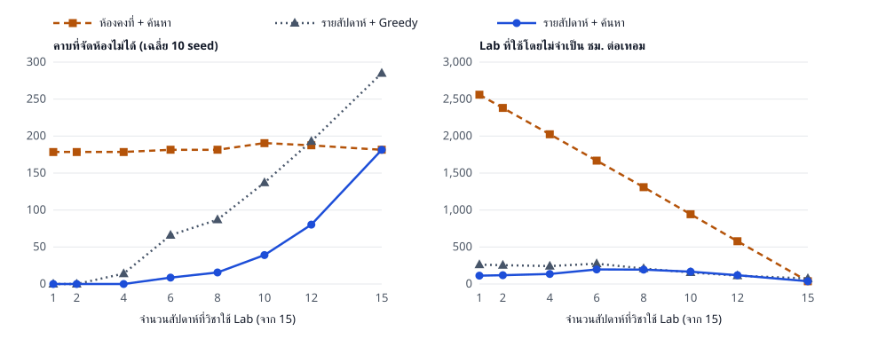

# จำนวนสัปดาห์ Lab ต่อวิชา Lab จาก 1 ถึง 15

รันเมื่อ 2026-11-19 ด้วย engine C# บน seed 1001–1010 งบ 500 พารามิเตอร์ที่จูนแล้วจาก [experiments/tuning](../tuning/)

```sh
python dataset_tools/make_lab_week_variants.py
bash experiments/lab-weeks/run.sh
python experiments/lab-weeks/summarize.py
```

## ทำไมต้องมีชุดนี้

ชุดข้อมูลหลักให้วิชา Lab ทุกวิชาใช้ Lab 4 จาก 15 สัปดาห์ (assumption A10) ตัวเลข 4 เป็นค่าที่ตั้งเองค่าเดียว ไม่ได้มาจากการสำรวจ ถ้าข้อสรุปขึ้นกับค่านี้ก็ควรรู้ว่าขึ้นแค่ไหน

ชุดนี้จึงทำให้จำนวนสัปดาห์ Lab เป็นตัวแปรที่ศึกษา ตั้งแต่ใช้ Lab สัปดาห์เดียวจนถึงใช้ทุกสัปดาห์ แล้วดูว่า Lab 4 ห้องรับได้ถึงระดับไหน

## ชุดข้อมูลสร้างอย่างไร

`dataset_tools/make_lab_week_variants.py` เปลี่ยนเฉพาะ `lab_weeks` ของคาบปฏิบัติในวิชา Lab อย่างอื่นเหมือนชุดหลักทุกอย่าง

- วิชา Lab คือ 20 วิชาชุดเดียวกับชุดหลัก (106 จาก 223 คาบประจำ) อีก 117 คาบไม่ใช้ Lab เลยในทุกระดับ
- การระบุว่าคาบไหนเป็นคาบปฏิบัติเป็น **การอนุมานจากรูปแบบเวลาเรียน** ไม่ใช่ข้อมูลจากต้นฉบับ (วิชาหลายส่วนใช้ส่วนที่คาบยาวที่สุด วิชาส่วนเดียวนับเฉพาะที่เรียนสัปดาห์ละครั้ง)
- ทุกกลุ่มเรียนในคาบปฏิบัติของวิชาเดียวกันใช้สัปดาห์ Lab ชุดเดียวกัน
- แต่ละวิชา Lab มีลำดับสุ่มของ 15 สัปดาห์หนึ่งชุด เก็บไว้ใน `generator.lab_plan` ของชุดหลัก ระดับ n ใช้ n สัปดาห์แรกของลำดับนั้น ระดับต่าง ๆ จึงซ้อนกัน เช่น สัปดาห์ Lab ของระดับ 4 อยู่ในระดับ 6 ทั้งหมด
- ระดับที่สร้าง: 1, 2, 4, 6, 8, 10, 12 และ 15 สัปดาห์ (`data/variants/fall-cs-labweeks-w01` ถึง `w15`)
- **ระดับ 4 ใช้สัปดาห์ Lab ชุดเดียวกับชุดหลัก** ผลของระดับ 4 จึงเท่ากับผลของ [experiments/final](../final/) บน seed 1001–1010 ทุกตัวเลข

ความต้องการ Lab รวมทั้งเทอมตามระดับคือ 200, 400, 800, 1,200, 1,600, 2,000, 2,400 และ 3,000 ชั่วโมง ที่ระดับ 4 ความต้องการกระจายไม่เท่ากัน สัปดาห์ที่น้อยที่สุดใช้ 9 ชั่วโมง สัปดาห์ที่มากที่สุดใช้ 89 ชั่วโมง

## ผล (เฉลี่ย 10 seed, `summary.csv`)

8 ระดับ × 4 วิธี × 2 โหมดห้อง × 10 seed = 640 รัน ผ่านตัวตรวจอิสระทุกรัน สามคอลัมน์สุดท้ายเรียงเป็น HC / SA / GA

| สัปดาห์ Lab ต่อวิชา Lab | Greedy: คาบที่จัดไม่ได้ | HC | SA | GA | รันที่จัดครบ จาก 10 | Lab ไม่จำเป็น (ชั่วโมง) | ห้องคงที่: คาบที่จัดไม่ได้ |
|---:|---:|---:|---:|---:|---|---|---|
| 1 | 0.0 | 0.0 | 0.0 | 0.0 | 10 / 10 / 10 | 112 / 140 / 136 | 200 / 178 / 192 |
| 2 | 0.0 | 0.0 | 0.0 | 0.0 | 10 / 10 / 10 | 128 / 118 / 126 | 200 / 178 / 192 |
| 4 | 14.0 | 0.0 | 0.1 | 0.0 | 10 / 9 / 10 | 161 / 136 / 146 | 200 / 178 / 184 |
| 6 | 66.0 | 10.2 | 9.2 | 8.6 | 0 / 0 / 0 | 223 / 197 / 203 | 200 / 184 / 182 |
| 8 | 87.0 | 18.4 | 16.7 | 15.6 | 0 / 0 / 0 | 194 / 216 / 208 | 194 / 186 / 182 |
| 10 | 137.0 | 48.7 | 42.8 | 39.1 | 0 / 0 / 0 | 178 / 167 / 181 | 194 / 194 / 190 |
| 12 | 193.0 | 89.9 | 86.1 | 80.3 | 0 / 0 / 0 | 142 / 119 / 132 | 190 / 200 / 188 |
| 15 | 285.0 | 189.0 | 190.5 | 181.5 | 0 / 0 / 0 | 38 / 50 / 39 | 189 / 190 / 182 |

คอลัมน์ Greedy, HC, SA, GA และ Lab ไม่จำเป็น เป็นโหมดห้องรายสัปดาห์ ข้อมูลมีทั้งหมด 3,345 คาบรายสัปดาห์



ในกราฟ เส้น "ค้นหา" คือค่าเฉลี่ยที่ต่ำที่สุดในสามวิธี (HC, SA, GA) ของแต่ละระดับ

## อ่านผล

- **ถึง 4 สัปดาห์ วิธีค้นหาจัดได้ครบ** ที่ 1 และ 2 สัปดาห์ครบทุกรัน ที่ 4 สัปดาห์ครบ 29 จาก 30 รัน (SA ขาด 1 คาบใน 1 seed) ส่วน Greedy เริ่มขาดที่ 4 สัปดาห์ (14 คาบทุก seed)
- **ขอบเขตอยู่ระหว่าง 4 กับ 6 สัปดาห์** ตั้งแต่ 6 สัปดาห์ไม่มีรันไหนจัดครบเลย วิธีค้นหาเหลือเฉลี่ย 9 ถึง 10 คาบที่ 6 สัปดาห์ และเพิ่มขึ้นเรื่อย ๆ ทั้งหมดนี้ที่งบ 500
- **Lab ยิ่งตึง Greedy ยิ่งทิ้งห่างจากวิธีค้นหา จนถึง 12 สัปดาห์** จำนวนคาบที่วิธีค้นหาที่ดีที่สุดจัดได้มากกว่า Greedy คือ 0, 0, 14, 57, 71, 98, 113 และ 104 คาบ ตามระดับ 1 ถึง 15
- **โหมดห้องรายสัปดาห์เหลือคาบที่จัดไม่ได้น้อยกว่าโหมดห้องคงที่ทุกระดับที่ต่ำกว่า 15** ที่ 12 สัปดาห์วิธีค้นหายังขาด 80 ถึง 90 คาบ เทียบกับ 188 ถึง 200 คาบของห้องคงที่ ช่องว่างแคบลงเมื่อสัปดาห์ Lab เพิ่ม ข้อนี้เป็นผลของโจทย์ที่ตั้งไว้ ไม่ใช่ข้อค้นพบเกี่ยวกับมหาวิทยาลัยจริง
- **ที่ 15 สัปดาห์สองโหมดให้ผลเท่ากันทุกรัน** เพราะกลายเป็นโจทย์เดียวกัน ใช้เป็นการตรวจความถูกต้องของระบบ
- **ห้องคงที่ขาดคาบใกล้เดิมทุกระดับ** (Greedy 285 ทุกระดับ วิธีค้นหา 178 ถึง 200) เพราะในโหมดนี้คาบที่มีสัปดาห์ Lab ต้องอยู่ Lab ทั้งเทอมไม่ว่าจะใช้กี่สัปดาห์ ตัวเลขของวิธีค้นหาต่างกันเล็กน้อยระหว่างระดับเพราะการนับ Lab ไม่จำเป็นเปลี่ยน ทำให้การค้นหาเดินคนละเส้นทาง
- **Lab ไม่จำเป็นไม่ได้ลดตามระดับแบบตรงไปตรงมา** ขึ้นสูงสุดที่ 6 ถึง 8 สัปดาห์ (ราว 195 ถึง 225 ชม.) แล้วลดลง ส่วนหนึ่งเพราะคาบที่จัดไม่ได้ไม่ถูกนับ จึงต้องอ่านคู่กับคาบที่จัดไม่ได้เสมอ

## ข้อจำกัด

- **สุ่มเลือกวิชา Lab ครั้งเดียว** (seed สร้างข้อมูล `20261119`) ผลขึ้นกับว่าวิชาใหญ่วิชาไหนถูกเลือก ยังไม่ได้ลอง seed อื่นของการเลือกวิชา
- **คาบปฏิบัติเป็นการอนุมาน** จากรูปแบบเวลาเรียน ต้นฉบับไม่ได้บอกว่าส่วนไหนของวิชาเป็นงานปฏิบัติ
- **พารามิเตอร์จูนบนชุดหลัก** ที่ 4 สัปดาห์และงบ 500 ไม่ได้จูนใหม่ในแต่ละระดับ
- **งบ 500 เท่านั้น** ขอบเขต 4 ถึง 6 สัปดาห์อาจขยับถ้าให้งบมากขึ้น (ที่ชุดหลัก ทุกรันจัดครบตั้งแต่งบ 1,000) และชุดนี้ไม่ได้พิสูจน์ว่าระดับที่จัดไม่ครบนั้นจัดครบไม่ได้จริง
- **ยังเป็นข้อมูลจำลอง** จำนวนวิชา Lab (20 จาก 44) และสัปดาห์ Lab ไม่ได้มาจากการสำรวจ ชุดนี้ทำให้ข้อสรุปไม่ขึ้นกับค่า 4 สัปดาห์ค่าเดียว แต่ไม่ได้ทำให้ข้อมูลเป็นข้อมูลจริง
