# ถ้าอยากเปลี่ยนห้องน้อยลง ต้องยอมให้ Lab ถูกใช้โดยไม่จำเป็นเพิ่มเท่าไร

การทดลองหลักเรียงเป้าหมายตายตัว: คาบที่ยังจัดไม่ได้ → ชั่วโมง Lab ไม่จำเป็น → จำนวนครั้งที่เปลี่ยนห้อง จึงได้คำตอบแบบเดียว คือประหยัด Lab ที่สุดแล้วค่อยลดการเปลี่ยนห้อง ชุดนี้ปรับน้ำหนักระหว่างสองเป้าหมายหลัง แล้วดูว่าได้ตารางแบบไหนบ้าง แนวคิดมาจากงานที่มองการเปลี่ยนห้องเป็นเป้าหมายหนึ่งคู่กับเป้าหมายอื่น (Antunes-Batista et al., 2026 ใน [`docs/research-comparison.md`](../../docs/research-comparison.md)) แต่เราใช้การถ่วงน้ำหนักทีละค่า ไม่ได้ใช้อัลกอริทึมหลายเป้าหมายแบบ Pareto

เป็นการศึกษาเพิ่มหลังผลหลัก รายงานแยกจาก [`experiments/final/`](../final/)

## สิ่งที่เปลี่ยนใน engine

ค่าใหม่ `change_penalty_minutes` (ค่าปรับ) = เปลี่ยนห้อง 1 ครั้งนับเท่ากับ Lab ไม่จำเป็นกี่นาที (`engine/lab_core.py`)

- ต้นทุนที่ใช้เทียบ = นาที Lab ไม่จำเป็น + ค่าปรับ × จำนวนครั้งที่เปลี่ยนห้อง ถ้าเท่ากันเลือกแบบที่เปลี่ยนห้องน้อยกว่า
- ใช้ต้นทุนเดียวกันทั้งสามจุด: ตอน decoder เลือกห้อง ตอน decoder เลือกช่วงเวลาของคลาส และตอนเทียบคำตอบทั้งตาราง (HC และ GA เทียบด้วย `rank` ส่วน SA ใช้ `energy` ซึ่งเรียงคำตอบตรงกัน)
- คาบที่ยังจัดไม่ได้มาก่อนเสมอทุกค่าปรับ
- ค่าปรับ 0 คือลำดับเดิม ค่าปรับ 1,000,000 เท่ากับลดการเปลี่ยนห้องก่อน Lab ไม่จำเป็น
- โหมด fixed ไม่มีการเปลี่ยนห้อง ค่าปรับจึงไม่มีผล (มี test ยืนยันใน `engine/tests/test_engine.py`)

## วิธีรัน

โหมด weekly · seed 1001–1010 · งบ 500 · พารามิเตอร์ที่จูนแล้ว · ค่าปรับ 7 ระดับ × 4 วิธี = 280 รัน ด้วย engine Python เมื่อ 2026-11-18 (4 คอร์ ราว 1 ชม. 57 นาที)

```sh
python3 experiments/room-change-tradeoff/run.py --workers 4
python3 experiments/room-change-tradeoff/analyze_tradeoff.py
```

ตรวจแล้วว่ารันค่าปรับ 0 ทั้ง 40 รันได้ผลและเส้นทางการค้นหาตรงกับ `experiments/final` ทุกรัน (`summary.json` → `reproduction_check`) และทั้ง 280 รันผ่านตัวตรวจคำตอบอิสระ

## ผล (เฉลี่ย 10 seed, `summary.csv`)

| ค่าปรับ (นาที/ครั้ง) | วิธี | คาบที่ยังจัดไม่ได้ | รันที่จัดครบ | Lab ไม่จำเป็น (ชม.) | เปลี่ยนห้อง (ครั้ง) |
|---:|---|---:|---:|---:|---:|
| 0 (ลำดับเดิม) | HC | 0 | 10 / 10 | 60.0 | 827 |
| | SA | 0 | 10 / 10 | 76.1 | 840 |
| | GA | 0 | 10 / 10 | 56.7 | 834 |
| 30 | HC | 0 | 10 / 10 | 76.5 | 818 |
| | SA | 0 | 10 / 10 | 75.6 | 802 |
| | GA | 0 | 10 / 10 | 63.5 | 820 |
| 60 | HC | 0 | 10 / 10 | 437.5 | 521 |
| | SA | 0 | 10 / 10 | 430.8 | 521 |
| | GA | 0 | 10 / 10 | 448.4 | 511 |
| 90 | HC | 0.2 | 9 / 10 | 538.5 | 459 |
| | SA | 0.3 | 8 / 10 | 526.0 | 471 |
| | GA | 0 | 10 / 10 | 529.5 | 467 |
| 120 | HC | 4.3 | 1 / 10 | 1,307 | 209 |
| | SA | 8.1 | 0 / 10 | 1,292 | 211 |
| | GA | 2.3 | 3 / 10 | 1,304 | 211 |
| 300 | HC | 7.0 | 0 / 10 | 1,480 | 157 |
| | SA | 7.5 | 0 / 10 | 1,456 | 164 |
| | GA | 4.5 | 1 / 10 | 1,477 | 157 |
| เปลี่ยนห้องก่อน | HC | 18.9 | 0 / 10 | 1,620 | 139 |
| | SA | 25.4 | 0 / 10 | 1,647 | 132 |
| | GA | 17.7 | 0 / 10 | 1,644 | 137 |

Greedy (รันครั้งเดียว ไม่มีการค้นหา) จัดไม่ครบทุกระดับ: ขาด 20 คาบที่ค่าปรับ 0 ถึง 104 คาบที่ระดับ "เปลี่ยนห้องก่อน" ตัวเลขอยู่ใน `summary.csv`



กราฟข้างล่างแสดงเฉพาะรันโหมด weekly ที่จัดครบทุกคาบ (122 จาก 210 รันของ HC, SA, GA) จุดหนึ่งจุดคือหนึ่งรัน



## อ่านผล

- **มี trade-off จริง แต่เป็นขั้น ไม่ใช่เส้นเรียบ** ผลจับกลุ่มเป็น 3 ระดับ: ราว 830 ครั้งกับ 60–75 ชม. (ค่าปรับ 0–30) ราว 460–520 ครั้งกับ 430–540 ชม. (ค่าปรับ 60–90) และราว 130–210 ครั้งกับ 1,300–1,650 ชม. (ค่าปรับ 120 ขึ้นไป) เพราะคาบในข้อมูลยาว 60 หรือ 120 นาทีเกือบทั้งหมด (108 และ 107 จาก 223 คาบ) ค่าปรับจึงเปลี่ยนการตัดสินใจเฉพาะตอนข้าม 60 และ 120 นาที
- **ลดการเปลี่ยนห้องราว 310 ครั้ง แลกกับ Lab ไม่จำเป็นเพิ่มราว 380 ชม.** (ค่าปรับ 0 → 60 ทั้งสามวิธี) คือราว 1.2 ชม. ต่อการเปลี่ยนห้องที่ลดได้ 1 ครั้ง และยังจัดครบทุกคาบทั้ง 30 รัน
- **ลดต่อจากนั้นต้องแลกกับความครบของตาราง** ที่ค่าปรับ 120 เปลี่ยนห้องเหลือราว 210 ครั้ง แต่จัดครบแค่ 4 จาก 30 รัน และ Lab ไม่จำเป็นขึ้นไปราว 1,300 ชม. เพราะคลาสที่จัดก่อนนั่ง Lab ต่อหลังสัปดาห์ Lab แล้วคลาสที่จัดทีหลังไม่มี Lab ให้ใช้
- **ค่าปรับ 30 แทบไม่ต่างจากลำดับเดิม** decoder ยังเลือกห้องเหมือนเดิม ต่างแค่การเทียบคำตอบทั้งตาราง เปลี่ยนห้องลดได้ 9–37 ครั้ง
- **ทั้งสามวิธีให้ผลใกล้กันในแต่ละระดับ** จุดบนกราฟถูกกำหนดโดยกฎเลือกห้องของ decoder มากกว่าโดยวิธีค้นหา
- ใน 122 รันที่จัดครบ มี 21 รันที่ไม่มีรันอื่นดีกว่าทั้งสองแกน (`summary.json` → `non_dominated_complete_runs`) เป็นแค่ชุดที่ดีที่สุดในรันที่ทำ ไม่ใช่ขอบ Pareto ที่พิสูจน์แล้ว

## โหมด fixed (รายงานแยก)

โหมด fixed ไม่อยู่บนกราฟเดียวกัน เพราะจัดไม่ครบสักรัน ตัวเลขจาก `experiments/final` บน seed เดียวกัน

| วิธี | คาบที่ยังจัดไม่ได้ | Lab ไม่จำเป็น (ชม.) | เปลี่ยนห้อง |
|---|---:|---:|---:|
| HC | 195.0 | 1,978 | 0 |
| SA | 151.5 | 2,026 | 0 |
| GA | 159.0 | 2,010 | 0 |

ระดับ "เปลี่ยนห้องก่อน" ของโหมด weekly เปลี่ยนห้อง 132–139 ครั้งและขาด 18–25 คาบ เทียบกับโหมด fixed ที่ไม่เปลี่ยนห้องเลยแต่ขาด 152–195 คาบ

## ข้อจำกัด

- **decoder เลือกห้องทีละสัปดาห์โดยไม่มองล่วงหน้า** คาบที่มีสัปดาห์ Lab เริ่มในห้องบรรยายแล้วย้ายเข้า Lab อย่างน้อย 1 ครั้งเสมอ ปลายด้านเปลี่ยนห้องน้อยจึงอาจยังไม่ใช่ค่าต่ำสุดที่ทำได้ และการที่คลาสแรก ๆ ครอง Lab ก็มาจากกฎนี้
- พารามิเตอร์ของ HC, SA, GA จูนที่ค่าปรับ 0 เท่านั้น
- 10 seed งบ 500 ชุดข้อมูลเดียว และยังไม่ได้ทดสอบทางสถิติระหว่างระดับค่าปรับ
- ค่าปรับ 7 ระดับเลือกเอง ผลระหว่างระดับ (เช่น 60 ถึง 90) ไม่ได้วัด
- ทำเฉพาะ engine Python ส่วน engine C# และหน้าเว็บยังไม่รู้จักค่าปรับ (ค่าเริ่มต้น 0 ให้ผลเหมือนเดิม)

## ไฟล์

`experiment.json.gz` / `experiment.csv` (ผลดิบ 280 รัน ไม่เก็บตารางคำตอบ `config_id` = `p<ค่าปรับ>`) · `per-run.csv` · `summary.csv` · `summary.json` · `tradeoff-by-penalty.svg` · `tradeoff-complete-runs.svg` · `manifest.json` · `run.py` · `analyze_tradeoff.py`
